**Universidad San Francisco Xavier de Chuquisaca**  
**Estudiante:** Pereira Manzano Benjamín Solano  
**Carrera:** Ing. Sistemas  
**Docente:** Ing. Marcelo Quispe Ortega  
**Semestre:** 2/2026  
**Repositorio GIT:** https://github.com/BenjaminPereira26/COM610-TrabajandoEnLaNube
# Informe Laboratorio 1

## Sección 1: Preparación del Entorno Virtual
### 1.1 Creación de la Máquina Virtual (VM)
Siguiendo las indicaciones del material de referencia y las especificaciones de la computadora se configuró la 
VM de la siguiente manera:

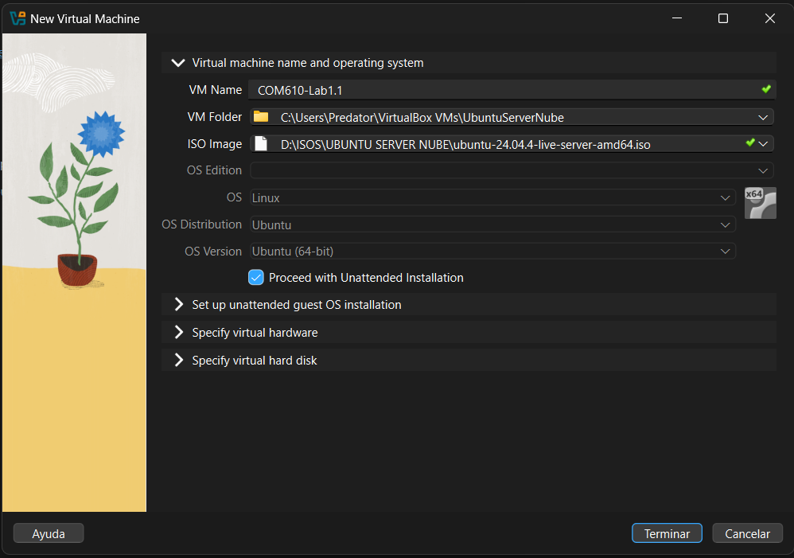

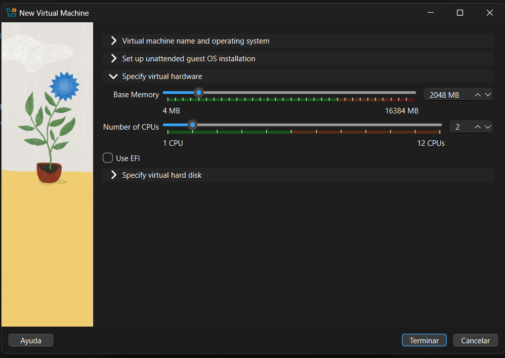

### 1.2. Instalación del Sistema Operativo
Siguiendo las indicaciones del material se realiza la instalacion del software para nuestra maquina virtual, manteniendo la mayoria de configuraciones automáticas, y cambiando solo algunas de preferencias de interfaz de usuario
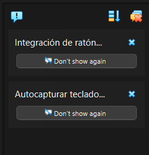
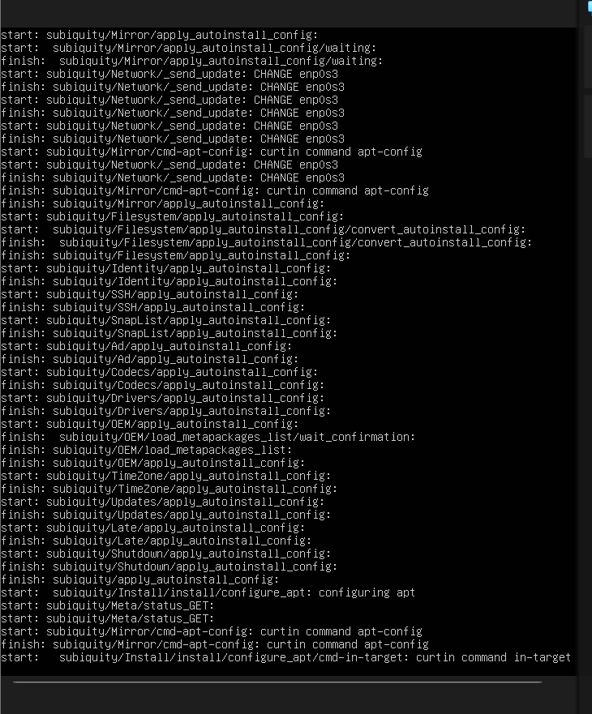
Másquina Virtual configurada corriendo
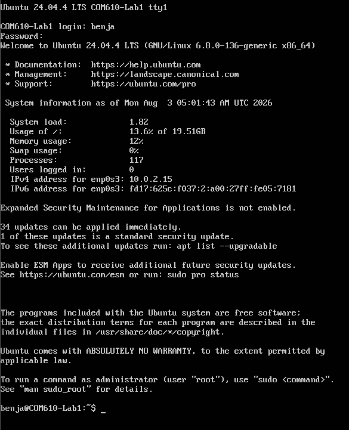
Instalación de ssh para funciones futuras, no instalado de manera predeterminada
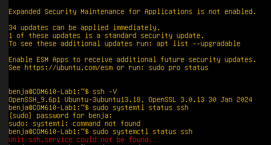
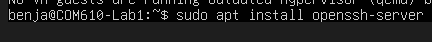
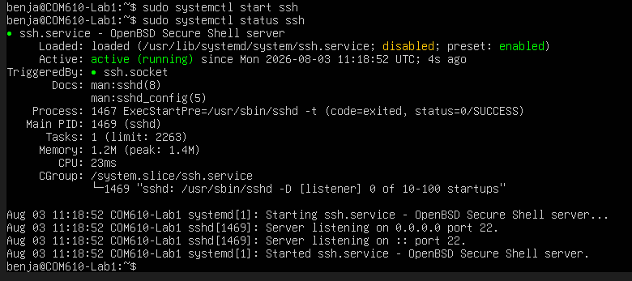

### 1.3. Acceso Remoto: Configuración de Reenvío de Puertos (Port Forwarding)
La máquina virtual COM610-Lab1.1 usa una red de tipo NAT, lo que significa que tiene una dirección IP privada (10.0.2.15) que solo existe dentro de VirtualBox. Por esta razón, la computadora física no puede conectarse directamente a ella.

Para solucionar esto, se configuró un reenvío de puertos, que funciona como un puente entre la PC física y la máquina virtual. 
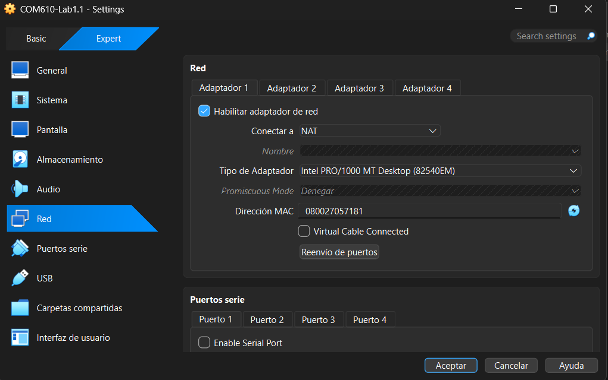
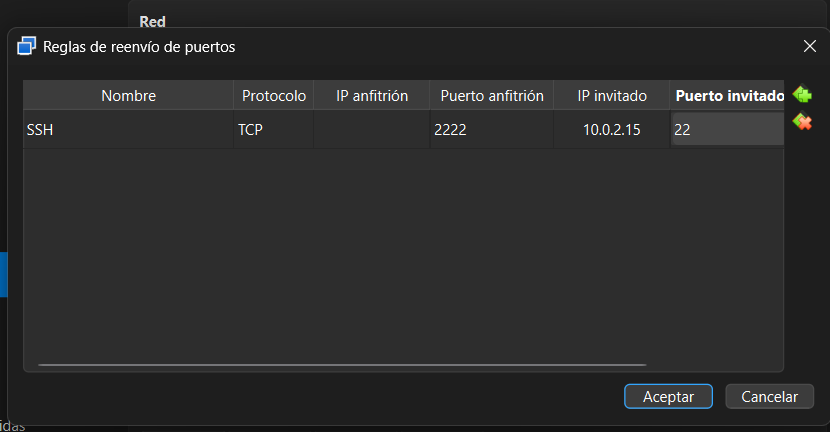
Esto le indica a VirtualBox que todo lo que llegue al puerto 2222 de la PC física debe ser redirigido al puerto 22 (SSH) de la máquina virtual. Así, se puede administrar el servidor de forma remota desde la PC como si fuera un servidor real en la nube.
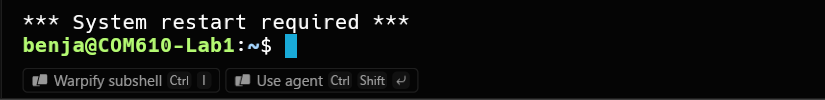
Warp activo corriendo
## Sección 2: Práctica Guiada (Administración de Sistemas)
### 2.1. Gestión de Archivos y Directorios: "Navegando en el Almacenamiento"
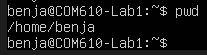

```bash
pwd
```
pwd significa "print working directory" (imprimir el directorio de trabajo actual).

El comando muestra en pantalla la ruta completa de la carpeta en la que se encuentra el usuario en ese momento dentro de la terminal. Por ejemplo, si se ejecuta pwd y devuelve /home/benja, significa que el usuario está ubicado en esa carpeta.

Es un comando muy utilizado para ubicarse al navegar por el sistema de archivos, especialmente al trabajar por SSH sin interfaz gráfica.
```bash
ls -la
```
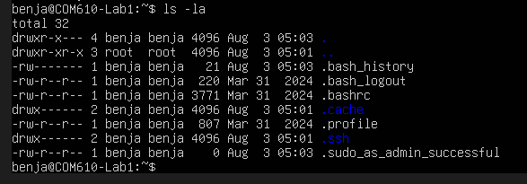
Al combinarse, ls -la permite ver de forma completa y detallada todo el contenido de una carpeta, incluyendo archivos ocultos, junto con su información de permisos y propiedad. Es muy utilizado para revisar configuraciones o verificar quién tiene acceso a qué archivos dentro del sistema.
```bash
mkdir -p lab1/respaldos
```

En este caso, el comando crea la carpeta lab1 (si no existía) y, dentro de ella, la subcarpeta respaldos, todo en un solo paso. Sin la opción -p, el comando fallaría si la carpeta lab1 no existiera previamente, porque mkdir normalmente solo crea un nivel de carpeta a la vez.

Es un comando útil para organizar la estructura de directorios de forma rápida, como en este caso, para preparar una carpeta destinada a guardar respaldos dentro del laboratorio.
```bash
touch lab1/notas.txt
```
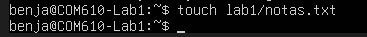
En este caso, el comando crea el archivo notas.txt dentro de la carpeta lab1 (que ya se había creado previamente con mkdir -p lab1/respaldos). El archivo queda vacío, listo para que luego se le agregue contenido con otro comando o con un editor de texto (como nano o vim).

Es un comando muy usado para generar rápidamente archivos de prueba o placeholders dentro de una estructura de carpetas.
```bash
cp lab1/notas.txt lab1/notas_backup.txt
```

El comando copia el archivo notas.txt y genera una nueva copia con el nombre notas_backup.txt, dentro de la carpeta lab1. El archivo original permanece intacto, y quedan dos archivos con el mismo contenido pero distinto nombre. Es un comando muy utilizado para generar respaldos rápidos de archivos antes de modificarlos.
```bash
mv lab1/notas.txt /tmp/
```
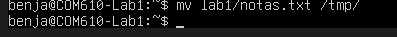
El comando toma el archivo notas.txt (ubicado dentro de la carpeta lab1) y lo traslada a la carpeta /tmp/, que es un directorio temporal del sistema usado normalmente para archivos de uso pasajero. A diferencia de cp, mv no deja una copia en el lugar original: el archivo desaparece de lab1 y queda únicamente en /tmp/. El comando mv también se utiliza para renombrar archivos, cuando el origen y el destino están en la misma carpeta pero con nombre distinto.
```bash
mv lab1/notas_backup.txt lab1/final.txt
```
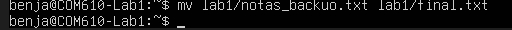
Como el origen y el destino están dentro de la misma carpeta (lab1), el comando no traslada el archivo a otro lugar, sino que cambia su nombre de notas_backup.txt a final.txt. Es la forma habitual de renombrar archivos en la terminal, ya que Linux no tiene un comando rename de uso general tan común como mv para esta tarea.
```bash
rm lab1/final.txt
```
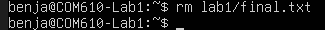
El comando borra el archivo final.txt ubicado dentro de la carpeta lab1 de forma permanente. A diferencia de eliminar un archivo desde una interfaz gráfica, rm no envía el archivo a una papelera de reciclaje, por lo que la eliminación es directa y no se puede deshacer fácilmente. Por eso se recomienda tener cuidado al usar este comando, especialmente si se combina con opciones como -r (para eliminar carpetas completas) o -f (para forzar la eliminación sin pedir confirmación).
```bash
tail -f /var/log/syslog
```
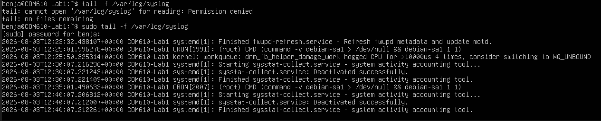
-f: significa "follow" (seguir). Mantiene el comando corriendo y muestra automáticamente en pantalla las nuevas líneas que se van agregando al archivo a medida que se generan, sin necesidad de volver a ejecutar el comando.

El comando muestra el final del archivo /var/log/syslog, que es el registro general del sistema en distribuciones basadas en Debian/Ubuntu, donde quedan asentados eventos del sistema operativo, servicios y aplicaciones. Con la opción -f, la terminal queda "monitoreando" ese archivo en vivo, mostrando cada nuevo evento apenas ocurre. Es muy utilizado para diagnosticar problemas o supervisar la actividad del servidor mientras sucede. Para salir de este modo de seguimiento, se usa la combinación de teclas Ctrl + C.
```bash
head -n 20 /var/log/syslog
```
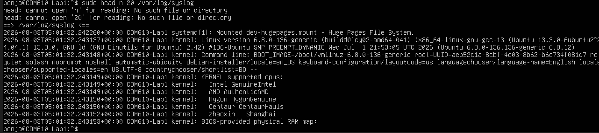
-n 20: indica la cantidad de líneas a mostrar, en este caso las primeras 20 (se puede ajustar el número según lo que se necesite).
Es importante aclarar que head no tiene la opción -f (follow) como tail, porque no tiene sentido "seguir en vivo" el inicio de un archivo: las primeras líneas de un log ya están escritas y no cambian con el tiempo, mientras que las nuevas entradas siempre se agregan al final del archivo. Por eso, para monitorear eventos en tiempo real siempre se usa tail -f, y head se utiliza solo para revisar el comienzo de un archivo, por ejemplo para ver las cabeceras de un log antiguo o el inicio de un archivo de texto grande.
```bash
find /etc -name "hostname"
```
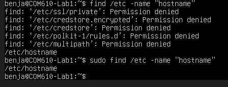
El comando find /etc -name "hostname" sirve para buscar archivos por nombre dentro de un directorio específico.

El comando recorre la carpeta /etc y todas sus subcarpetas, mostrando la ruta completa de cualquier archivo llamado hostname que encuentre. En Ubuntu Server, normalmente arroja como resultado /etc/hostname, que es el archivo donde el sistema guarda el nombre configurado del equipo (hostname). Es un comando muy útil cuando no se recuerda la ubicación exacta de un archivo dentro del sistema.

```bash
grep "error" /var/log/syslog
```
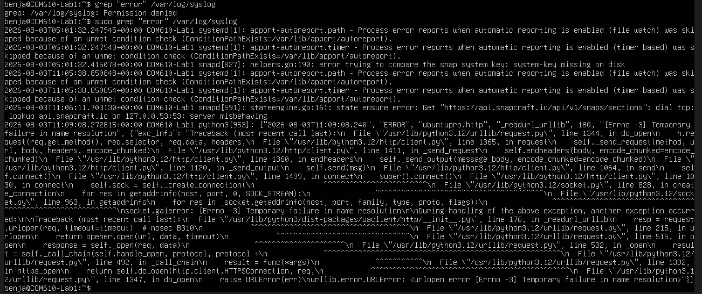
El comando grep "error" /var/log/syslog sirve para buscar texto dentro de un archivo.El comando recorre todo el archivo /var/log/syslog y muestra únicamente las líneas que contienen la palabra "error". Por defecto, grep es sensible a mayúsculas y minúsculas, por lo que no detectaría, por ejemplo, "Error" o "ERROR" (para eso se usaría la opción -i, que ignora las mayúsculas). Es un comando muy utilizado para filtrar información relevante dentro de archivos de registro extensos, sin tener que revisar todo el contenido manualmente.
### 2.2. Administración de Usuarios y Grupos: "Acceso Lógico"
```bash
sudo groupadd ventas
```
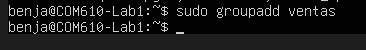
El comando sudo groupadd ventas sirve para crear un nuevo grupo de usuarios en el sistema.
El comando crea un grupo llamado ventas dentro del sistema, que luego puede utilizarse para organizar usuarios y asignarles permisos en conjunto. Por ejemplo, si varios usuarios pertenecen al grupo ventas, se les puede otorgar acceso compartido a ciertos archivos o carpetas sin tener que configurar los permisos individualmente para cada usuario. Los grupos quedan registrados en el archivo /etc/group.
```bash
sudo groupadd -g 2000 contabilidad
```

El comando sudo groupadd -g 2000 contabilidad sirve para crear un nuevo grupo con un identificador numérico específico.El comando crea el grupo contabilidad con el GID 2000, quedando registrado en el archivo /etc/group. Asignar un GID específico suele usarse cuando se necesita mantener consistencia entre distintos servidores o sistemas, por ejemplo, para que un mismo grupo tenga siempre el mismo identificador numérico en toda una red o infraestructura.
```bash
sudo useradd -u 2001 -g contabilidad -md /home/jperez -s /bin/bash -c "Juan Perez" jperez
```
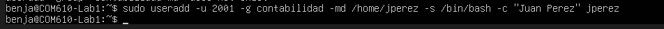
El comando sudo useradd -u 2001 -g contabilidad -md /home/jperez -s /bin/bash -c "Juan Perez" jperez sirve para crear un nuevo usuario en el sistema con varias configuraciones específicas.
- sudo: ejecuta el comando con permisos de administrador, necesarios para crear usuarios en el sistema.
useradd: es el comando específico para crear usuarios.
-  -u 2001: asigna manualmente el UID (User ID, identificador numérico del usuario), en lugar de dejar que el sistema asigne automáticamente el siguiente disponible.
- -g contabilidad: establece el grupo principal del usuario, en este caso el grupo contabilidad creado previamente.
- -m: crea automáticamente el directorio personal (home) del usuario si no existe.
- -d /home/jperez: especifica la ruta del directorio personal del usuario, en este caso /home/jperez.
- -s /bin/bash: define la shell (intérprete de comandos) que usará el usuario al iniciar sesión, en este caso Bash.
- -c "Juan Perez": agrega un comentario o descripción asociada al usuario, generalmente utilizado para el nombre completo de la persona.
jperez: es el nombre de usuario (login) que se crea.

El comando crea el usuario jperez con UID 2001, perteneciente al grupo contabilidad, con directorio personal en /home/jperez, shell Bash, y el nombre completo "Juan Perez" registrado como descripción. Queda registrado en los archivos /etc/passwd, /etc/shadow y /etc/group.
```bash
sudo passwd jperez
```
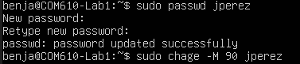
El comando sudo passwd jperez sirve para establecer o cambiar la contraseña de un usuario. El comando solicita ingresar y confirmar una nueva contraseña para el usuario jperez. Una vez establecida, esa contraseña queda encriptada y almacenada en el archivo /etc/shadow, y será la que el usuario deberá usar para iniciar sesión en el sistema o autenticarse, por ejemplo, al conectarse por SSH.
```bash
sudo chage -M 90 jperez
```
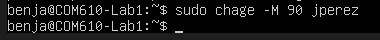
El comando establece que la contraseña del usuario jperez debe cambiarse cada 90 días como máximo. Una vez cumplido ese plazo, el sistema obliga al usuario a definir una nueva contraseña la próxima vez que inicie sesión. Esta configuración queda registrada en el archivo /etc/shadow y es una práctica común de seguridad para forzar la renovación periódica de contraseñas.
### 2.3. El Comando sudo y Gestión de Paquetes: "Instalando la Capa de Software"
```bash
sudo apt update
```
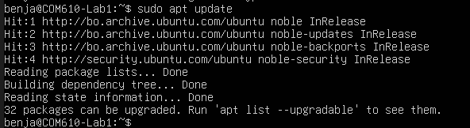
El comando sudo apt update sirve para actualizar la lista de paquetes disponibles del sistema.

```bash
sudo apt upgrade
```
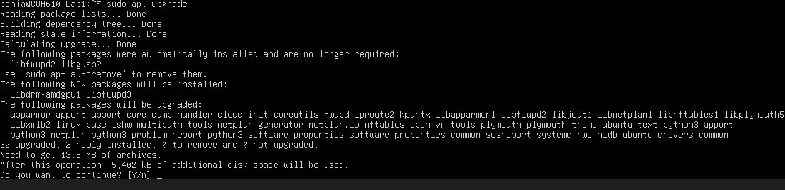
El comando sudo apt upgrade sirve para actualizar los paquetes ya instalados en el sistema a sus versiones más recientes.

```bash
sudo apt install nginx
```
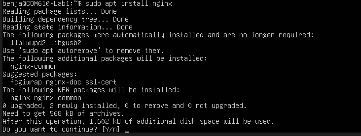
El comando sudo apt install nginx sirve para instalar un paquete de software en el sistema. 

El comando descarga e instala Nginx junto con sus dependencias necesarias, tomando la información de los repositorios previamente actualizados con apt update. Al finalizar la instalación, el servicio de Nginx queda instalado en el sistema y, generalmente, se inicia automáticamente, quedando disponible para servir contenido web a través del puerto 80 por defecto.
```bash
sudo apt remove nginx
```
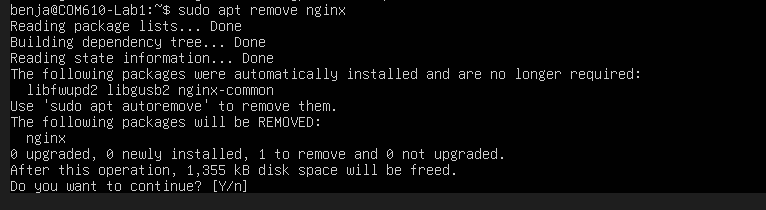
El comando sudo apt remove nginx sirve para desinstalar un paquete de software del sistema. El comando elimina el programa Nginx del sistema, pero conserva los archivos de configuración asociados (generalmente ubicados en /etc/nginx), por si el usuario decide reinstalarlo más adelante y quiere mantener su configuración previa.

```bash
sudo apt purge nginx
```
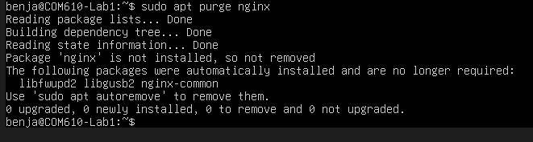
El comando sudo apt purge nginx sirve para desinstalar un paquete de software del sistema, incluyendo sus archivos de configuración. El comando elimina el programa Nginx del sistema y, a diferencia de apt remove, también borra los archivos de configuración asociados (por ejemplo, los ubicados en /etc/nginx). Se utiliza cuando se quiere hacer una desinstalación completa, dejando el sistema como si el paquete nunca hubiera sido instalado, sin dejar restos de configuraciones anteriores.
### 2.4. Control de Servicios: systemctl
```bash
sudo systemctl status nginx
```
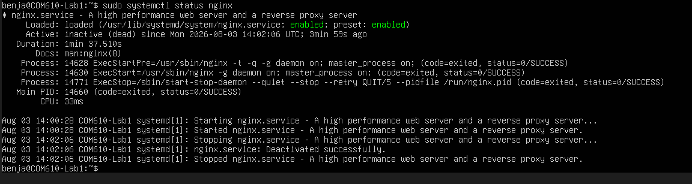
El comando sudo systemctl status nginx sirve para consultar el estado de un servicio del sistema.

El comando muestra información detallada sobre el servicio Nginx, incluyendo si está activo (running), detenido (inactive) o con errores (failed), además de datos como el proceso principal (PID), el tiempo que lleva corriendo, y las últimas líneas de su registro de actividad (log).
```bash
sudo systemctl status nginx
```
```bash
sudo systemctl stop nginx
```
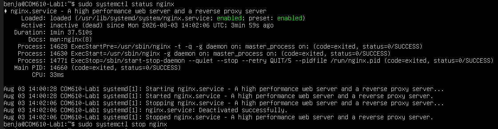
sudo systemctl stop nginx

El comando sudo systemctl stop nginx sirve para detener un servicio del sistema.
El comando detiene el servicio de Nginx, deteniendo el proceso en ejecución y dejando de servir contenido web.
```bash
sudo systemctl enable nginx
```
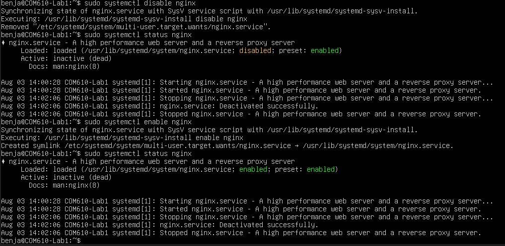
El comando sudo systemctl enable nginx sirve para configurar un servicio para que se inicie automáticamente con el sistema.

El comando crea los enlaces necesarios para que Nginx se inicie automáticamente cada vez que el servidor arranca, sin necesidad de iniciarlo manualmente con systemctl start. Es importante aclarar que enable no inicia el servicio de inmediato, solo configura su arranque automático a futuro; si se quiere que además se inicie en ese momento, se debe usar sudo systemctl start nginx (o combinarlo con --now, es decir, sudo systemctl enable --now nginx).
### 2.5. Permisos de Archivos: chmod y chown
```bash
sudo chown jperez:contabilidad informe.txt
```
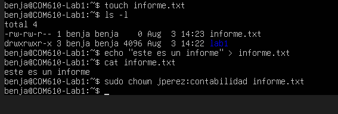
El comando sudo chown jperez:contabilidad informe.txt sirve para cambiar el propietario y el grupo de un archivo.

chown: significa "change owner", es el comando específico para cambiar el propietario y/o grupo de un archivo.

```bash
sudo chmod 640 informe.txt
```
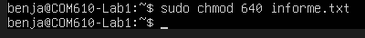
El número 640 se descompone en tres dígitos, cada uno representando un nivel de acceso: el primero para el propietario, el segundo para el grupo, y el tercero para otros usuarios. El valor 6 equivale a lectura y escritura (4+2), el 4 equivale solo a lectura, y el 0 equivale a ningún permiso. Por lo tanto, el propietario del archivo (jperez) puede leer y escribir el archivo, los miembros del grupo (contabilidad) solo pueden leerlo, y el resto de los usuarios del sistema no tienen ningún acceso a él.
### 2.6. Comandos de Red: "Verificando la Conectividad"
```bash
ip addr
```
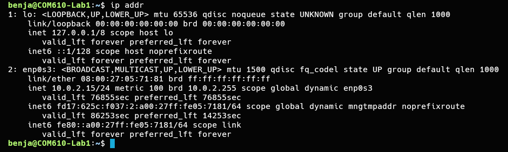
El comando muestra todas las interfaces de red del equipo (por ejemplo, lo para loopback y enp0s3 o eth0 para la interfaz principal), junto con sus direcciones IP asignadas (tanto IPv4 como IPv6), el estado de cada interfaz (UP o DOWN), y la máscara de subred correspondiente. Es muy utilizado para verificar rápidamente qué dirección IP tiene asignada el servidor dentro de la red.
```bash
ping -c 4 google.com
```
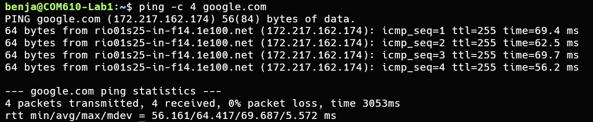
El comando ping -c 4 google.com sirve para verificar la conectividad de red hacia un host determinado.

- ping: envía paquetes de prueba (ICMP) hacia un destino para comprobar si hay comunicación con él.
- -c 4: indica la cantidad de paquetes a enviar, en este caso 4 (sin esta opción, ping seguiría enviando paquetes indefinidamente hasta detenerlo manualmente con Ctrl + C).
- google.com: es el host de destino al que se envían los paquetes.
```bash
ss -tunlp
```
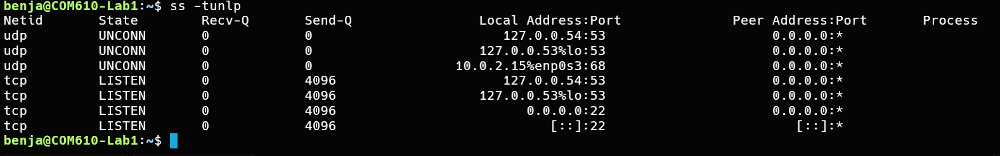
El comando ss -tunlp sirve para mostrar los puertos y conexiones de red activos en el sistema.
### 2.7. Diagnóstico de Hardware y Sistema Base
```bash
uname -a
```
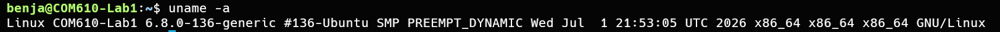
El comando uname -a sirve para mostrar información general del sistema operativo y del kernel.

- uname: significa "Unix name", es el comando que muestra información sobre el sistema.
- -a: significa "all" (todo), e indica que se debe mostrar toda la información disponible.
```bash
sudo hostnamectl set-hostname nodo-monitoreo-usfx
```
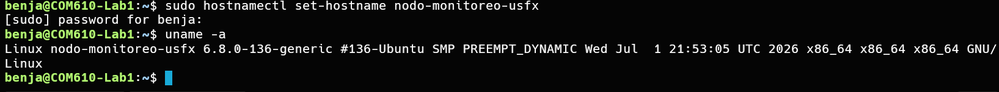
```bash
lscpu
```
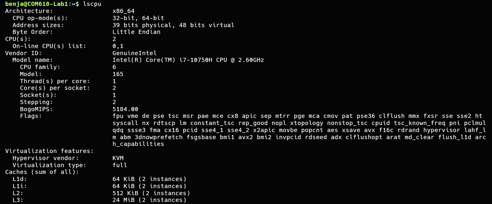
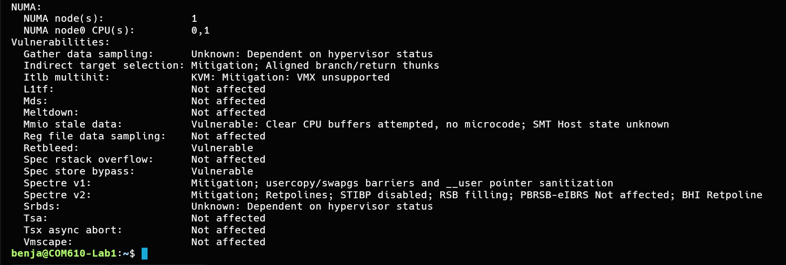
El comando lscpu sirve para mostrar información detallada sobre el procesador (CPU) del sistema.
```bash
lsblk
```
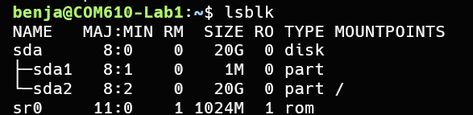
El comando lsblk sirve para mostrar información sobre los dispositivos de bloque (discos y particiones) del sistema.
### 2.8. Configuración de Red Avanzada (Netplan
```bash
ip addr
```
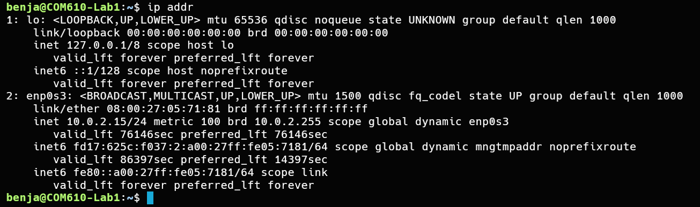
```bash
sudo nano /etc/netplan/01-netcfg.yaml
```
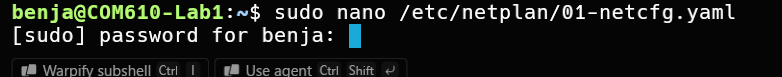
El comando sudo nano /etc/netplan/01-netcfg.yaml sirve para abrir y editar un archivo de configuración de red.
```bash
network:
version: 2
ethernets:
    enp0s8:
    dhcp4: no
    addresses: [192.168.1.100/24] # Usa una IP libre de tu red real
    gateway4: 192.168.1.1
    nameservers:
        addresses: [8.8.8.8, 1.1.1.1]
```
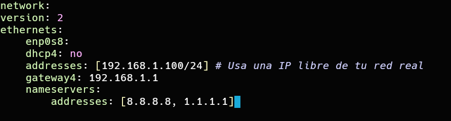
En conjunto, esta configuración deja fija la dirección IP de la interfaz enp0s8, en lugar de que el servidor la reciba automáticamente por DHCP. Es la forma habitual de asignar una IP estática en servidores, ya que evita que la dirección cambie al reiniciar el equipo, algo importante para servicios que deben ser siempre accesibles en la misma dirección.
```bash
sudo netplan apply
```
El comando sudo netplan apply sirve para aplicar los cambios realizados en los archivos de configuración de red de Netplan.

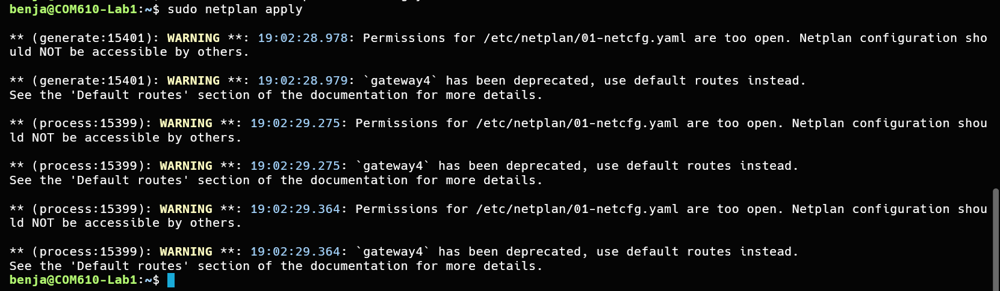
### 2.9. Instalación de Software y Repositorios de Terceros
```bash
sudo add-apt-repository ppa:pitti/proctools -y
```
```bash
sudo add-apt-repository universe -y
```
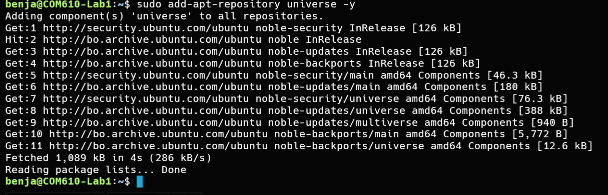
El primer comando, sudo add-apt-repository ppa:pitti/proctools -y, intenta agregar un repositorio PPA (Personal Package Archive) específico, mantenido por el usuario pitti en Launchpad, con el nombre proctools. No pudo usarse porque ese PPA no existe actualmente en Launchpad (o ya fue eliminado), por lo que el sistema devuelve el error ppa 'pitti/proctools' not found. Los PPA son repositorios personales creados por desarrolladores individuales, y a diferencia de los repositorios oficiales de Ubuntu, pueden desaparecer, cambiar de nombre o dejar de mantenerse en cualquier momento.

El segundo comando, sudo add-apt-repository universe -y, habilita el repositorio universe, uno de los componentes oficiales de Ubuntu (junto con main, restricted y multiverse). Este repositorio contiene software de código abierto mantenido por la comunidad, y suele venir deshabilitado o parcialmente habilitado en instalaciones mínimas como Ubuntu Server. A diferencia de un PPA de terceros, universe es parte de la infraestructura oficial de Ubuntu, por lo que siempre está disponible y no depende de que un usuario individual mantenga el repositorio activo. Este comando permite ampliar la disponibilidad de paquetes sin depender de fuentes externas inestables, y con él es posible instalar herramientas como ncdu y nload, que están alojadas justamente en este componente.
```bash
sudo apt update && sudo apt install ncdu nload -y
```
El comando actualiza primero la información de paquetes disponibles y, si esa actualización fue exitosa, instala directamente ncdu (herramienta visual para analizar el uso de espacio en disco por carpetas) y nload (monitor de tráfico de red en tiempo real), ambos disponibles gracias al repositorio universe habilitado en el paso anterior.

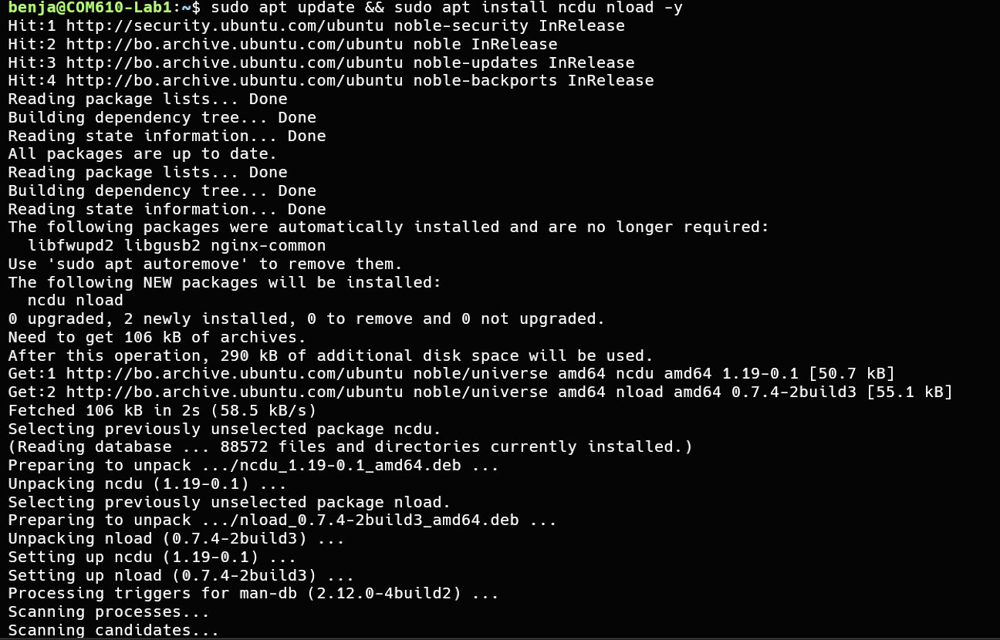
### 2.10. Monitoreo de Rendimiento y Procesos
```bash
free -m
```
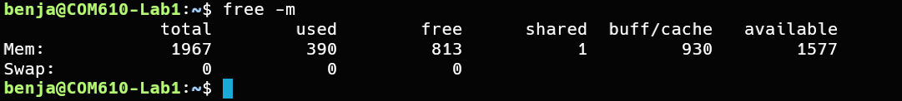
El comando free -m sirve para mostrar el uso de memoria del sistema.

- free: es el comando que muestra información sobre la memoria RAM y la memoria de intercambio (swap) del sistema.
- -m: indica que los valores se muestren en megabytes (MB), en lugar del formato por defecto en kilobytes.

El comando muestra una tabla con la memoria total, usada, libre, compartida, en buffers/caché, y disponible, tanto para la memoria RAM física como para la memoria swap (espacio de intercambio en disco, usado cuando la RAM se llena). Tal como indica la consigna, este comando permite verificar que una partición o archivo swap recién creado aparece correctamente reconocido por el sistema, sumado al total de memoria swap disponible, confirmando que la configuración se aplicó con éxito.
```bash
htop
```

El comando htop sirve para mostrar el uso de recursos del sistema en tiempo real, de forma interactiva.
```bash
vmstat 1 5
```

El comando vmstat 1 5 sirve para mostrar estadísticas del sistema (memoria, procesos, CPU, entrada/salida) en intervalos de tiempo.
```bash
ps -aux | grep nginx
```

El comando ps -aux | grep nginx sirve para buscar procesos activos relacionados con un programa específico.
```bash
sudo kill -HUP [PID]
```

El comando kill -HUP [PID] envía la señal SIGHUP a un proceso identificado por su número de PID, funcionando como una notificación estándar en Linux más que como una orden de terminación forzosa. La reacción depende de cómo esté programado el proceso: en servicios que corren en segundo plano (como Nginx, Apache o SSH), suele interpretarse como una orden de recargar la configuración sin detener el servicio; en programas ejecutados desde una terminal, históricamente se interpretaba como el cierre de esa terminal, provocando el cierre del proceso; y en otros casos, el comportamiento depende de cómo el propio programa maneje la señal, a diferencia de SIGKILL, que fuerza la terminación inmediata sin dar margen de reacción.
```bash
sudo kill -9 [PID]
```
El comando sudo kill -9 [PID] sirve para terminar un proceso de forma forzosa e inmediata.
### 2.11. Auditoría, Logs y Pruebas de Estrés
```bash
journalctl -p err
```

El comando journalctl -p err sirve para consultar los registros del sistema (logs) gestionados por systemd, filtrando solo por un nivel de severidad específico.
"No entries": significa que, dentro de lo que sí puede ver el usuario benja, no se encontró ningún mensaje de nivel error o superior. Esto puede deberse tanto a que realmente no hay errores registrados en esa sesión, como a la limitación de permisos mencionada arriba. Para obtener una visión completa y confiable de errores en todo el sistema, sería más apropiado ejecutar:

```bash
tail -n 20 /var/log/auth.log
```

El comando muestra las últimas 20 líneas del archivo /var/log/auth.log, que registra eventos como inicios de sesión (exitosos y fallidos), uso de sudo, intentos de conexión por SSH, y cambios relacionados con la autenticación de usuarios. Es un archivo clave para auditar la seguridad del servidor, ya que permite detectar accesos no autorizados, intentos de fuerza bruta u otras actividades sospechosas relacionadas con el acceso al sistema.
```bash
sudo apt install stress
```

```bash
stress --cpu 2 --io 1 --vm 1 --vm-bytes 128M --timeout 60s
```


El comando stress --cpu 2 --io 1 --vm 1 --vm-bytes 128M --timeout 60s sirve para generar carga artificial en el sistema, con el fin de probar su comportamiento bajo estrés.
El comando somete al servidor a una carga combinada de CPU, entrada/salida y memoria durante 60 segundos, simulando un escenario de alto uso de recursos.

```bash
dd if=/dev/zero of=/mnt/datosA/testfile bs=1G count=1 oflag=dsync
```
Discco para la prueba:


Configuracion del disco:


Prueba del disco:


El comando sudo dd if=/dev/zero of=/mnt/datosA/testfile bs=1G count=1 oflag=dsync sirve para medir la velocidad de escritura de un disco.El comando escribe un archivo de prueba de 1GB lleno de ceros en la ruta /mnt/datosA/testfile, y al finalizar muestra en pantalla el tiempo que tardó la operación y la velocidad de escritura resultante (por ejemplo, en MB/s). Es una forma habitual de comprobar el rendimiento real de un disco o partición montada, especialmente útil para evaluar discos añadidos manualmente o unidades de almacenamiento en la nube.

```bash
sudo crontab -e
```

```bash
0 3 * * * rm -rf /var/tmp/*
```


Este es el paso completo de configuración de una tarea automática con cron, el sistema de programación de tareas en Linux. En conjunto, esta configuración programa una tarea que se ejecuta automáticamente todos los días a las 3:00 AM, eliminando todo el contenido de la carpeta /var/tmp/ (usada normalmente para archivos temporales), sin necesidad de que un administrador lo haga manualmente. Al guardar el archivo (Ctrl+O y Ctrl+X en nano), cron queda encargado de ejecutar esta limpieza de forma automática y recurrente.

## Sección 3: Práctica Individual (Desafío de Infraestructura)

### Ejercicio 1:

```bash
sudo mkdir -p /srv/plataforma_usfx
sudo groupadd desarrolladores
sudo useradd -m -s /bin/bash webmaster
sudo chown webmaster:desarrolladores /srv/plataforma_usfx
sudo chmod 750 /srv/plataforma_usfx
```


Pide: crear una carpeta para una app, un grupo, un usuario dueño, y asignar permisos restringidos.

- mkdir -p: crea la carpeta de la aplicación.
- groupadd: crea el grupo desarrolladores.
- useradd -m -s /bin/bash: crea el usuario webmaster con carpeta personal y Bash.
- chown: asigna dueño y grupo a la carpeta.
- chmod 750: dueño con control total, grupo con lectura/entrada, resto sin acceso.
- 
### Ejercicio 2:
```bash
touch /tmp/audit_test.log
sudo crontab -e

59 23 * * 0 rm -f /tmp/*.log
```


Pide: un archivo de prueba y una tarea cron que borre logs de /tmp semanalmente.

- touch: crea el archivo vacío de prueba.
- crontab -e: abre el editor de tareas programadas de root.
- La línea: ejecuta el borrado de archivos .log en /tmp todos los domingos a las 23:59.

### Ejercicio 3:
```bash
sudo apt install nginx -y
sudo systemctl enable nginx
sudo systemctl start nginx
ss -tunlp
```


Pide: instalar Nginx, dejarlo con inicio automático, y confirmar que escucha en el puerto 80.

- apt install nginx: instala el servidor web.
- systemctl enable: activa el arranque automático con el sistema.
- systemctl start: inicia el servicio en ese momento.
- ss -tunlp: lista puertos en escucha; sirve para verificar que el 80 esté activo.
- 
### Ejercicio 4:
```bash
sudo useradd -m -s /bin/bash pasante_it
sudo passwd pasante_it
sudo chage -M 30 pasante_it
```


Pide: un usuario limitado, contraseña con vencimiento, y evidencia de que no tiene sudo.

- useradd: crea el usuario pasante_it.
- passwd: le asigna contraseña.
- chage -M 30: fuerza el cambio de contraseña cada 30 días.
- sudo whoami (ejecutado como pasante_it): confirma el rechazo por no estar en sudoers; queda registrado en /var/log/auth.log.
- 
### Ejercicio 5:
```bash
stress --cpu 1 --vm 1 --vm-bytes 128M --timeout 30s

htop
```


Pide: simular carga en el servidor y observar su efecto en vivo.
- stress: satura 1 núcleo de CPU y reserva 128MB de RAM durante 30 segundos.
- htop: muestra en vivo el proceso stress y su consumo de recursos.
- 
### Ejercicio 6:
```bash
ssh-keygen -t rsa -b 4096
ssh-copy-id -p 2222 benja@127.0.0.1  -  type $env:USERPROFILE\.ssh\id_rsa.pub | ssh -p 2222 benja@127.0.0.1 "cat >> ~/.ssh/authorized_keys"
ssh -p 2222 benja@127.0.0.1
```


Pide: reemplazar el login por contraseña con autenticación por llave.
- ssh-keygen: genera el par de llaves RSA de 4096 bits (privada y pública).
- El comando con type y cat: copia la llave pública al servidor, agregándola a authorized_keys (reemplaza a ssh-copy-id, no disponible en Windows).
- ssh -p 2222: prueba la conexión; si funcionó, entra sin pedir contraseña.