**Universidad San Francisco Xavier de Chuquisaca**  
**Estudiante:** Pereira Manzano Benjamín Solano  
**Carrera:** Ing. Sistemas  
**Docente:** Ing. Marcelo Quispe Ortega  
**Semestre:** 2/2026  
**Repositorio GIT:** https://github.com/BenjaminPereira26/COM610-TrabajandoEnLaNube
# Informe Laboratorio 1

## Sección 1: Registro y Activación (Aprovisionamiento del Tenant)

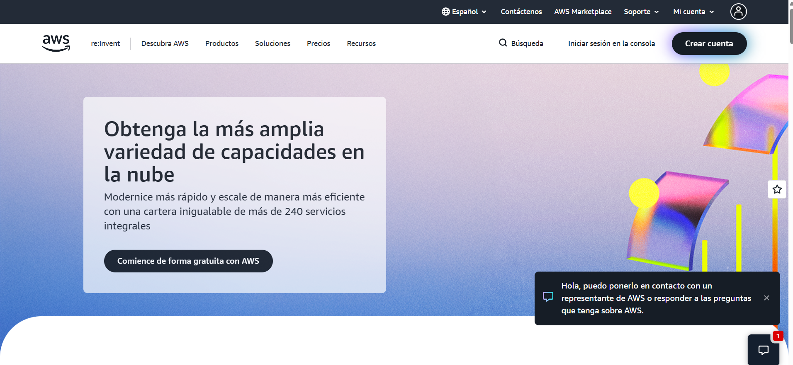
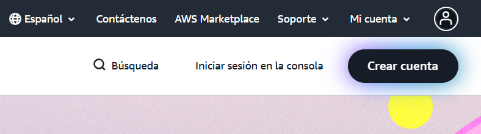
**Registro Inicial:** Corresponde al primer paso para dar de alta una cuenta en AWS, ingresando al sitio oficial y comenzando el proceso de creación mediante la opción correspondiente.

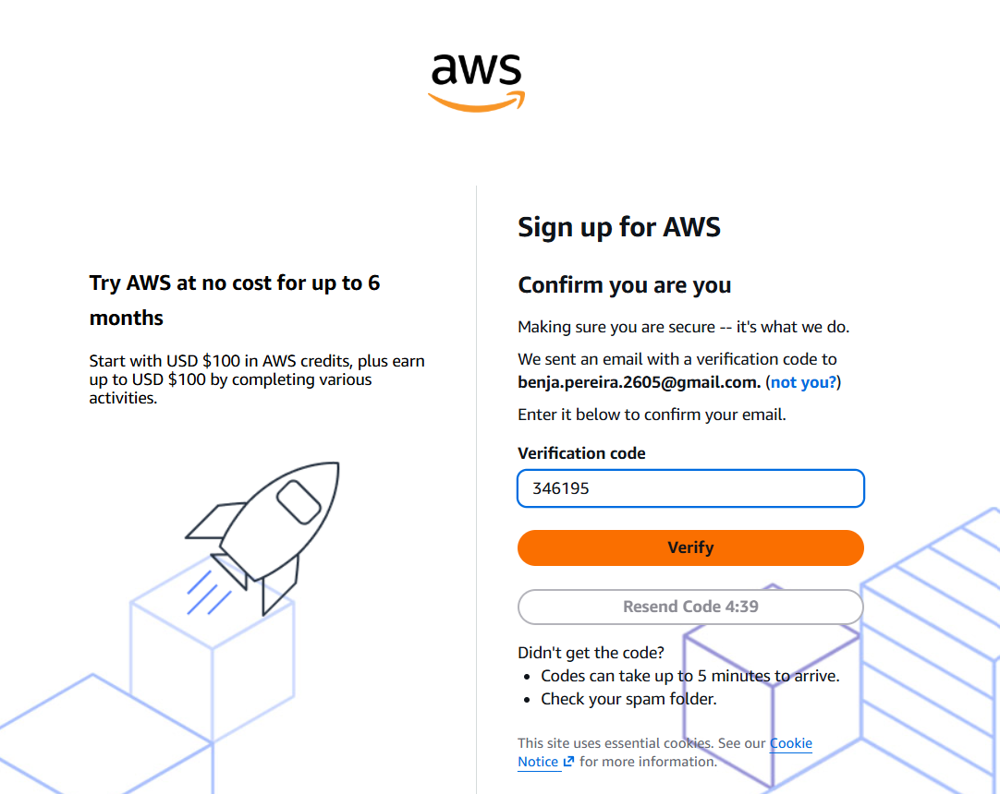

**Configuración de Credenciales:** Consiste en asociar la cuenta a una dirección de correo electrónico, que queda establecida como el Usuario Raíz. Este usuario posee acceso total a todos los servicios y recursos de la cuenta, por lo que su correo debe ser de uso frecuente para poder gestionar notificaciones y recuperaciones de acceso.

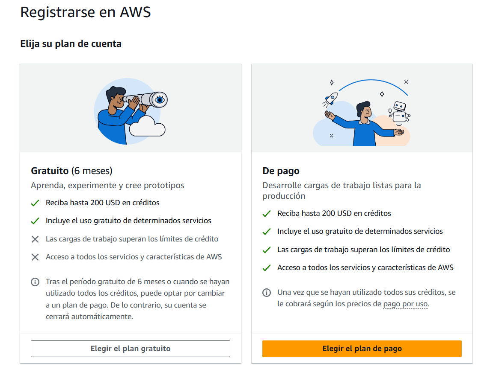

**Selección del Plan de Soporte:** Se refiere a la elección del nivel de soporte técnico que ofrecerá AWS. El plan Basic no tiene costo e incluye acceso a documentación, foros de la comunidad y soporte limitado, siendo suficiente para uso personal o de aprendizaje.

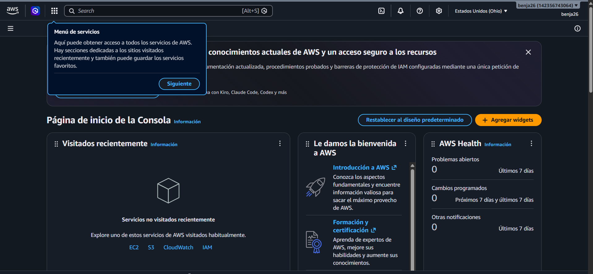

## Sección 2: Navegación Crítica en la Consola de Gestión

### 2.1. El Selector de Regiones (El Concepto Geográfico)

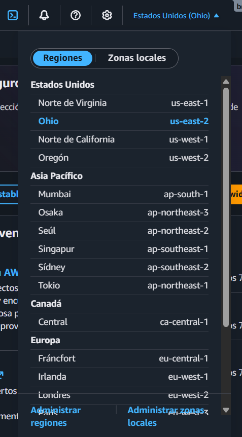

Región Ohio:

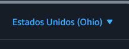
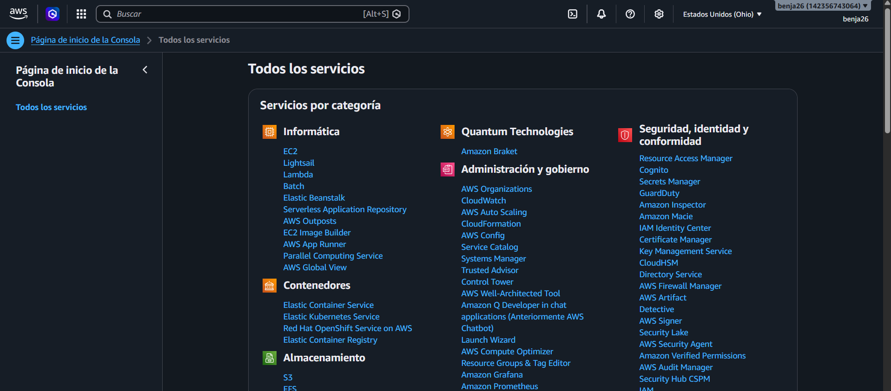

Región Virginia:

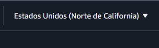
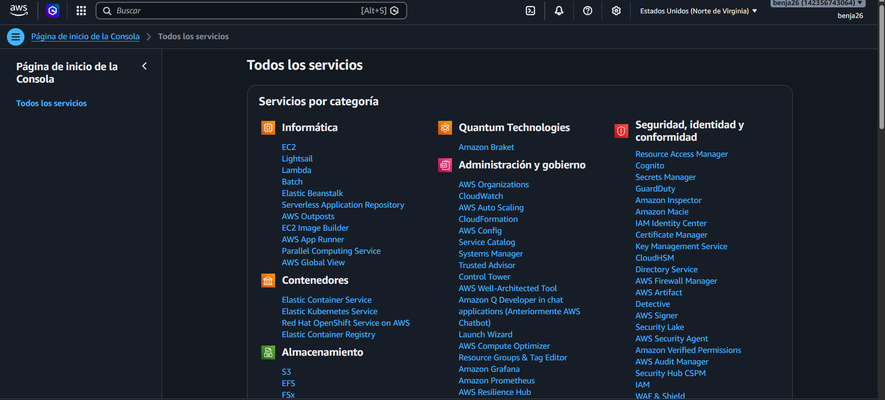

### 2.2. La Barra de Búsqueda de Servicios

**EC2:**
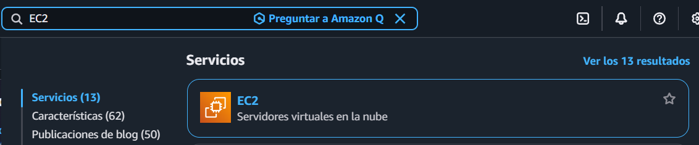

**S3:**
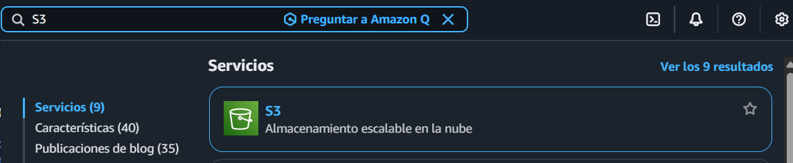

**RDS:**
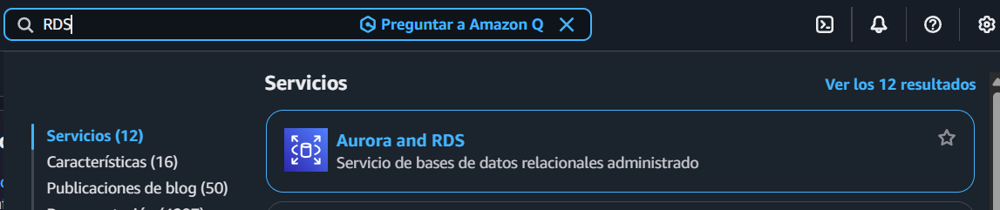

### 2.3. Panel de Facturación (Billing Dashboard)

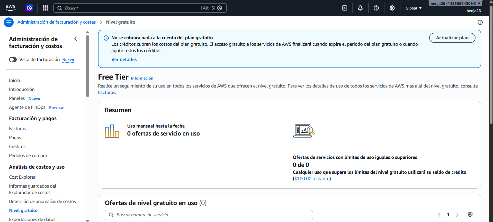
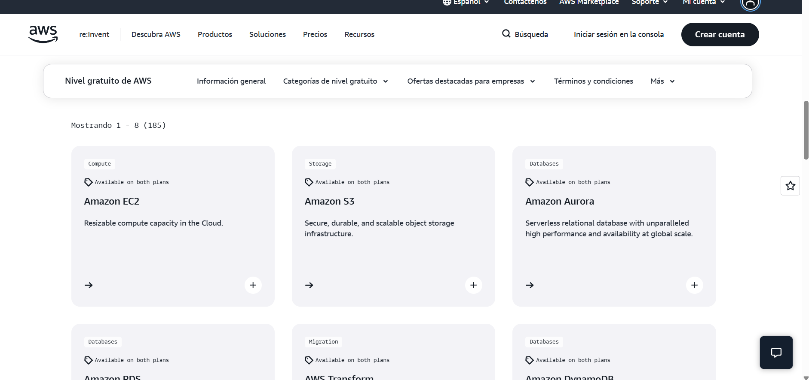
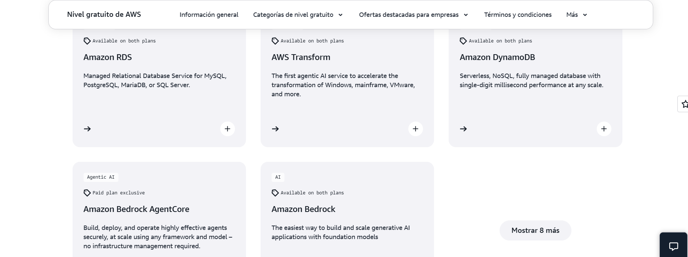

#### Análisis de Regiones:
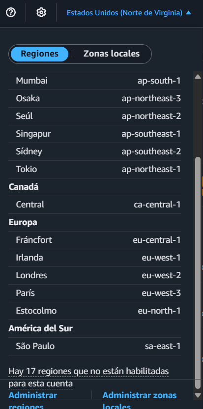
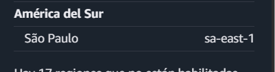

Es crucial porque la región determina la ubicación física del servidor. Para una empresa en Bolivia, conviene elegir la región disponible más cercana (por ejemplo, São Paulo, en Sudamérica), ya que reduce la latencia (los datos viajan menos distancia, la app responde más rápido), ayuda a cumplir normativas de residencia de datos, y puede influir en el costo del servicio.

#### Auditoría del Nivel Gratuito

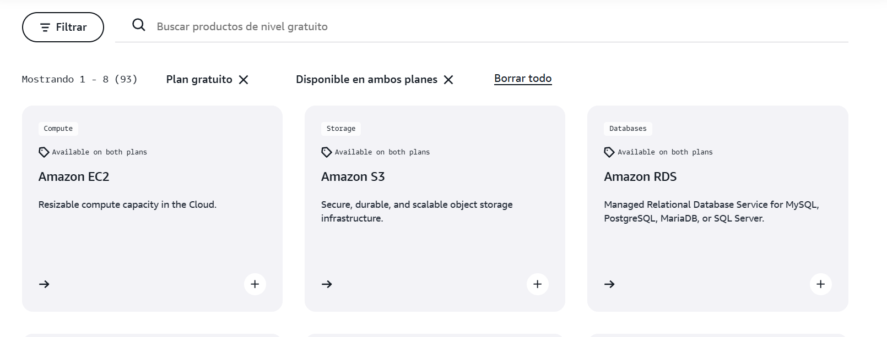
Al revisar el panel de "Free Tier" de la cuenta, se observa que, al ser una cuenta creada en 2026, AWS ya no aplica el antiguo esquema de "12 meses gratis" con límites fijos por servicio. En su lugar, la cuenta cuenta con un saldo de $100 en créditos (ampliable a $200 completando ciertas acciones), que se consume a medida que se utilizan los distintos servicios. Entre los servicios que pueden utilizarse con este crédito se encuentran:

Amazon EC2: permite crear instancias de cómputo (servidores virtuales); el uso se descuenta del saldo de créditos según las horas y el tipo de instancia utilizada, en lugar de un límite fijo de 750 horas mensuales.
Amazon S3: ofrece almacenamiento de objetos (archivos); el uso de espacio y transferencia de datos también se descuenta del mismo saldo de créditos, ya no como un límite fijo de 5 GB por separado.
Amazon Aurora (PostgreSQL Serverless): disponible dentro del plan gratuito con un límite específico propio de hasta 4 unidades de capacidad (ACU) y 1 GiB de almacenamiento por clúster, además de consumir del saldo general de créditos.

#### Exploración de Documentación Local
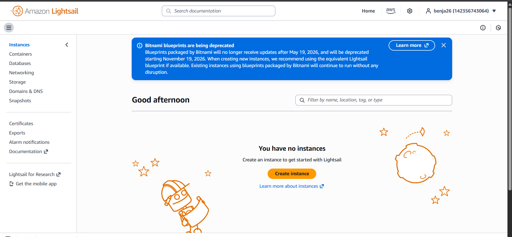
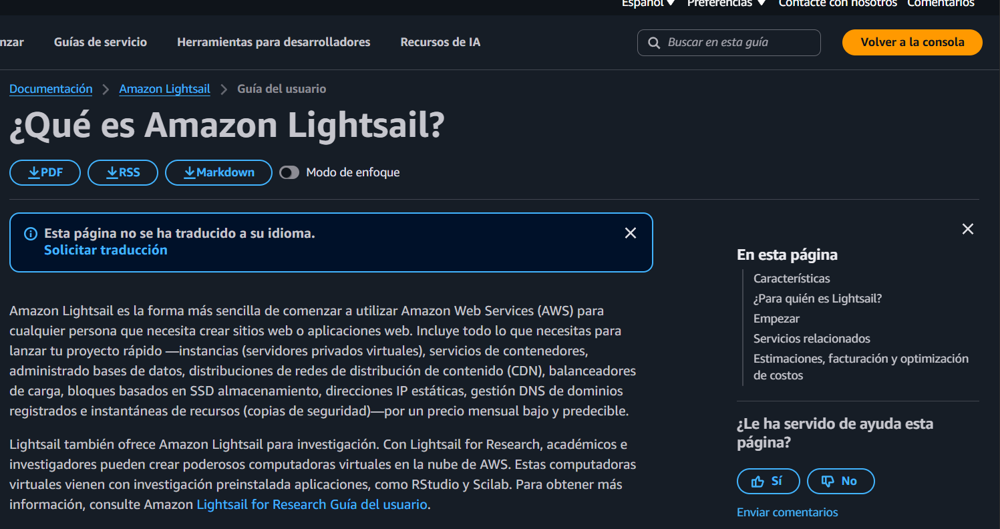

--

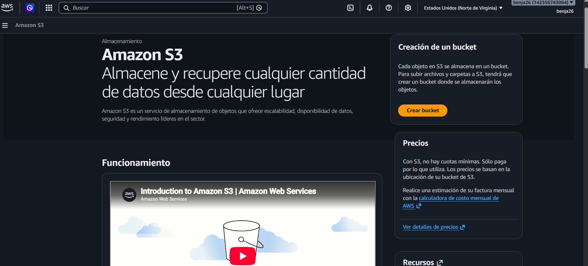
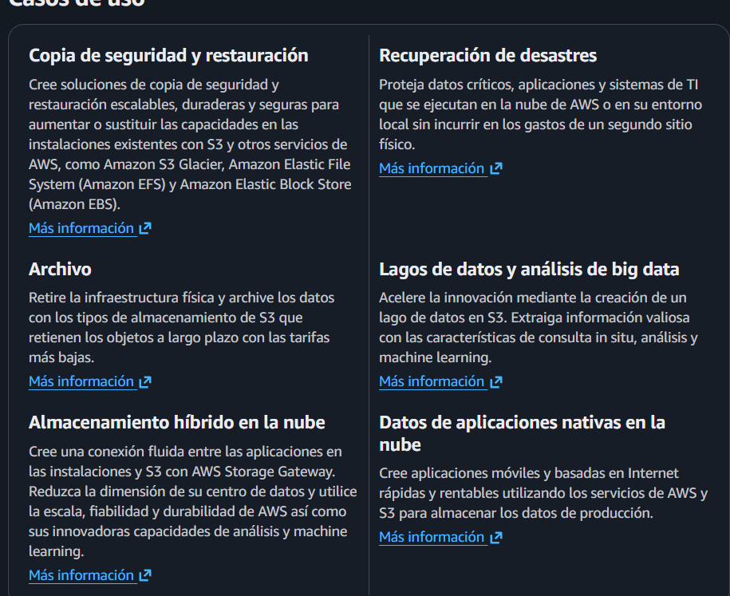

Lightsail es cómputo (procesa, ejecuta programas), mientras que S3 es almacenamiento (guarda datos).

#### Seguridad Inicial (IAM)

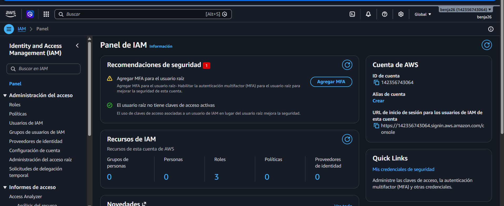

Al acceder al panel de IAM (Identity and Access Management) en la consola, se observa que este servicio tiene como propósito principal gestionar de forma segura el acceso a los recursos y servicios de AWS. Según lo que indica el panel, IAM permite:

- Crear y administrar usuarios, grupos y roles dentro de la cuenta, en lugar de que todas las personas usen las credenciales del Usuario Raíz.
- Asignar permisos específicos (políticas) a cada usuario o grupo, controlando exactamente a qué servicios y acciones puede acceder cada uno.
- Habilitar medidas adicionales de seguridad, como la autenticación multifactor (MFA), para reforzar el acceso a la cuenta.