# Laboratorio 2.1: Creación de una Imagen Docker para una Aplicación

## Ejercicio 3.1: Gestión de Imágenes y Contenedores

### 1. Verificación de la Instalación

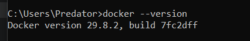

* `docker --version`: consulta la versión actual del motor de Docker instalado en la máquina, asegurando que el servicio se encuentra operativo.

### 2. Descarga de Imágenes (docker pull)

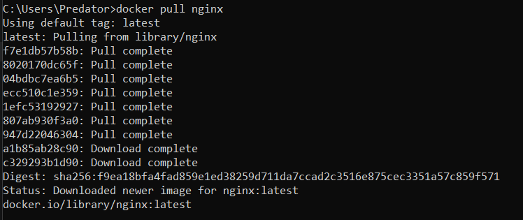

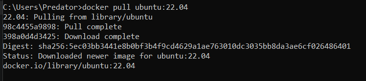

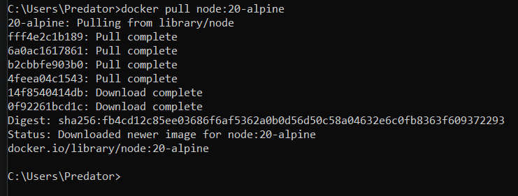

* `docker pull nginx`: descarga la etiqueta por defecto (`latest`) del servidor web Nginx.
* `docker pull ubuntu:22.04`: descarga una versión concreta del sistema operativo Ubuntu.
* `docker pull node:20-alpine`: descarga una imagen basada en Alpine Linux, optimizada y ligera, con la versión 20 de Node.js instalada.

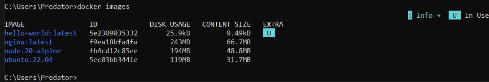

* `docker images`: muestra las imágenes descargadas localmente en la máquina.

### 3. Búsqueda de Imágenes (docker search)

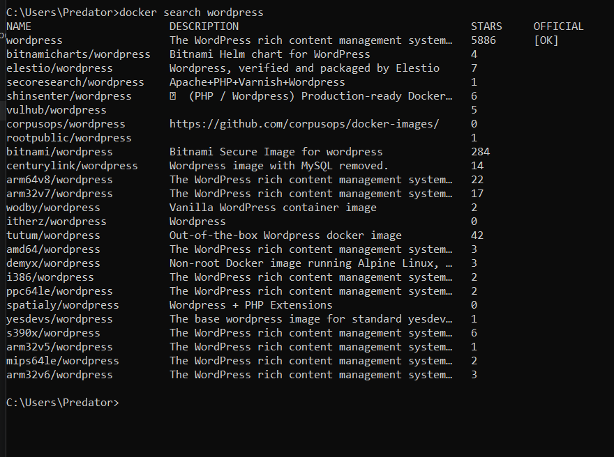

* `docker search <término-de-búsqueda>`: permite buscar imágenes disponibles en Docker Hub directamente desde la terminal, sin necesidad de abrir el navegador.

### 4. Ejecución de Contenedores (docker run)

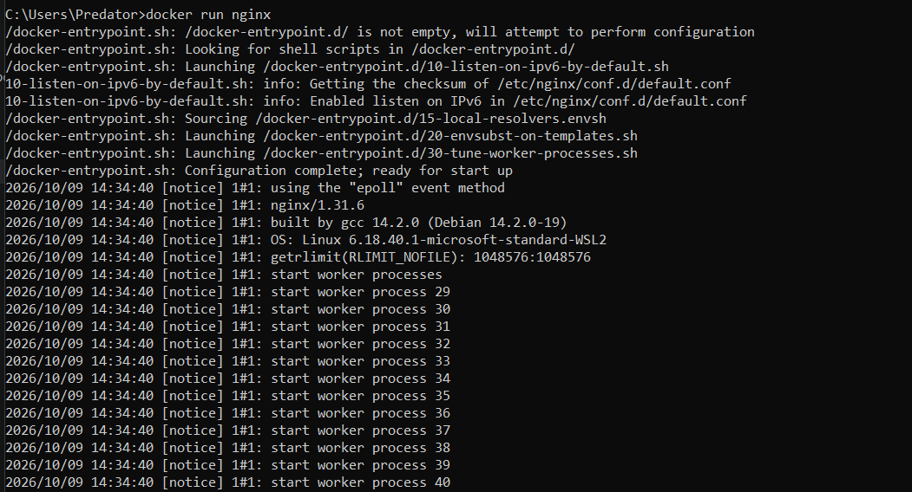

* `docker run <imagen>`: combina en un solo paso la creación de un contenedor a partir de una imagen y su ejecución.
* `docker run nginx`: descarga (si no existe localmente) la imagen de Nginx y ejecuta el contenedor en primer plano. La salida del servidor se muestra directamente en la terminal, y el contenedor se detiene al presionar `Ctrl+C`.

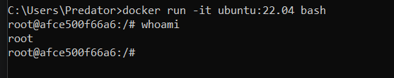

* `docker run -it ubuntu:22.04 bash`: crea un contenedor basado en Ubuntu 22.04 y abre una sesión de terminal interactiva dentro de él.
* `-i`: mantiene la entrada estándar abierta.
* `-t`: asigna una pseudo-terminal para interactuar con el shell.
* `bash`: comando ejecutado dentro del contenedor al iniciar.

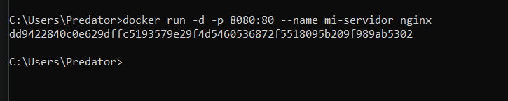

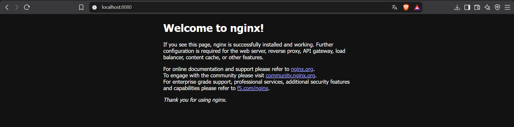

* `docker run -d -p 8080:80 --name mi-servidor nginx`: levanta un contenedor Nginx que queda corriendo en segundo plano y accesible desde el host.
* `-d`: ejecuta el contenedor en modo *detached* (segundo plano), liberando la terminal.
* `-p 8080:80`: mapea el puerto 8080 del host al puerto 80 del contenedor, permitiendo acceder al servicio desde `localhost:8080`.
* `--name mi-servidor`: asigna un nombre identificable al contenedor, facilitando su gestión posterior (en lugar de usar el ID generado automáticamente).

### 5. Gestión de Contenedores en ejecución (docker ps, docker stop, docker rm)

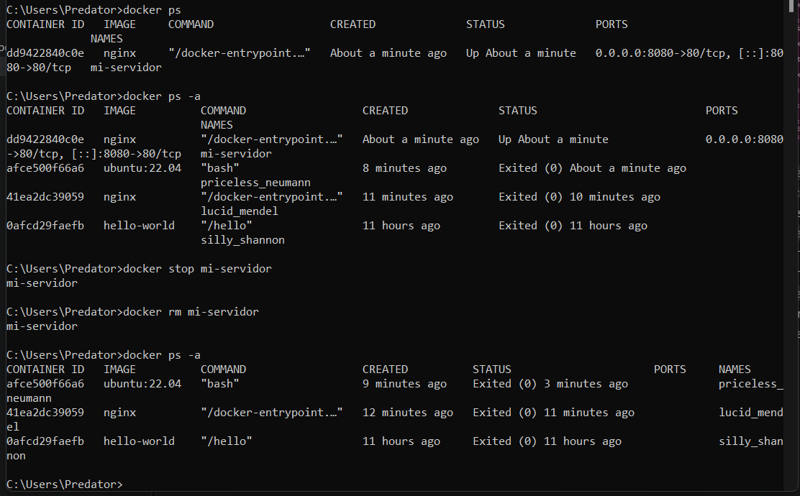

* `docker ps`: muestra únicamente los contenedores que están en ejecución en ese momento, junto con su ID, imagen, puertos expuestos y nombre.
* `docker ps -a`: amplía la consulta anterior e incluye también los contenedores detenidos, mostrando el historial completo de contenedores creados.
* `docker stop <ID o Nombre>`: detiene un contenedor en ejecución de forma controlada, enviando una señal de apagado que permite finalizar correctamente los procesos internos.
* `docker rm <ID o Nombre>`: elimina un contenedor específico del sistema; debe estar detenido previamente.
* `docker rm $(docker ps -a -q)`: elimina todos los contenedores detenidos en una sola operación. La subexpresión `docker ps -a -q` obtiene los ID de todos los contenedores (`-q`, modo *quiet*), que luego se pasan como argumento a `docker rm`.
* `docker container prune`: elimina automáticamente todos los contenedores detenidos, sin necesidad de especificar ID manualmente, solicitando confirmación antes de ejecutar la acción.

### 6. Visualización de Logs (docker logs)

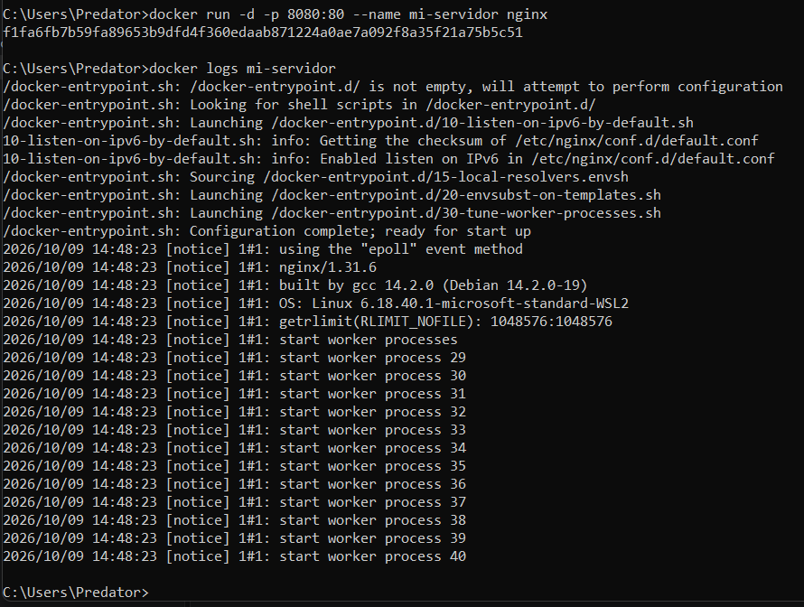

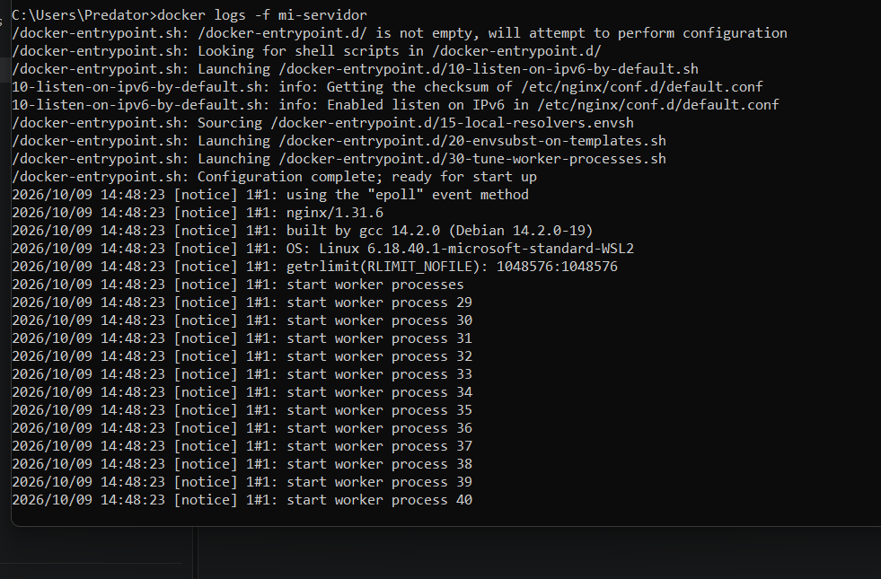

* `docker logs <ID o Nombre>`: muestra el historial completo de logs generados por el contenedor desde su inicio.
* `docker logs -f <ID o Nombre>`: muestra los logs en tiempo real. La opción `-f` (*follow*) mantiene la conexión abierta y va mostrando nuevas líneas a medida que se generan.

## Ejercicio 3.2: Creación de Imágenes con Dockerfile

### 1. Ejemplo Básico: Una imagen de bienvenida

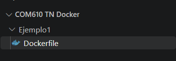

* `Ejemplo1`: crea una carpeta nueva para organizar los archivos del ejercicio.
* `cd Ejemplo1`: ingresa a la carpeta recién creada.

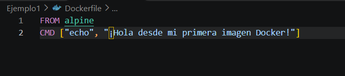

* `Dockerfile`: abre el editor de texto nano y crea un archivo llamado exactamente `Dockerfile`, sin extensión.
* `FROM alpine`: define la imagen base, en este caso una distribución Linux muy ligera.
* `CMD ["echo", "¡Hola desde mi primera imagen Docker!"]`: indica el comando que se ejecuta al iniciar el contenedor.

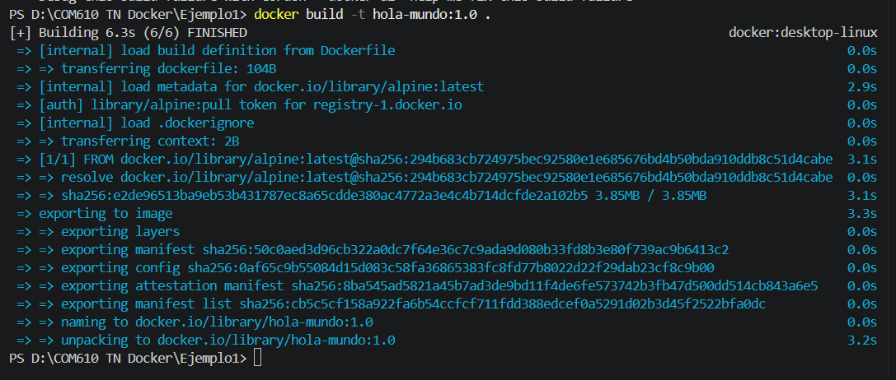

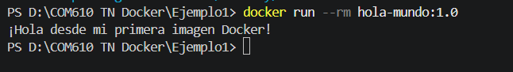

* `docker build -t hola-mundo:1.0 .`: construye la imagen a partir del Dockerfile, asignándole el nombre `hola-mundo` y la etiqueta `1.0`. El punto final indica que el contexto de construcción es la carpeta actual.
* `docker run --rm hola-mundo:1.0`: ejecuta el contenedor a partir de la imagen creada. La opción `--rm` elimina el contenedor automáticamente al finalizar su ejecución.

### 2. Ejemplo para una Aplicación Web Simple

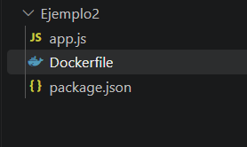

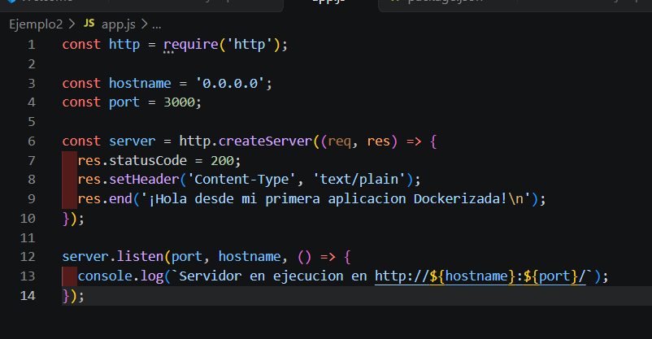

**app.js** — servidor web básico que responde en el puerto 3000

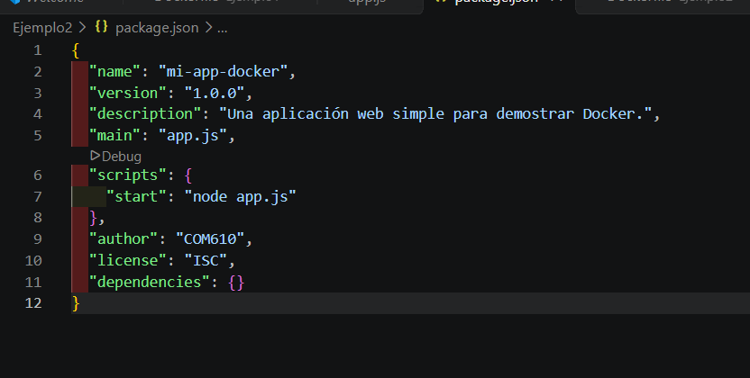

**package.json** — define la información del proyecto y sus dependencias; la parte más importante es el script `start`, usado para iniciar la aplicación

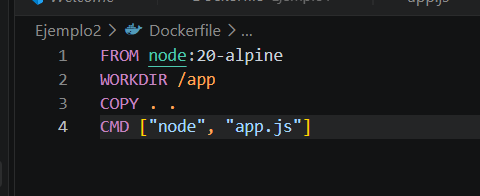

* `FROM node:20-alpine`: define la imagen base, una versión ligera de Node.js 20.
* `WORKDIR /app`: establece `/app` como directorio de trabajo dentro del contenedor.
* `COPY . .`: copia todos los archivos de la aplicación al directorio de trabajo del contenedor.
* `CMD ["node", "app.js"]`: ejecuta el script principal al iniciar el contenedor.

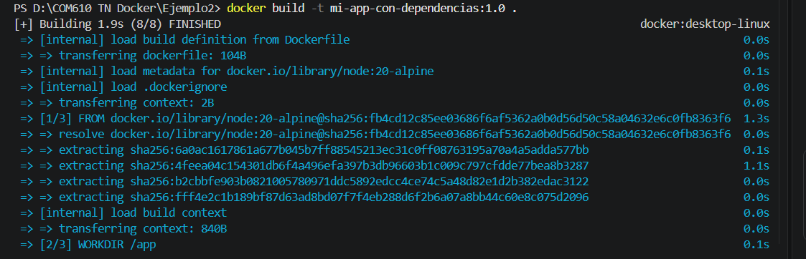

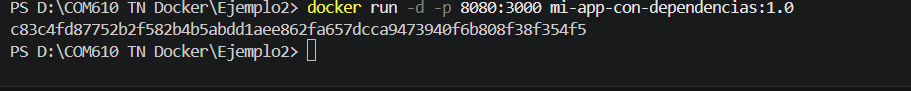

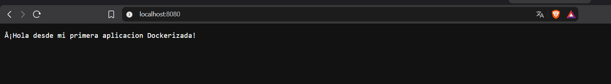

* `docker build -t mi-app-web:1.0 .`: construye la imagen a partir del Dockerfile, asignándole el nombre `mi-app-web` y la etiqueta `1.0`.
* `docker run -d -p 8080:3000 --name mi-web-app mi-app-web:1.0`: ejecuta el contenedor en segundo plano.
* `-p 8080:3000`: mapea el puerto de la aplicación (3000) a un puerto local (8080), accesible desde `http://localhost:8080`.
* `--name mi-web-app`: asigna un nombre identificable al contenedor.

### 3. Ejemplo con Gestión de Dependencias

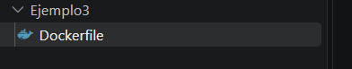

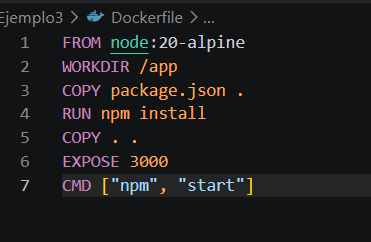

* `FROM node:20-alpine`: define la imagen base, una versión ligera de Node.js 20.
* `WORKDIR /app`: establece `/app` como directorio de trabajo dentro del contenedor.
* `COPY package.json .`: copia únicamente el archivo `package.json` antes que el resto del código.
* `RUN npm install`: instala las dependencias del proyecto. Al ejecutarse en un paso separado, Docker puede reutilizar esta capa en construcciones futuras mientras `package.json` no cambie.
* `COPY . .`: copia el resto de los archivos de la aplicación al contenedor.
* `EXPOSE 3000`: documenta que el contenedor escucha en el puerto 3000.
* `CMD ["npm", "start"]`: ejecuta el script `start` definido en `package.json` al iniciar el contenedor.

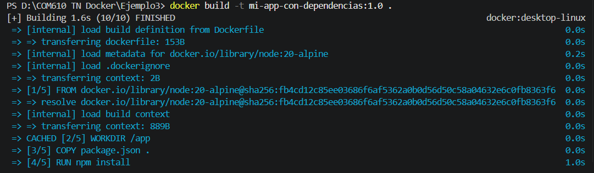

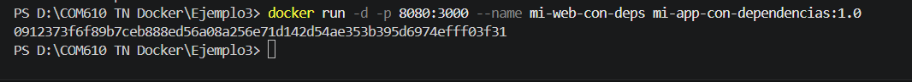

* `docker build -t mi-app-con-dependencias:1.0 .`: construye la imagen a partir del Dockerfile, asignándole el nombre `mi-app-con-dependencias` y la etiqueta `1.0`.

* `docker run -d -p 8080:3000 --name mi-web-con-deps mi-app-con-dependencias:1.0`: ejecuta el contenedor en segundo plano, mapeando el puerto 3000 de la aplicación al puerto 8080 del host y asignándole el nombre `mi-web-con-deps`.

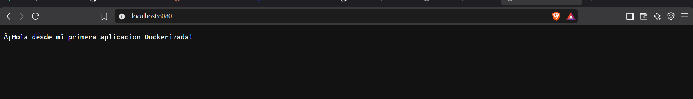

### 4. Ejemplo con Múltiples Fases (Multi-stage Build)

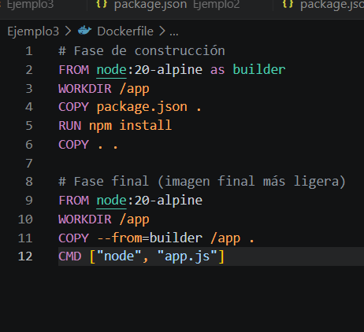

* `FROM node:20-alpine as builder`: inicia la primera fase, llamada `builder`, usada solo para preparar la aplicación.
* `WORKDIR /app`: establece `/app` como directorio de trabajo dentro de esta fase.
* `COPY package.json .`: copia el archivo de dependencias.
* `RUN npm install`: instala las dependencias del proyecto.
* `COPY . .`: copia el resto de los archivos de la aplicación.
* `FROM node:20-alpine`: inicia la segunda fase, que forma la imagen final.
* `WORKDIR /app`: define el directorio de trabajo en la imagen final.
* `COPY --from=builder /app .`: copia únicamente los archivos ya preparados desde la fase `builder`, descartando herramientas de construcción innecesarias.
* `CMD ["node", "app.js"]`: ejecuta el script principal al iniciar el contenedor.

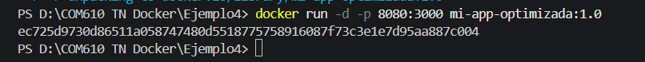

* `docker build -t mi-app-optimizada:1.0 .`: construye la imagen final optimizada a partir del Dockerfile, asignándole el nombre `mi-app-optimizada` y la etiqueta `1.0`.
* `docker run -d -p 8080:3000 mi-app-optimizada:1.0`: ejecuta el contenedor en segundo plano, mapeando el puerto 3000 de la aplicación al puerto 8080 del host.

### 5. Ejemplo para una Aplicación de Python

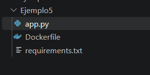

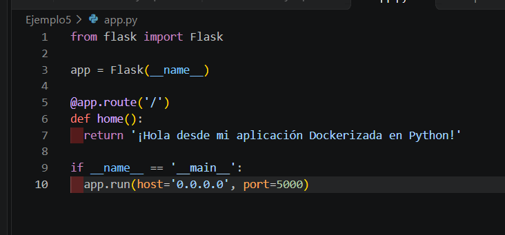

**app.py** — utiliza el framework Flask para crear una API simple que responde a una solicitud GET

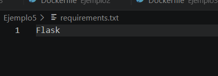

**requirements.txt** — lista las dependencias del proyecto; en este caso, únicamente Flask

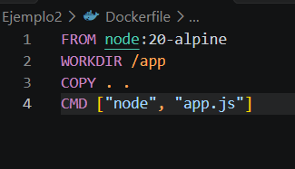

* `FROM python:3.9-alpine`: define la imagen base, una versión ligera de Python 3.9.
* `WORKDIR /app`: establece `/app` como directorio de trabajo dentro del contenedor.
* `COPY requirements.txt .`: copia el archivo de dependencias al contenedor.
* `RUN pip install -r requirements.txt`: instala las dependencias listadas en `requirements.txt`.
* `COPY . .`: copia el resto de los archivos de la aplicación.
* `CMD ["python", "app.py"]`: ejecuta el script principal al iniciar el contenedor.

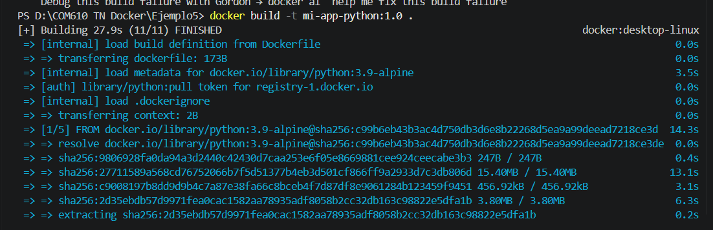

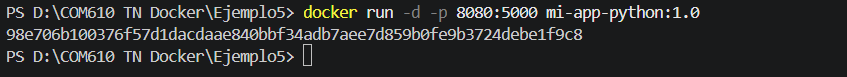

* `docker build -t mi-app-python:1.0 .`: construye la imagen a partir del Dockerfile, asignándole el nombre `mi-app-python` y la etiqueta `1.0`.
* `docker run -d -p 8080:5000 mi-app-python:1.0`: ejecuta el contenedor en segundo plano, mapeando el puerto 5000 de la aplicación al puerto 8080 del host.

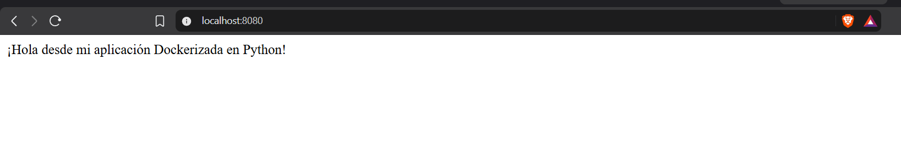

## 4. Práctica Individual
API REST con operaciones CRUD (Crear, Leer, Actualizar, Borrar) construida con Python y Flask, empaquetada en un contenedor Docker.

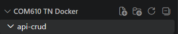

* `mkdir api-crud`: crea una carpeta nueva para el proyecto.
* `cd api-crud`: ingresa a la carpeta recién creada.

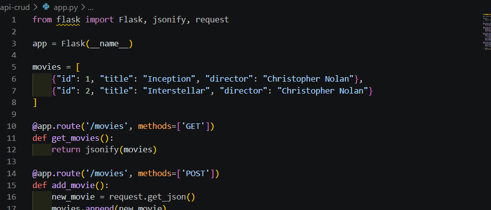

**app.py** — contiene la lógica de la API para administrar una lista de películas en memoria con sus respectivos endpoints

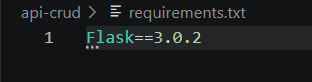

* `requirements.txt`: crea el archivo que lista las dependencias del proyecto; en este caso, únicamente Flask.

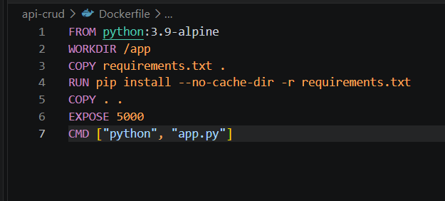

* `FROM python:3.9-alpine`: define la imagen base, una versión ligera de Python 3.9.
* `WORKDIR /app`: establece `/app` como directorio de trabajo dentro del contenedor.
* `COPY requirements.txt .`: copia el archivo de dependencias antes que el resto del código, aprovechando el cacheo de capas.
* `RUN pip install --no-cache-dir -r requirements.txt`: instala las dependencias sin guardar archivos temporales de la instalación, reduciendo el tamaño de la imagen.
* `COPY . .`: copia el resto de los archivos de la aplicación.
* `EXPOSE 5000`: documenta que el contenedor escucha en el puerto 5000.
* `CMD ["python", "app.py"]`: ejecuta el script principal al iniciar el contenedor.

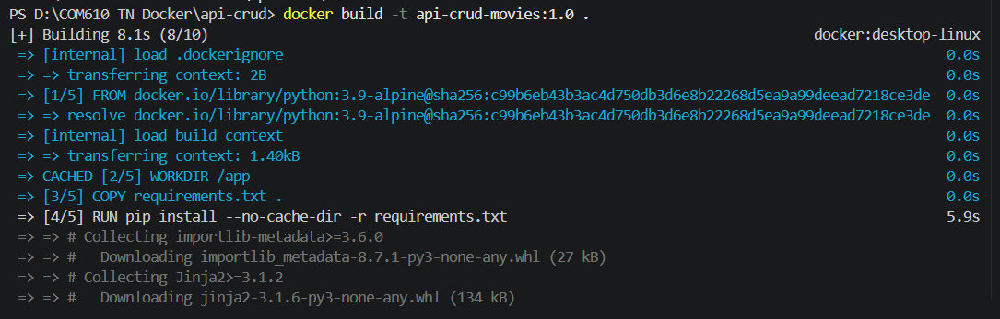

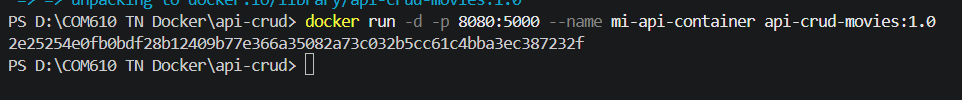

* `docker build -t api-crud-movies:1.0 .`: construye la imagen a partir del Dockerfile, asignándole el nombre `api-crud-movies` y la etiqueta `1.0`.

* `docker run -d -p 8080:5000 --name mi-api-container api-crud-movies:1.0`: ejecuta el contenedor en segundo plano, mapeando el puerto 5000 de la API al puerto 8080 del host, con el nombre `mi-api-container`.

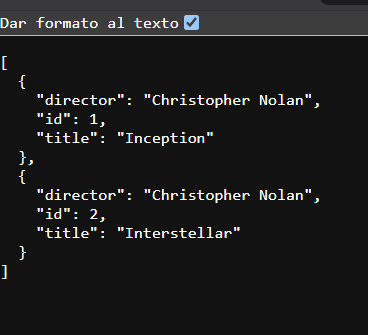

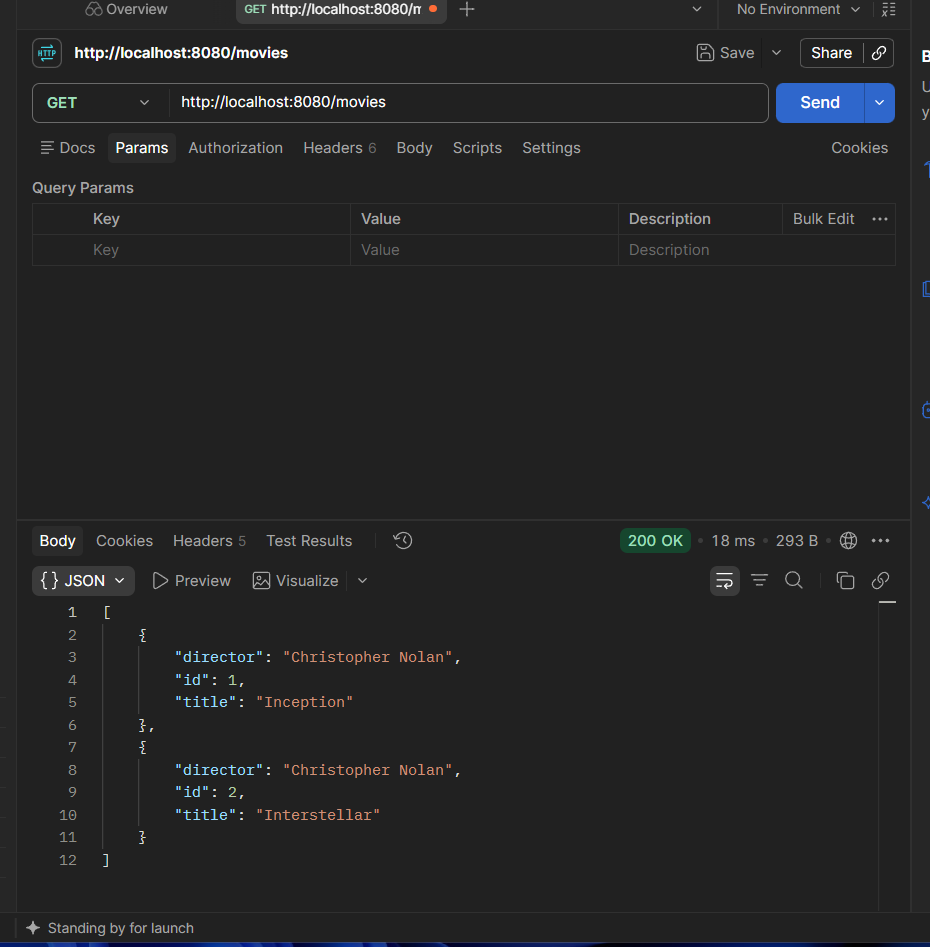

**GET (Listar todas las películas)**

* Método: `GET`
* URL: `http://localhost:8080/movies`
* Body/Headers: no requiere configuración adicional.
* Acción: enviar la petición (`Send`). Devuelve la lista de películas en formato JSON.

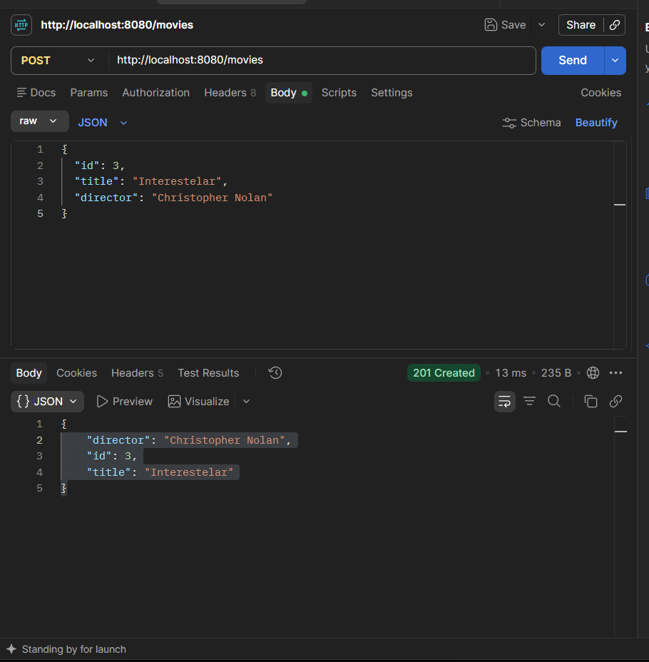

**POST (Crear una nueva película)**

* Método: `POST`
* URL: `http://localhost:8080/movies`
* Body: seleccionar `raw` y cambiar el tipo a `JSON`.

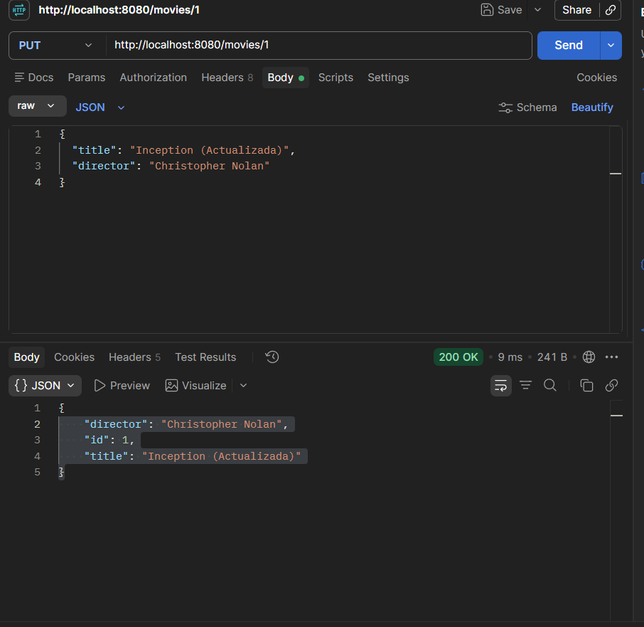

**PUT (Actualizar una película existente)**

* Método: `PUT`
* URL: `http://localhost:8080/movies/1`
* Body: seleccionar `raw` y tipo `JSON`.

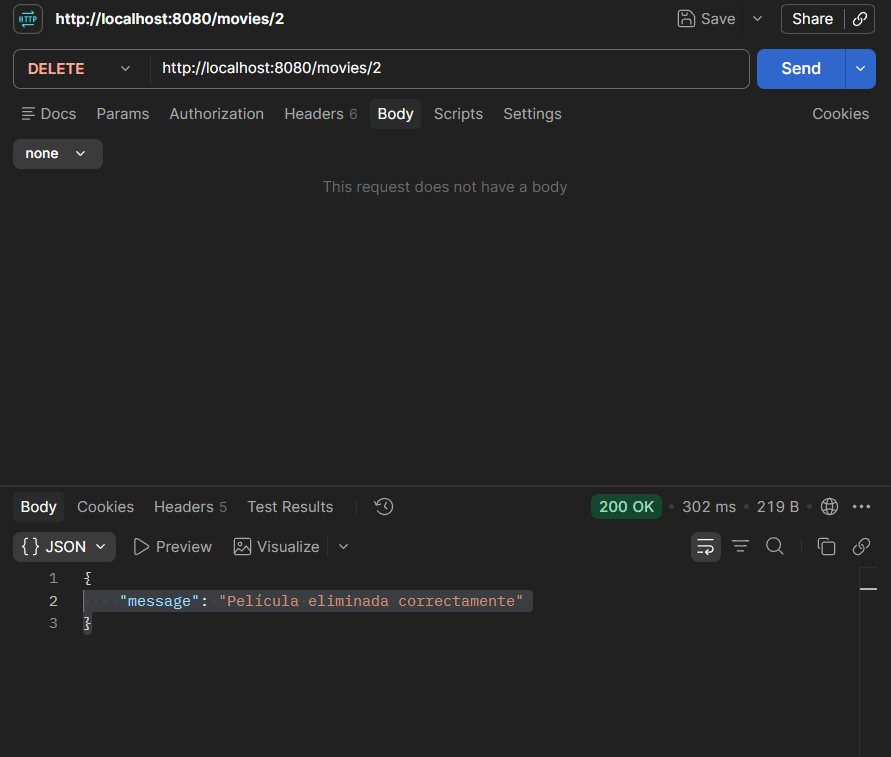

**DELETE (Borrar una película)**

* Método: `DELETE`
* URL: `http://localhost:8080/movies/2`
* Body/Headers: no requiere contenido adicional.
* Acción: enviar la petición. Devuelve un mensaje confirmando la eliminación de la película con ID 2.

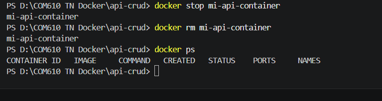

Limpieza de contenedores usados