# Laboratorio 2.2: Gestión de Contenedores y Volúmenes Locales

## Ejercicio 3.1: Volúmenes para la Persistencia de Datos

### 1. Creación y Verificación de un Volumen:

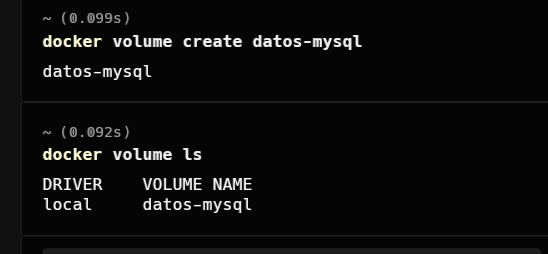

* `docker volume create datos-mysql`: crea un volumen gestionado por Docker en el sistema de archivos del host.

* `docker volume ls`: muestra una lista de todos los volúmenes existentes para verificar su correcta creación.

### Uso de un Volumen en un Contenedor:

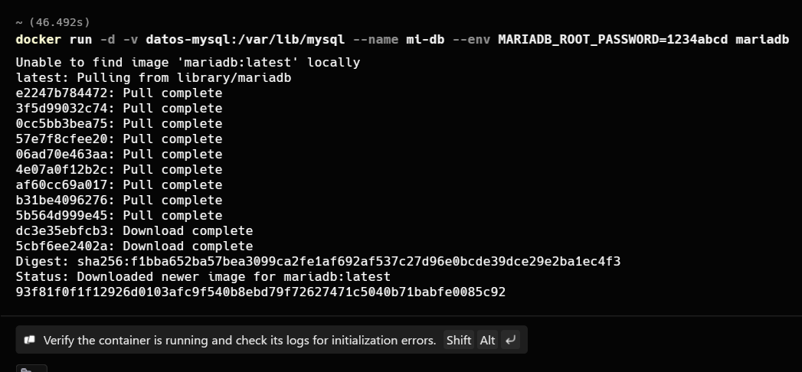

* `docker run -d -v datos-mysql:/var/lib/mysql --name mi-db --env MARIADB_ROOT_PASSWORD=1234abcd mariadb`: inicia un contenedor de MariaDB en segundo plano y monta el volumen `datos-mysql` en la ruta interna `/var/lib/mysql`, asegurando la persistencia de los datos.

    * `docker run`: Es el comando principal para crear y ejecutar un nuevo contenedor a partir de una imagen.

    * `-d (Detached)`: Ejecuta el contenedor en segundo plano (modo desvinculado). Esto libera la terminal para que puedas seguir escribiendo otros comandos sin que se quede bloqueada mostrando los registros del servidor.

    * `-v datos-mysql:/var/lib/mysql (Volume)`: Monta un volumen de Docker. Conecta el volumen llamado datos-mysql (creado previamente) con la ruta interna del contenedor /var/lib/mysql, que es donde MariaDB guarda por defecto toda su información. Esto permite que los datos persistan aunque se elimine el contenedor.

    * `--name mi-db`: Asigna un nombre personalizado y fácil de recordar al contenedor (mi-db), en lugar de dejar que Docker le genere un identificador aleatorio.

    * `--env MARIADB_ROOT_PASSWORD=1234abcd (Variables de entorno)`: Configura variables de entorno dentro del contenedor. En este caso, establece la contraseña de la cuenta root de MariaDB con el valor 1234abcd, un requisito obligatorio de la imagen oficial para poder iniciar el servicio.

    * `mariadb`: Es la imagen oficial de MariaDB que se descargará y utilizará como base para levantar este contenedor.

### 3. Verificación de la Persistencia:

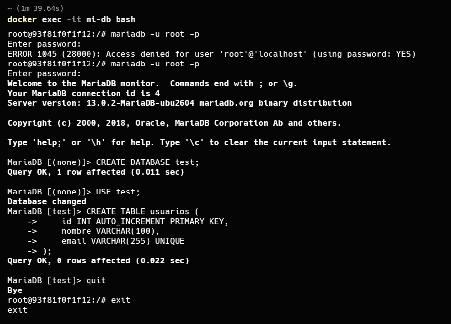

* `docker exec -it mi-db bash`: abre una sesión interactiva de terminal dentro del contenedor en ejecución.

    * `-it`: combina dos opciones. -i (interactive) mantiene abierta la entrada estándar para interactuar, y -t (tty) asigna una pseudo-terminal o consola de comandos.

    * `mi-db`: especifica el nombre del contenedor de destino en el que se desea ingresar.

    * `bash`: indica el intérprete de comandos que se abrirá dentro del contenedor para interactuar con su sistema operativo interno.


* `mariadb -u root -p`: accede al cliente de línea de comandos de MariaDB utilizando la contraseña configurada para realizar operaciones en la base de datos.

    * `-u root`: especifica el nombre de usuario con el que se desea iniciar sesión (en este caso, el administrador root).

    * `-p`: solicita que el sistema pida una contraseña antes de conceder el acceso.

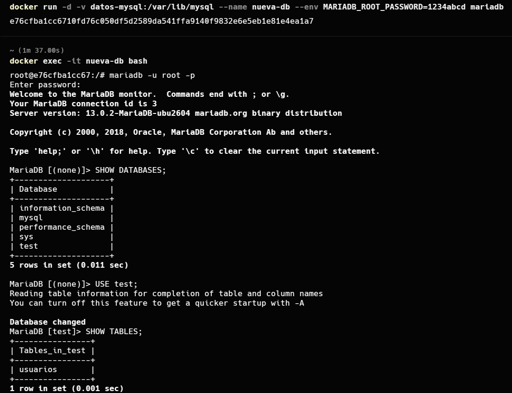

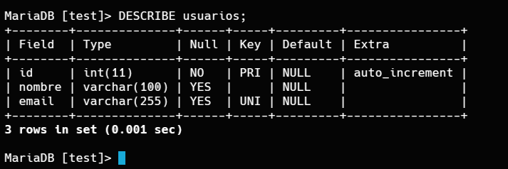

* `docker run -d -v datos-mysql:/var/lib/mysql --name nueva-db --env MARIADB_ROOT_PASSWORD=1234abcd mariadb`: inicia un nuevo contenedor de MariaDB reutilizando el volumen existente (`datos-mysql`), lo que permite que el servicio reconecte con los datos guardados previamente.

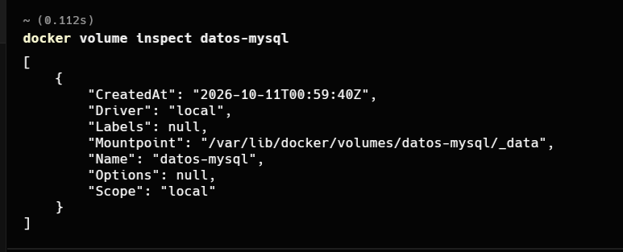

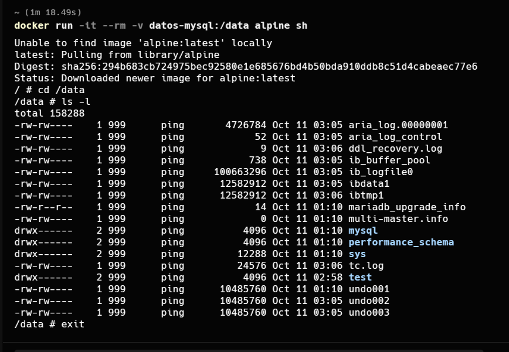

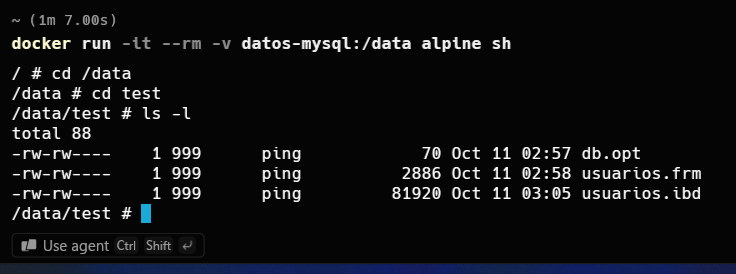

* `docker volume inspect datos-mysql`: muestra los detalles técnicos del volumen, incluyendo el punto de montaje (`Mountpoint`) con su ruta exacta en el sistema de archivos del host.
* `docker run -it --rm -v datos-mysql:/data alpine sh`: inicia un contenedor temporal basado en la imagen ligera Alpine, montando el volumen en el directorio `/data` y abriendo una sesión de terminal (*shell*) para explorar físicamente los archivos guardados.

## Ejercicio 3.2: Volúmenes para Persistencia y Hot Reload

### 1. Montaje de Volúmenes para "Hot Reload" en Desarrollo:


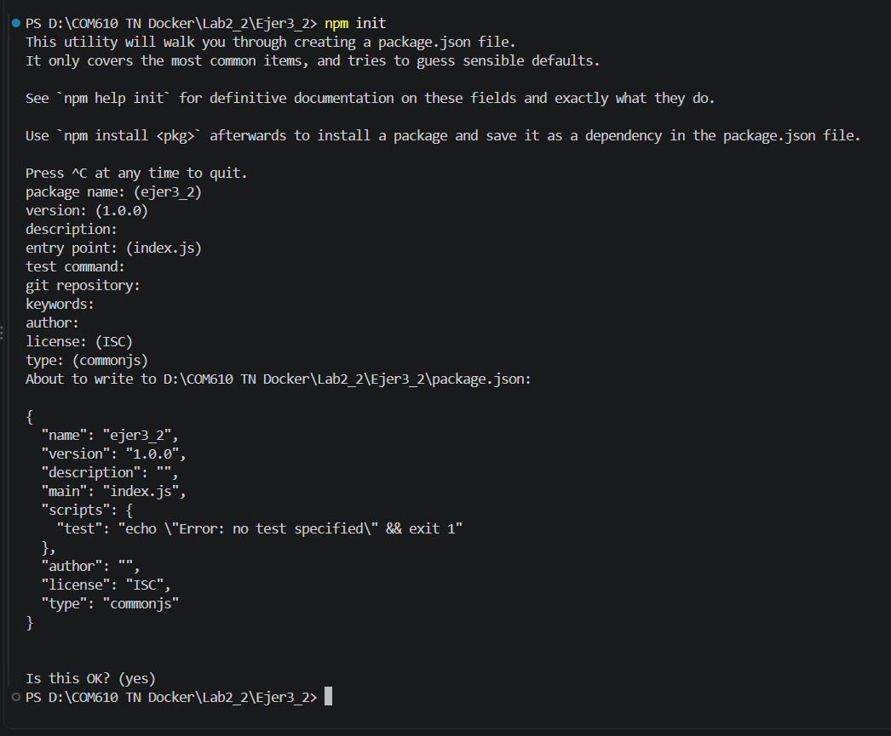

* `npm init`: inicializa un nuevo proyecto de Node.js creando el archivo de configuración `package.json` para gestionar metadatos y dependencias.

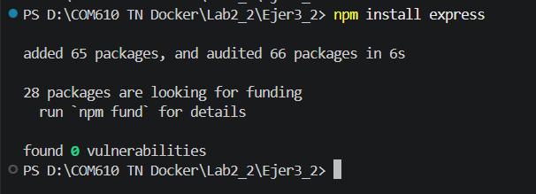

* `npm install express`: descarga e instala el framework minimalista **Express**, añadiéndolo a las dependencias principales del proyecto.

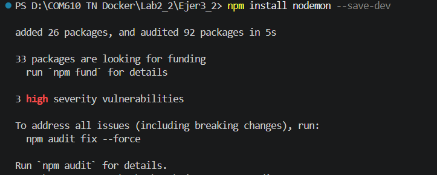

* `npm install nodemon --save-dev`: descarga e instala **Nodemon** como dependencia de desarrollo (`--save-dev`), herramienta encargada de reiniciar automáticamente el servidor al detectar cambios en el código.

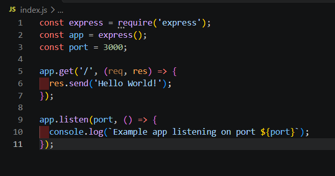

* Creación y configuración de `index.js`: define el servidor web básico utilizando el framework Express, configurando una ruta raíz (`/`) que responde con "Hello World!" y un listener en el puerto 3000.

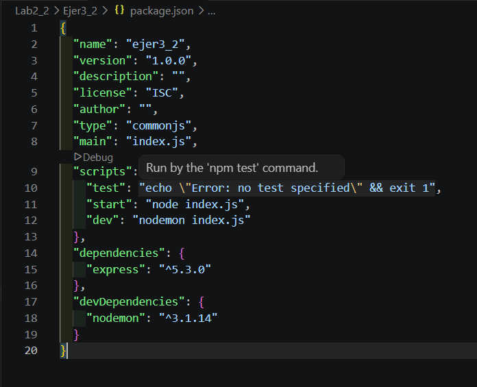

* Actualización de `package.json` (`scripts`): añade los comandos de automatización `"start"` (para producción usando Node) y `"dev"` (para desarrollo en vivo usando Nodemon).

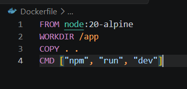

* Creación del `Dockerfile`: define la imagen base ligera (`node:20-alpine`), establece el directorio de trabajo en `/app`, copia el código fuente y configura el comando de inicio predeterminado (`npm run dev`).

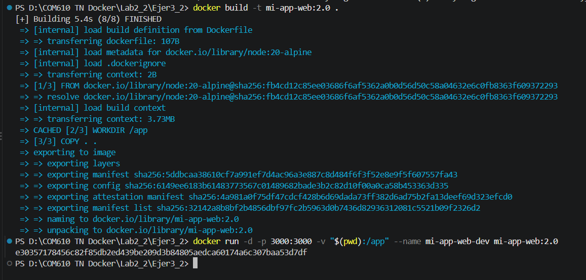

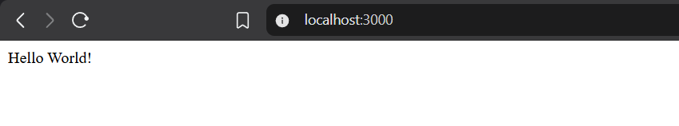

- `docker build -t mi-app-web:2.0 .`: construye una nueva imagen Docker a partir del `Dockerfile` ubicado en el directorio actual (`.`), asignándole la etiqueta (`-t`) `mi-app-web:2.0`.
- `docker run -d -p 3000:3000 -v "$(pwd):/app" --name mi-app-web-dev mi-app-web:2.0`: ejecuta un contenedor en segundo plano (`-d`) con el nombre `mi-app-web-dev`, mapeando el puerto 3000 del host al puerto 3000 del contenedor (`-p`).
  - `-v "$(pwd):/app"`: implementa un **montaje de enlace (*bind mount*)**, una técnica avanzada que vincula el directorio actual de tu máquina host (`$(pwd)` de PowerShell) directamente con la carpeta `/app` dentro del contenedor. Esto permite que cualquier modificación en el código fuente de tu computadora se refleje instantáneamente en el entorno de ejecución sin necesidad de reconstruir la imagen.

### 2. Pruebas de Hot Reload:

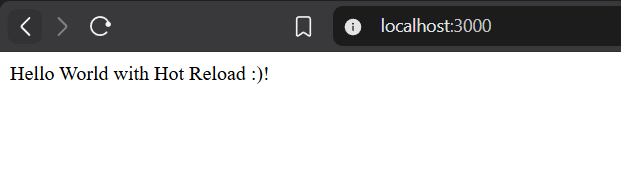

- **Verificación inicial**: Se accede a `http://localhost:3000` a través del navegador web para confirmar que la aplicación Express responde de manera correcta con el mensaje inicial de bienvenida.
- **Implementación del contenedor con sincronización en vivo**: Para garantizar que el entorno de desarrollo en Windows detecte los cambios del sistema de archivos local dentro del contenedor, se ejecuta el siguiente comando optimizado:

  ```powershell
  docker run -d -p 3000:3000 -v "${PWD}:/app" -e CHOKIDAR_USEPOLLING=true --name mi-app-web-dev mi-app-web:2.0
  ```
 - `-e CHOKIDAR_USEPOLLING=true`: Define una variable de entorno dentro del contenedor que habilita el modo de sondeo (polling) para la librería Chokidar (utilizada internamente por Nodemon). Esto es fundamental en sistemas operativos Windows con Docker Desktop / WSL2, ya que los eventos nativos del sistema de archivos a veces no se transmiten correctamente a través de los volúmenes montados; el sondeo obliga a revisar activamente las modificaciones en los ficheros.

 - `${PWD}`: Sintaxis nativa de PowerShell que representa la ruta absoluta del directorio actual de trabajo, asegurando un mapeo de volumen preciso hacia el contenedor sin errores de interpretación de variables.

 ## Ejercicio 3.3: Redes para la Comunicación entre Contenedores

 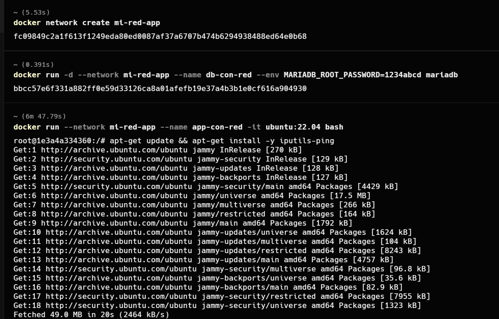

 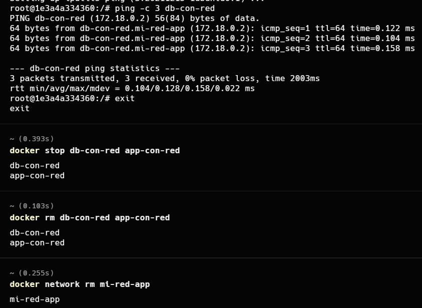

 ```powershell
  docker network create mi-red-app
 ``` 

  Este comando crea una red virtual aislada basada en el controlador bridge. A diferencia de la red por defecto de Docker, una red personalizada habilitada por el usuario permite activar la resolución DNS interna, lo que significa que los contenedores conectados a ella pueden encontrarse y comunicarse directamente utilizando sus nombres en lugar de depender de direcciones IP dinámicas.

 ```powershell
docker run -d --network mi-red-app --name db-con-red --env MARIADB_ROOT_PASSWORD=1234abcd mariadb


docker run --network mi-red-app --name app-con-red -it ubuntu:22.04 bash
 ``` 

- `--network mi-red-app`: Conecta instantáneamente el contenedor a la red virtual recién creada al momento de su inicialización.

- `--env MARIADB_ROOT_PASSWORD=1234abcd`: Configura variables de entorno internas (en este caso, la contraseña de administrador para la base de datos MariaDB).

- `-it ubuntu:22.04 bash`: Lanza un contenedor interactivo basado en Ubuntu, abriendo una terminal de comandos (bash) para pruebas manuales en tiempo real.

 ```powershell
apt-get update && apt-get install -y iputils-ping

ping -c 3 db-con-red
 ``` 

Primero se actualizan los repositorios e instala la utilidad de red iputils-ping, ya que las imágenes base como Ubuntu vienen minimizadas sin herramientas de diagnóstico.

Al ejecutar ping -c 3 db-con-red, el contenedor cliente envía paquetes de eco ICMP al contenedor de la base de datos usando únicamente su nombre de servicio (db-con-red).

Resultado: Se obtiene una respuesta exitosa con tiempos de respuesta en milisegundos y cero pérdida de paquetes, comprobando de forma concluyente que la resolución de nombres por DNS interno de Docker funciona correctamente dentro de la red aislada.

## Ejercicio 3.4: Redes y Balanceo de Carga con Nginx

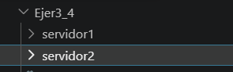

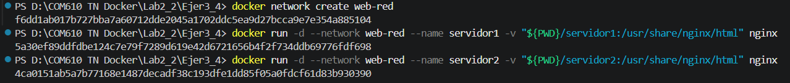

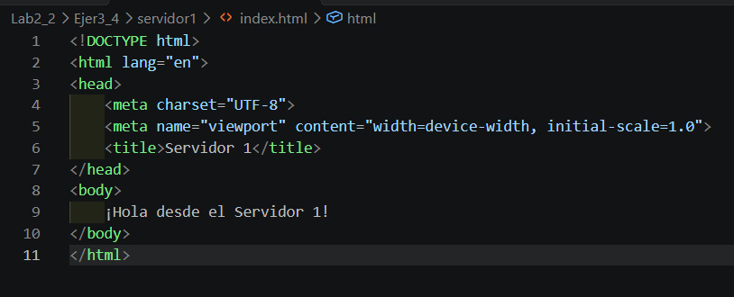

```powershell
  docker network create web-red
```

Se establece una red puente (bridge) exclusiva para este ejercicio. Esto permite que los tres contenedores (los dos servidores web y el balanceador) se reconozcan mediante resolución de nombres interna por DNS de Docker.

```powershell
docker run -d --network web-red --name servidor1 -v "${PWD}/servidor1:/usr/share/nginx/html" nginx

docker run -d --network web-red --name servidor2 -v "${PWD}/servidor2:/usr/share/nginx/html" nginx
```

- `-v "${PWD}/servidor1:/usr/share/nginx/html"`: Utiliza un montaje de enlace (bind mount) combinando la ruta absoluta de PowerShell (${PWD}) para mapear el contenido HTML estático local directamente en la ruta raíz donde Nginx sirve los sitios web dentro de cada contenedor (/usr/share/nginx/html).

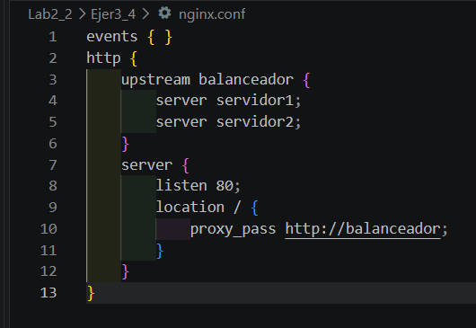

El bloque upstream balanceador agrupa los servidores de backend utilizando sus nombres de contenedores (servidor1 y servidor2). Por defecto, Nginx aplica un algoritmo de distribución de tráfico equitativo (Round-Robin).

El bloque server escucha en el puerto interno 80 y utiliza proxy_pass para reenviar las solicitudes hacia el grupo definido en el upstream.

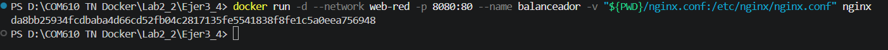

-p 8080:80: Realiza un mapeo de puertos de la máquina host (8080) al puerto del contenedor del balanceador (80), permitiendo el acceso externo desde el navegador web de la computadora física.

-v "${PWD}/nginx.conf:/etc/nginx/nginx.conf": Sobrescribe la configuración por defecto de Nginx dentro del contenedor montando nuestro archivo de configuración personalizado alojado en el host.

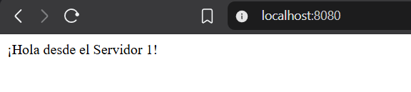

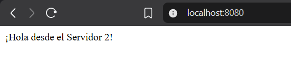

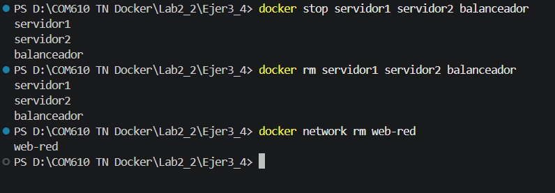

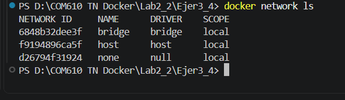

## 4. Práctica Individual

#### 1. Gestión de Infraestructura de Red y Almacenamiento
- **Comandos ejecutados:**

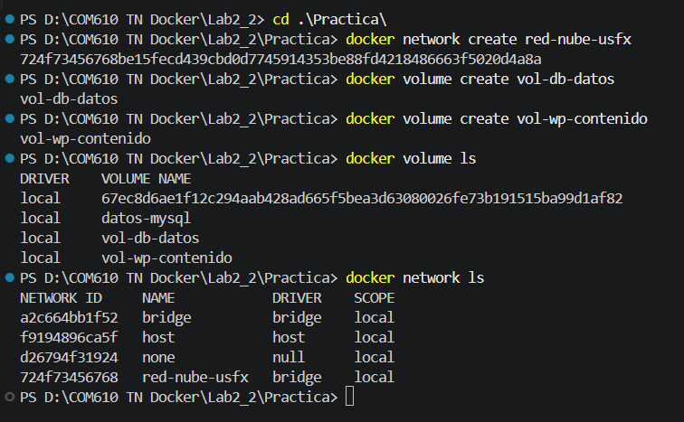

Se crea la red personalizada red-nube-usfx para interconectar de forma privada y segura los contenedores de base de datos y aplicación mediante resolución DNS interna.

Se establecen dos volúmenes independientes (vol-db-datos para el almacenamiento estructurado de MariaDB y vol-wp-contenido para los archivos multimedia, temas y plugins de WordPress), asegurando que los datos perduren aun si los contenedores son destruidos.

### 2. Seguridad y Variables de Entorno (blog.env)

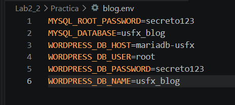

Se crea un archivo de configuración restringido llamado blog.env en la raíz del proyecto para evitar exponer contraseñas en texto plano por la línea de comandos


### 3. Despliegue del Nodo de Datos (MariaDB)

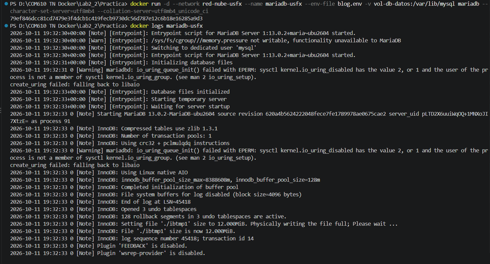


```powershell
docker run -d --network red-nube-usfx --name mariadb-usfx --env-file blog.env -v vol-db-datos:/var/lib/mysql mariadb --character-set-server=utf8mb4 --collation-server=utf8mb4_unicode_ci
```

--env-file blog.env: Inyecta las variables de entorno de forma segura desde el archivo de configuración.

-v vol-db-datos:/var/lib/mysql: Monta el volumen persistente en la ruta interna donde MariaDB almacena sus bases de datos.

--character-set-server=utf8mb4: Configura explícitamente el conjunto de caracteres a UTF-8 de 4 bytes para garantizar la compatibilidad total con emojis y caracteres especiales institucionales.

### 4. Despliegue del Nodo de Aplicación (WordPress y Ajustes de Rendimiento)

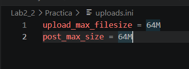

Configuración local previa (uploads.ini): Se genera un archivo de configuración de PHP para incrementar el límite de carga de archivos multimedia

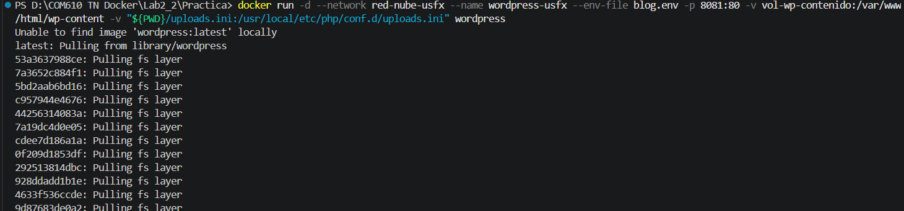

```powershell
docker run -d --network red-nube-usfx --name wordpress-usfx --env-file blog.env -p 8081:80 -v vol-wp-contenido:/var/www/html/wp-content -v "${PWD}/uploads.ini:/usr/local/etc/php/conf.d/uploads.ini" wordpress
```

-v vol-wp-contenido:/var/www/html/wp-content: Aisla y persiste todo el contenido dinámico y multimedia del CMS.

-v "${PWD}/uploads.ini:/usr/local/etc/php/conf.d/uploads.ini": Realiza un bind mount de la configuración de PHP sobreescrita para elevar el límite de subida a 64MB.

-p 8081:80: Expone el servicio web hacia el puerto 8081 de la máquina anfitriona.

### 5. Prueba de Resiliencia y Auditoría de Persistencia

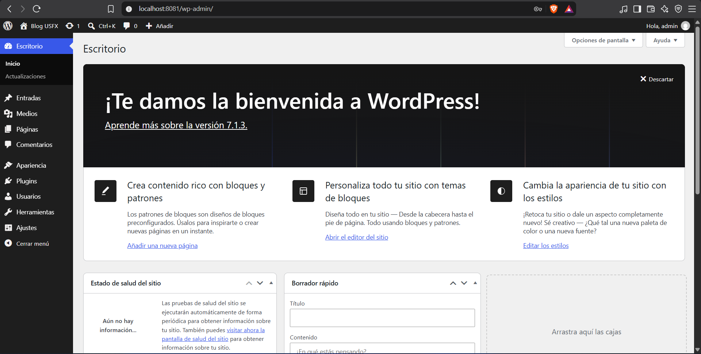

Se accede a http://localhost:8081, se completa la instalación inicial de WordPress y se procede a instalar un tema personalizado junto con la subida de una imagen multimedia de prueba.


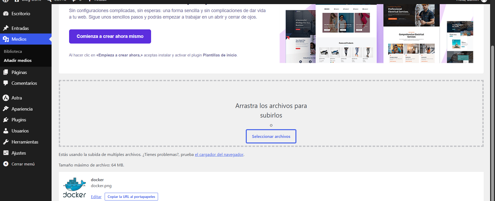

Para comprobar la resiliencia del sistema frente a fallos o actualizaciones, se destruyen los contenedores por completo

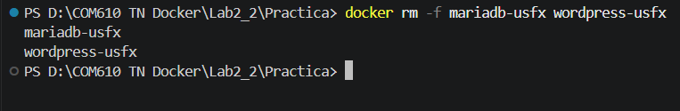

Se vuelve a ejecutar el despliegue de ambos contenedores apuntando exactamente a los mismos volúmenes creados inicialmente

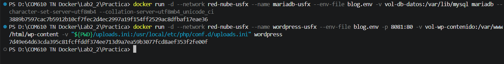

```powershell
docker run -d --network red-nube-usfx --name mariadb-usfx --env-file blog.env -v vol-db-datos:/var/lib/mysql mariadb --character-set-server=utf8mb4 --collation-server=utf8mb4_unicode_ci


docker run -d --network red-nube-usfx --name wordpress-usfx --env-file blog.env -p 8081:80 -v vol-wp-contenido:/var/www/html/wp-content -v "${PWD}/uploads.ini:/usr/local/etc/php/conf.d/uploads.ini" wordpress
```

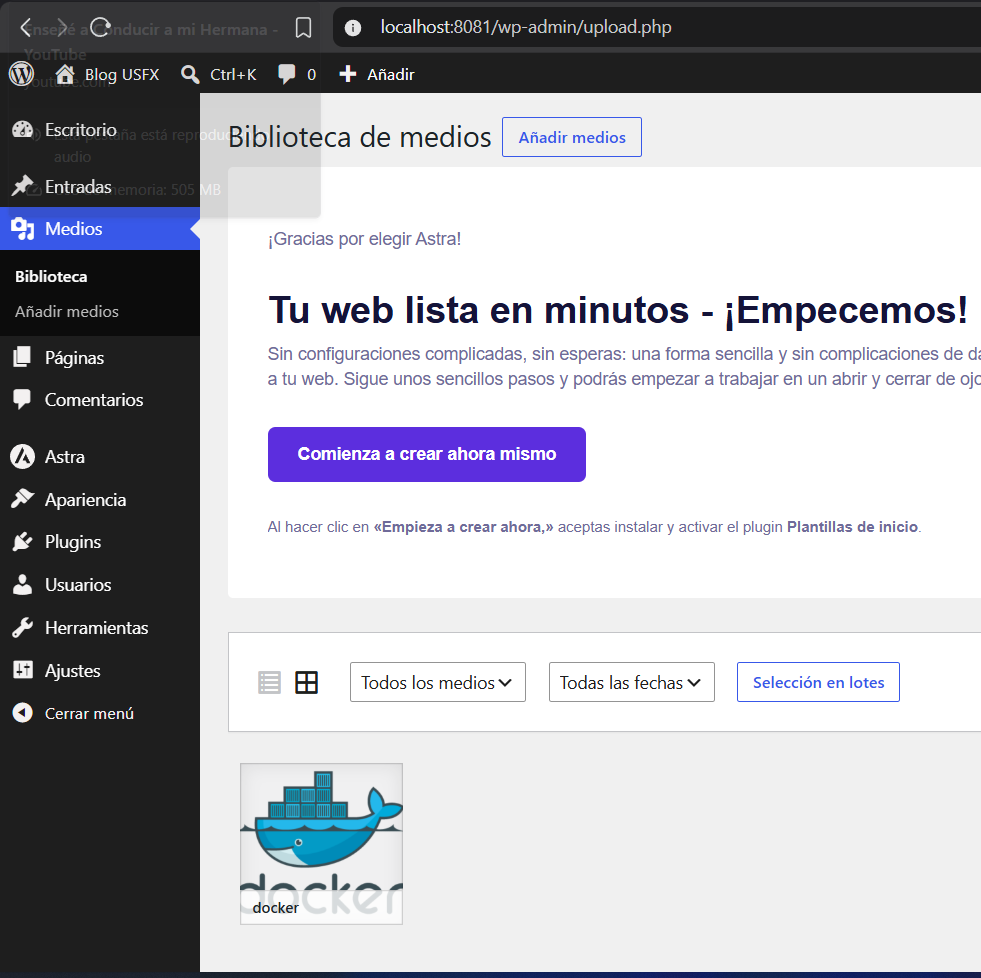