# Laboratorio 3: Creación de Entornos Multi-Servicio y Persistencia con Docker Compose

## 3. Ejercicios

### Ejercicio 3.1: Aplicación Web Simple con un Contenedor (Nginx)

#### 1. Estructura del Proyecto y Preparación del Entorno

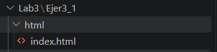

* Se define la estructura de directorios del proyecto, creando una carpeta principal (`Ejer3_1`) y un directorio interno (`html`) que contendrá el código fuente de la página web.

#### 2. Configuración del Contenido Web (`index.html`)

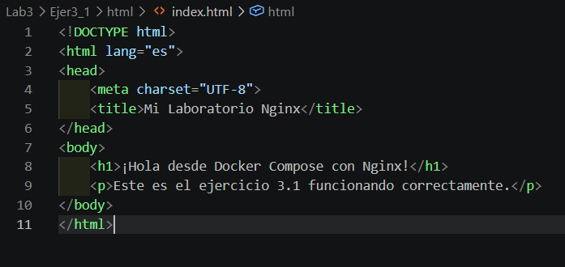

* Se implementa una página HTML básica que servirá como prueba de funcionamiento para verificar que Nginx responde correctamente a las peticiones del usuario.

#### 3. Declaración de Infraestructura (docker-compose.yml)

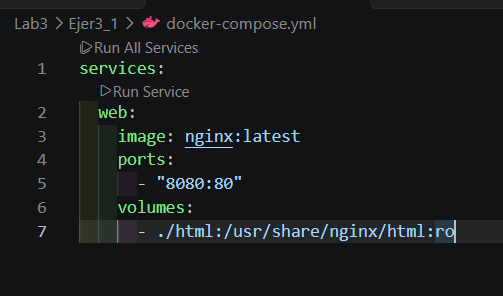

Se define el archivo de orquestación donde se especifica el comportamiento del servicio web, su imagen base, las reglas de red y los puntos de montaje de almacenamiento.

* `services`: Bloque principal que define los diferentes contenedores o microservicios que compondrán la aplicación.

* `web`: Identificador o nombre lógico asignado al servicio dentro de la red del archivo YAML.

* `image`: nginx:latest: Indica a Docker que debe descargar y utilizar la versión más reciente (latest) de la imagen oficial de Nginx desde el registro público Docker Hub.

* `ports`: Permite enlazar puertos de la máquina física (host) con los puertos internos del contenedor.

    * `8080:80`: El puerto 80 del contenedor (donde Nginx escucha por defecto) se mapea al puerto 8080 de tu máquina host. Esto permite acceder a la aplicación escribiendo localhost:8080 en el navegador.

* `volumes`: Mecanismo para persistir o compartir datos entre la máquina host y el contenedor.

    * `./html:/usr/share/nginx/html:ro`: Toma la carpeta local ./html (ubicada en el mismo directorio del archivo YAML) y la monta dentro de la ruta del contenedor /usr/share/nginx/html (carpeta raíz donde Nginx busca los archivos web). El modificador :ro (Read-Only) garantiza que el contenedor solo pueda leer los archivos, protegiendo el código fuente original de modificaciones accidentales o maliciosas desde el interior del contenedor.

#### 4. Ejecución del Despliegue y Validación

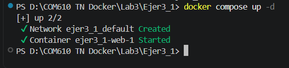

* `docker compose`: Invocación de la herramienta de orquestación de Docker para gestionar aplicaciones multicontenedor basadas en archivos YAML.

* `up`: Ordena a Docker descargar las imágenes necesarias (si no están presentes), crear la red predeterminada, configurar los volúmenes y poner en marcha los contenedores definidos.

* `-d (Modo Detached o desatendido)`: Ejecuta los contenedores en segundo plano, liberando la terminal para seguir introduciendo comandos y evitando que la salida de los registros (logs) bloquee la consola.

#### 5. Pruebas de Funcionamiento y Resultados

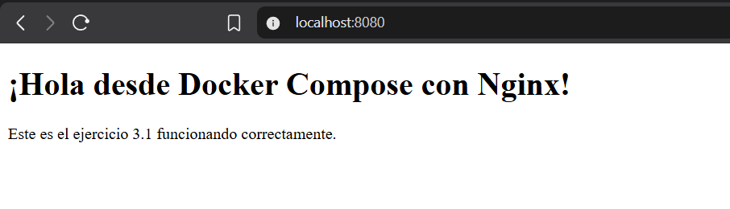

P ara verificar que el servicio web está operativo y atendiendo peticiones correctamente:

Se abre el navegador web y se accede a la URL: http://localhost:8080

#### 6. Limpieza y Cierre del Entorno

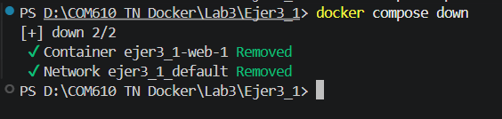

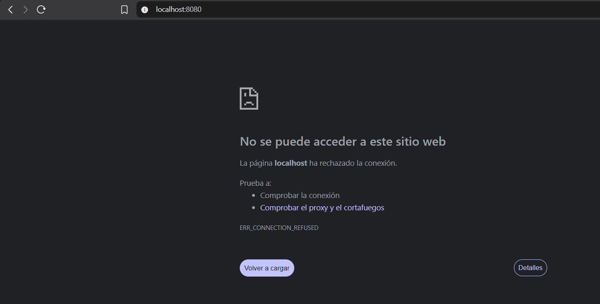

* `docker compose down`: Detiene de manera segura los contenedores activos asociados al archivo dockercompose.yml y elimina los recursos efímeros creados durante la ejecución (como las redes puente internas), manteniendo intactos los archivos del host.

### Ejercicio 3.2: Balanceador de Carga con Nginx y Proxy Inverso con Docker Compose

#### 1. Estructura de Directorios del Proyecto

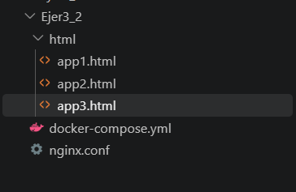

#### 2. Configuración del Contenido Backend (`html/app*.html`)

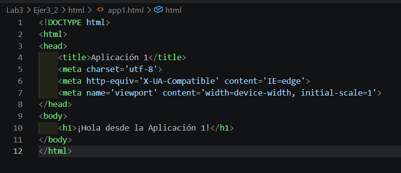

Se implementan cuatro páginas HTML independientes para simular servicios o instancias de backend separadas, lo que permitirá evidenciar visualmente el funcionamiento del balanceo de carga al refrescar el navegador.

#### 3. Configuración del Balanceador de Carga y Proxy Inverso (nginx.conf)

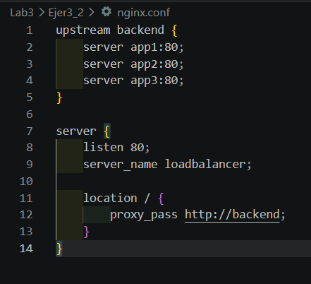

* '`upstream backend { ... }`': Define un grupo lógico de servidores servidores backend. Al agregar server app4:80;, incorporamos el cuarto nodo al algoritmo de distribución.

* `server { ... }`: Configura un servidor virtual escuchando en el puerto 80 interno del contenedor proxy.

* `location / { ... }`: Bloque que intercepta todas las peticiones dirigidas a la ruta raíz.

* `proxy_pass http://backend;`: Deriva el tráfico recibido hacia el grupo upstream definido previamente. Nginx se encarga automáticamente de repartir las peticiones secuencialmente (Round-Robin) entre app1, app2, app3 y app4.

#### 4. Orquestación de la Infraestructura Multinivel (docker-compose.yml)

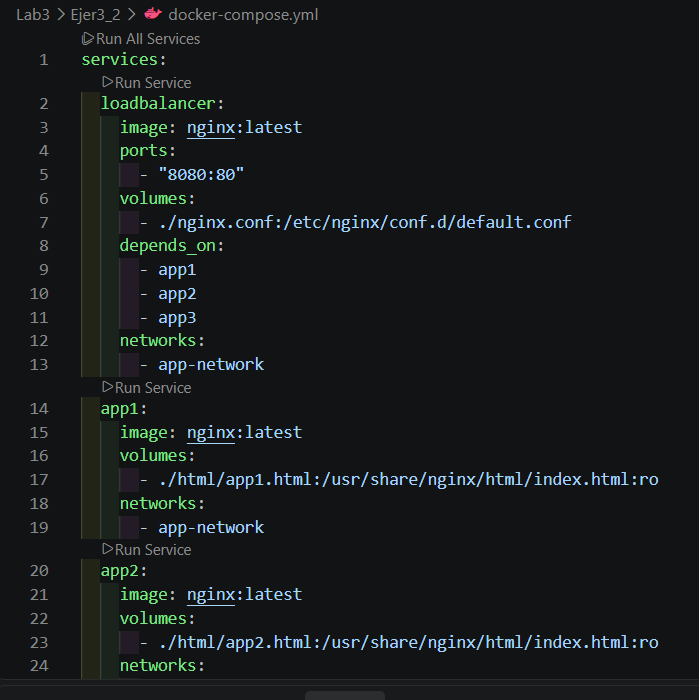

* `depends_on`: Garantiza el orden de arranque, asegurando que los cuatro contenedores de aplicaciones estén listos antes de levantar el proxy.

* `networks: - app-network`: Conecta tanto el balanceador como los backends a una red puente privada, permitiendo la resolución DNS interna (el proxy se conecta a app1, app2, etc., por sus nombres de servicio gracias a esta red).

#### 5. Ejecución del Despliegue y Validación

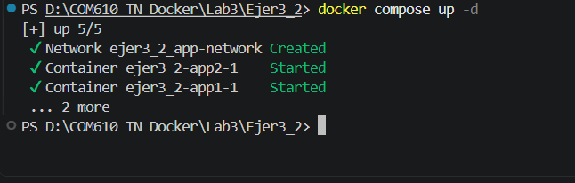

* `docker compose up -d`: Construye la red virtual, descarga las dependencias si es necesario y levanta los 5 contenedores en segundo plano (detached mode).

#### 6. Pruebas de Funcionamiento y Distribución de Carga


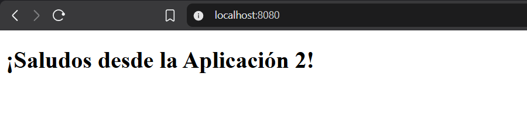


Para comprobar el funcionamiento del balanceador y la integración de la nueva aplicación:

Se accede en el navegador a: http://localhost:8080

#### 7. Limpieza y Cierre del Entorno

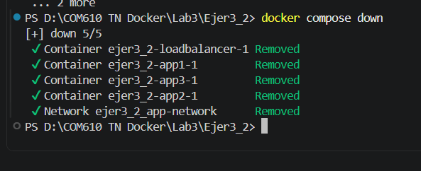

Detiene de manera segura todos los servicios y elimina la red puente creada para el laboratorio.

### Ejercicio 3.3: Aplicación Web con Base de Datos (WordPress y MySQL)

#### 1. Configuración de la Infraestructura y Persistencia (`docker-compose.yml`)

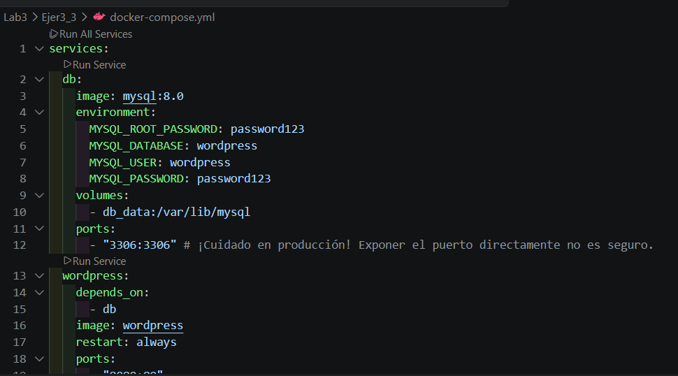

Se define el archivo de orquestación para levantar de forma secuencial y coordinada tanto el motor de base de datos como la aplicación web.

**Servicio db (MySQL):**

* `image: mysql:8.0`: Utiliza la imagen oficial de MySQL en su versión 8.0.

* `environment`: Configura las credenciales iniciales y la creación automática de la base de datos (wordpress), el usuario y las contraseñas de acceso.

* `volumes: - db_data:/var/lib/mysql`: Monta un volumen persistente (db_data) en la ruta interna donde MySQL almacena los archivos de bases de datos, garantizando que la información no se pierda al destruir los contenedores.

* `ports: - "3306:3306"`: Expone el puerto de MySQL hacia el host (útil para auditoría o conexión externa, aunque en entornos de producción estrictos se mantiene exclusivamente dentro de la red interna).

**Servicio wordpress:**

* `depends_on: - db`: Establece una dependencia de inicio, asegurando que el motor de base de datos comience su proceso de arranque antes de que WordPress intente conectarse.

* `image`: wordpress: Descarga y ejecuta la última imagen oficial del CMS WordPress.

* `restart`: always: Configura una política de reinicio automático ante fallos del contenedor o reinicios del sistema operativo host.

* `ports: - "8080:80"`: Mapea el puerto 80 del servidor web interno al puerto 8080 de la máquina host para acceder desde el navegador.

* `environment`: Especifica las credenciales y define WORDPRESS_DB_HOST: db apuntando al nombre del servicio de la base de datos gracias a la resolución DNS interna de Docker.

**Bloque volumes:**:

Declara el volumen con nombre db_data administrado por Docker para la persistencia del motor relacional.

#### 2. Ejecución del Despliegue

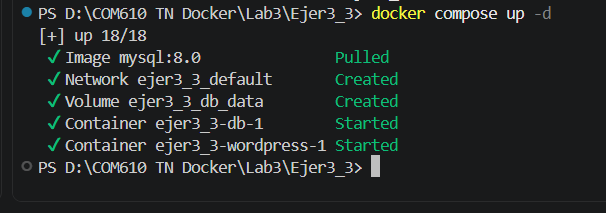

`docker compose up -d`: Descarga las imágenes de MySQL y WordPress (si no están almacenadas localmente), crea el volumen de datos persistente, configura la red interna y pone en marcha ambos servicios en segundo plano.

#### 3. Verificación de Funcionamiento y Configuración Inicial


ara comprobar que la aplicación web y la base de datos se comunican de forma correcta:

Se accede desde el navegador web a la dirección: http://localhost:8080

El sistema muestra la pantalla de selección de idioma y configuración inicial de WordPress, lo cual valida que la conexión con el servidor MySQL (db) se ha establecido exitosamente y las credenciales son correctas.

#### 4. Validación de la Persistencia y Limpieza del Entorno

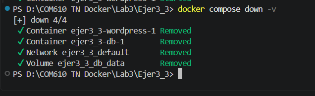

* `docker compose down`: Detiene y elimina los contenedores activos y las redes virtuales del proyecto.

* `-v (o --volumes)`: Elimina también los volúmenes de datos asociados (en este caso, db_data). Nota: Este modificador se utiliza únicamente cuando se desea reiniciar el entorno desde cero borrando toda la información de la base de datos; si se desea conservar la información para futuras sesiones, se debe ejecutar el comando sin la bandera -v.

### Ejercicio 3.4: Múltiples Instancias de un Servicio (Escalado)

#### 1. Definición del Servicio Base (`docker-compose.yml`)

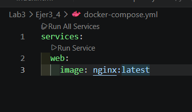

Se establece un archivo de configuración simplificado que declara un único servicio web basado en un servidor liviano.

* `services`: Bloque contenedor de los servicios que conformarán la aplicación.

* `web`: Identificador lógico asignado al servicio que servirá como base para la replicación.

* `image`: nginx:latest: Utiliza la imagen oficial de Nginx como plantilla para las instancias que se desplieguen.

#### 2. Escalado Horizontal Inicial (Scale Up)

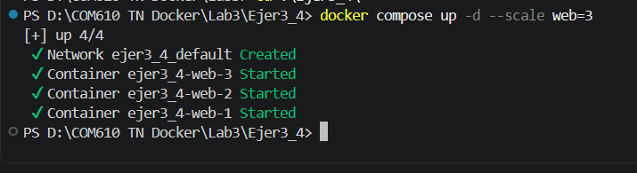

* `docker compose up`: Inicia los servicios definidos en el archivo de configuración.

* `-d (Modo Detached)`: Ejecuta los contenedores en segundo plano.

* `--scale web=3`: Instruye a Docker Compose para que despliegue e instancie 3 réplicas independientes del servicio web, asignándoles sufijos numéricos automáticos en sus nombres y distribuyendo los recursos de red.

#### 3. Verificación de Contenedores en Ejecución

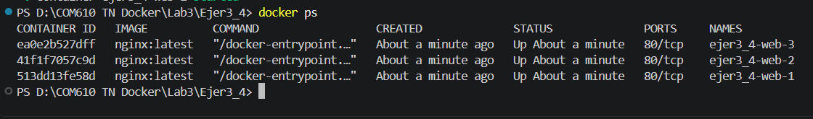

* `docker ps`: Lista todos los contenedores activos en el sistema, permitiendo visualizar los nombres generados automáticamente

#### 4. Reducción Dinámica de Instancias (Scale Down)

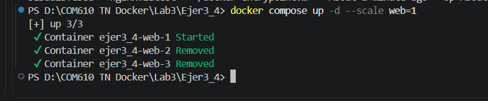

Al volver a ejecutar docker compose up -d especificando una escala menor (--scale web=1), el orquestador compara el estado actual con el deseado, procediendo a detener y eliminar de manera segura las instancias excedentes (en este caso, reduciendo el clúster a una sola réplica)

#### 5. Limpieza y Cierre del Entorno

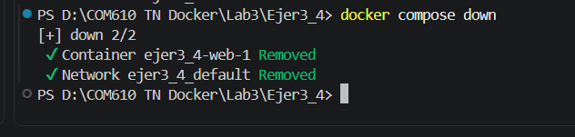

### Ejercicio 3.5: Aplicación en NodeJS conectandose a MongoDB

#### 1. Estructura de Directorios y Archivos del Proyecto

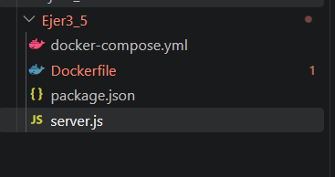

Se crea la carpeta principal que alberga el archivo de definición de orquestación (`docker-compose.yml`), la receta de construcción de la aplicación (`Dockerfile`), el gestor de dependencias (`package.json`) y la lógica del servidor (`server.js`).

#### 2. Definición de Dependencias de la Aplicación (`package.json`)

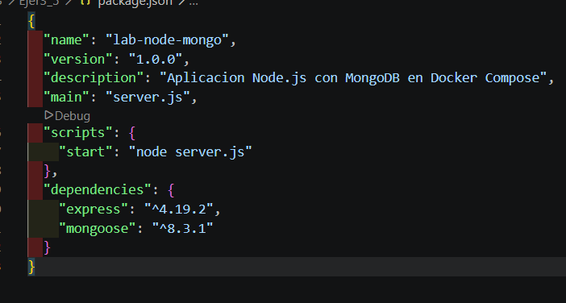

Se especifican los módulos de Node.js necesarios para levantar el servidor HTTP y gestionar la conexión con la base de datos documental.

#### 3. Lógica del Servidor Backend (server.js)

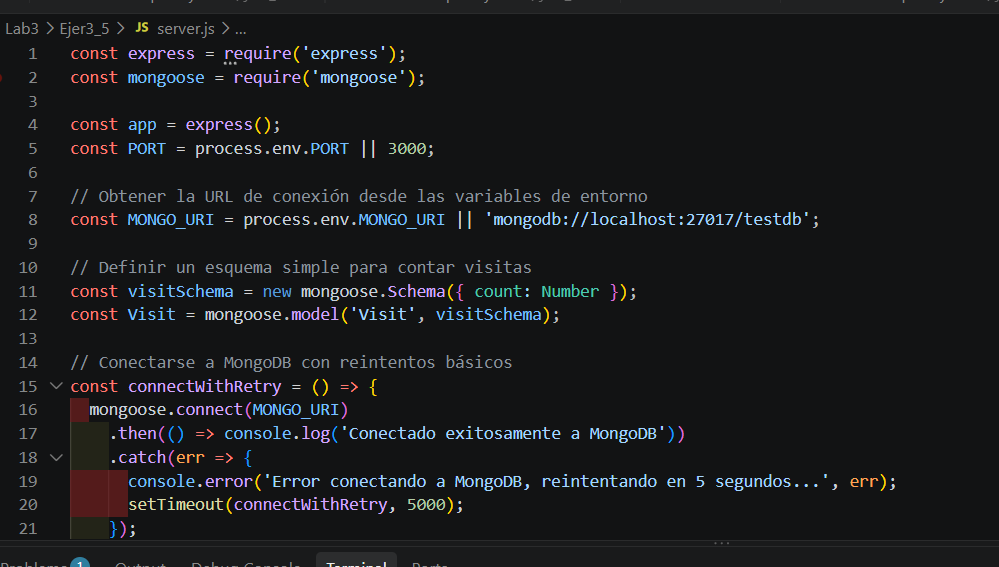

Se implementa una aplicación en Express que expone una ruta raíz (/). Cada vez que un cliente accede al servicio, el script realiza una operación de lectura/escritura en MongoDB para incrementar y persistir un contador de visitas.

#### 4. Receta de Contenedorización (Dockerfile)

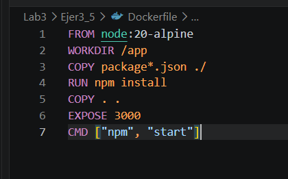

* `FROM node:20-alpine`: Utiliza una imagen base oficial y optimizada de Node.js sobre Alpine Linux.

* `WORKDIR /app`: Define el directorio de trabajo dentro del contenedor.

* `RUN npm install`: Instala las dependencias del proyecto descritas en el package.json.

* `EXPOSE 3000`: Señala que el contenedor escucha peticiones en el puerto interno 3000

#### 5. Orquestación de Infraestructura Multinivel (docker-compose.yml)

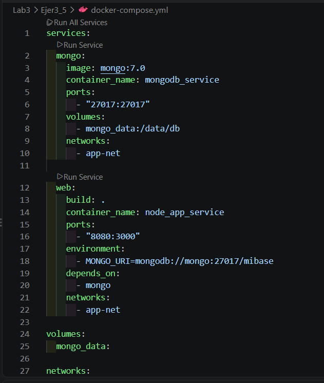

Se interconectan el servicio de base de datos (mongo) y el servicio web personalizado (web) mediante una red privada.

* `build: .`: Indica a Docker Compose que debe compilar la imagen de la aplicación utilizando el Dockerfile ubicado en el directorio actual.

* `environment: - MONGO_URI=...`: Configura la cadena de conexión utilizando el nombre del servicio mongo como host gracias a la resolución DNS interna de Docker.

* `volumes`: mongo_data:/data/db: Asegura la persistencia de los documentos de MongoDB en un volumen administrado.

#### 6. Ejecución del Despliegue y Construcción

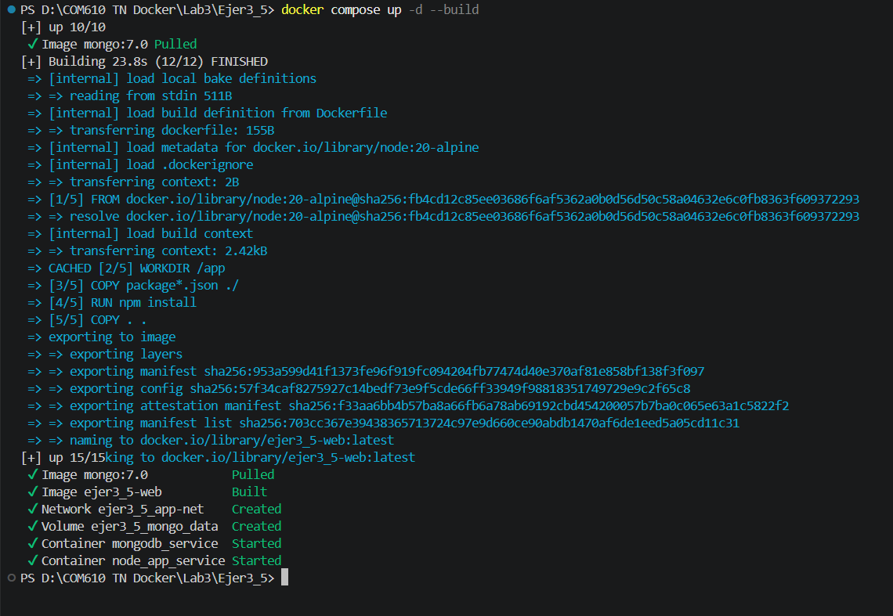

* `docker compose up`: Orquesta la creación de redes, volúmenes y contenedores.

* `-d (Modo Detached)`: Ejecuta los contenedores en segundo plano.

* `--build`: Fuerza a Docker Compose a construir la imagen de la aplicación (web) a partir del Dockerfile local antes de iniciar los servicios.

#### 7. Pruebas de Funcionamiento y Persistencia de Datos

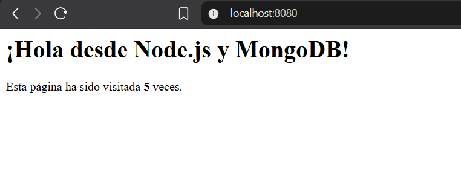

Se accede desde el navegador a la URL: http://localhost:8080

Al recargar la página consecutivamente, el contador de visitas aumenta, demostrando que Node.js está leyendo y escribiendo registros en el motor MongoDB en tiempo real.

#### 8. Limpieza y Cierre del Entorno

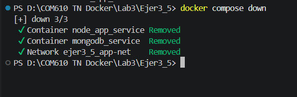

### Ejercicio 3.6: Aplicación en NodeJS conectandose a MySQL

#### 1. Estructura de Directorios y Archivos del Proyecto

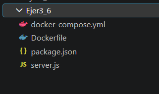

Se crea la carpeta principal que contiene el archivo de orquestación (`docker-compose.yml`), la receta de construcción (`Dockerfile`), el manifiesto de paquetes (`package.json`) y el script principal de conexión y control de visitas (`server.js`).

#### 2. Definición de Dependencias de la Aplicación (`package.json`)

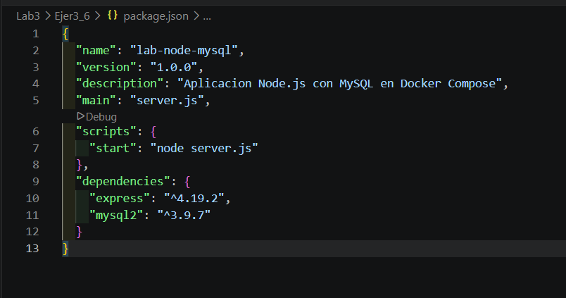

Se especifican los módulos de Node.js requeridos para levantar el servicio HTTP y gestionar las consultas SQL relacionales.

#### 3. Lógica del Servidor Backend (server.js)

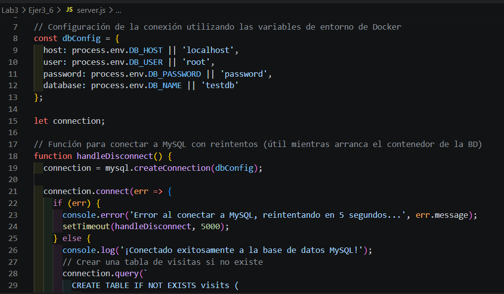

Se implementa una aplicación en Express que incluye una rutina de reintentos de conexión a MySQL, la creación automática de esquemas relacionales y una ruta principal para la persistencia del contador de visitas.

#### 4. Receta de Contenedorización (Dockerfile)

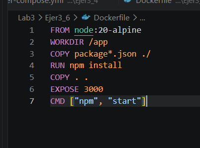

Se define el archivo de instrucciones para empaquetar la aplicación de Node.js en un contenedor aislado.

#### 5. Orquestación de Infraestructura Multinivel (docker-compose.yml)

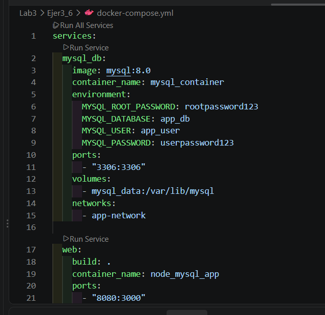

Se declaran los servicios relacionales y de aplicación, vinculándolos mediante variables de entorno seguras, volúmenes y una red privada.

* `mysql_db`: Contenedor del motor relacional MySQL 8.0 configurado con credenciales de acceso iniciales y la creación automática de la base de datos app_db.

* `volumes`: mysql_data:/var/lib/mysql: Garantiza la persistencia física de las tablas relacionales en un volumen administrado por Docker.

* `environment`: DB_HOST=mysql_db: Utiliza el nombre del servicio de la base de datos como host gracias a la resolución DNS interna de la red app-network.

* `depends_on`: Asegura que el servicio de base de datos inicie su proceso de carga antes de desplegar el contenedor de la aplicación web.

#### 6. Ejecución del Despliegue y Construcción

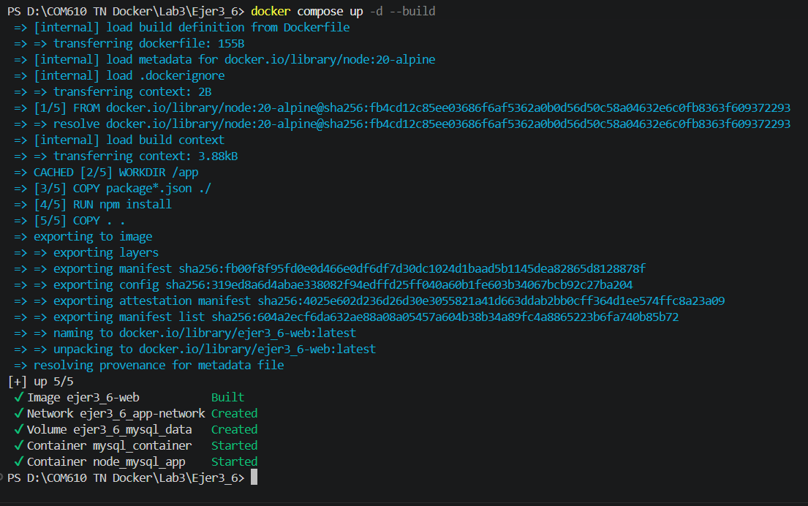

#### 7. Pruebas de Funcionamiento y Persistencia Relacional

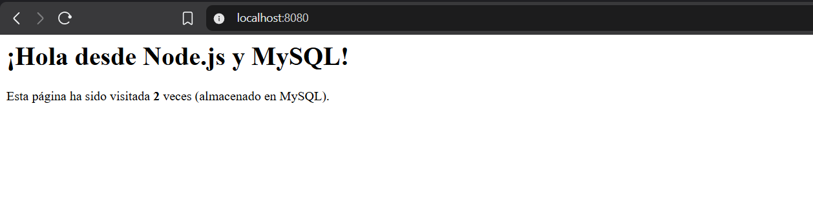

Se accede desde el navegador web a la URL: http://localhost:8080

#### 8. Limpieza y Cierre del Entorno

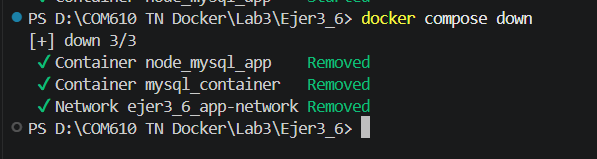

### 4. Prácticas Individuales

#### **Práctica 1: CRUD con Persistencia y Hot Reload**

#### 1. Configuración de Entornos y Archivos de Composición

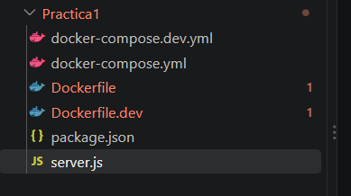

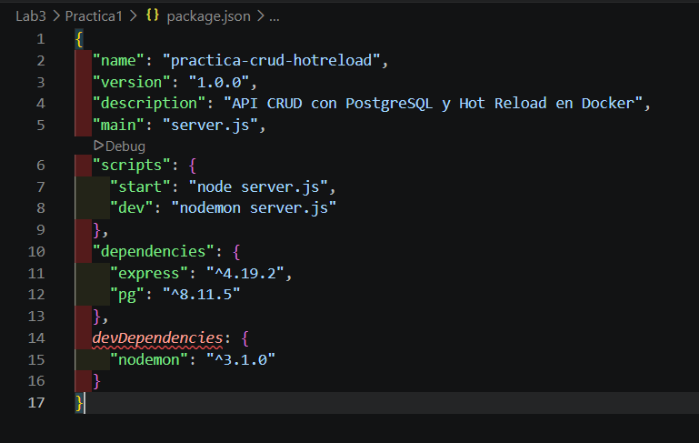

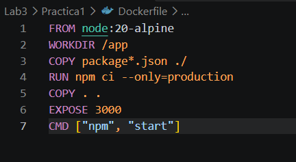

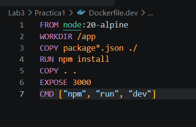

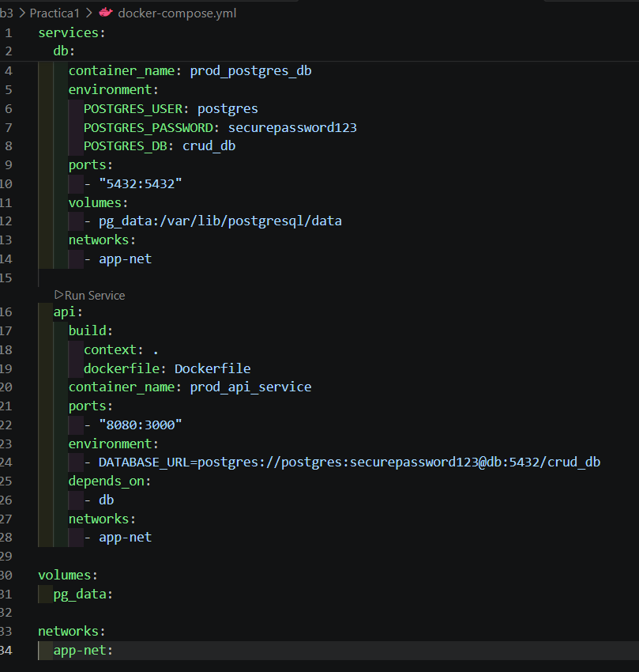

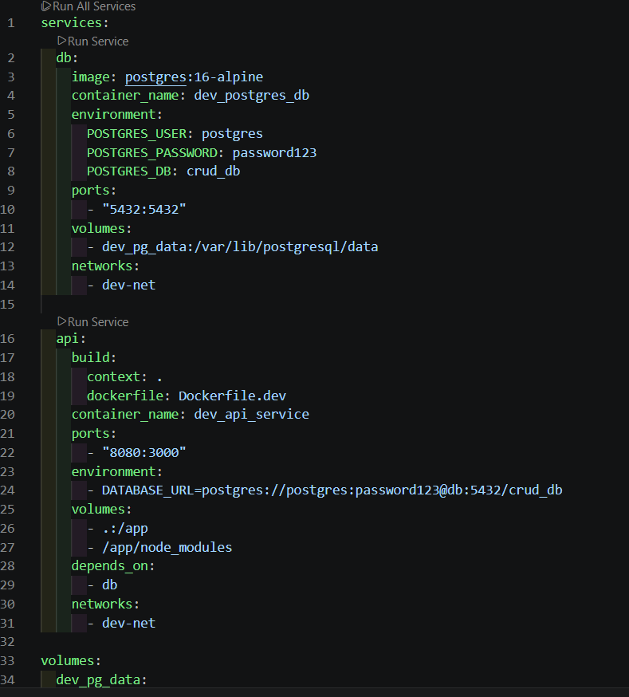


Se establecen dos recetas de orquestación independientes para separar el comportamiento del ciclo de vida del software.

* **Configuración de Producción (`docker-compose.yml`):** Utiliza un `Dockerfile` optimizado que instala únicamente paquetes de producción y levanta los servicios con un volumen persistente de PostgreSQL (`pg_data`).
* **Configuración de Desarrollo (`docker-compose.dev.yml`):** Incorpora un `Dockerfile.dev` con herramientas de supervisión de código y un mapeo de volúmenes de enlace (`.:/app`) que sincroniza instantáneamente los cambios locales del host con el contenedor.

#### 2. Implementación de la Lógica CRUD y Conexión Relacional (`server.js`)

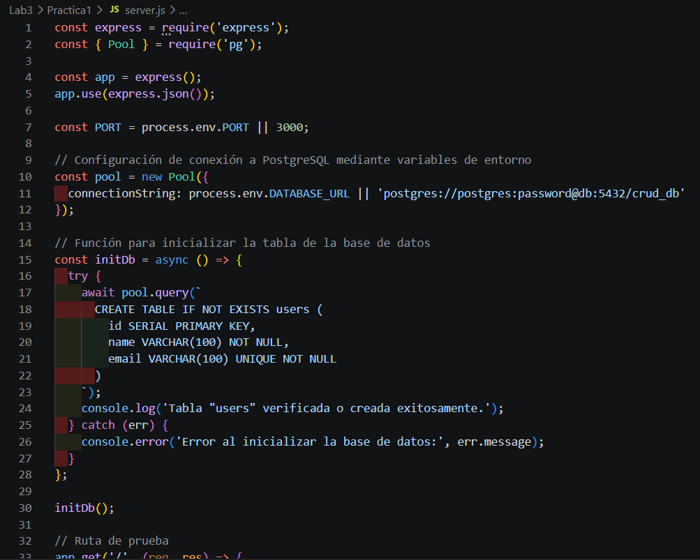

Se refactoriza la aplicación para conectar el servidor Express a PostgreSQL mediante la librería `pg`, implementando un esquema relacional automático para la gestión de usuarios (Crear, Leer, Actualizar y Borrar).

#### 3. Ejecución y Pruebas del Entorno de Desarrollo (Hot Reload)

Se levanta el entorno de desarrollo utilizando el archivo de composición específico.

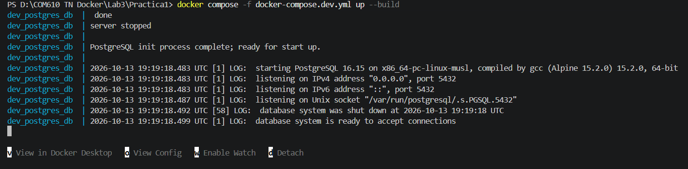

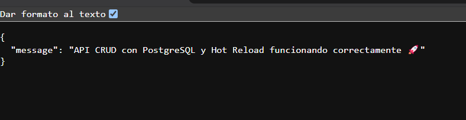

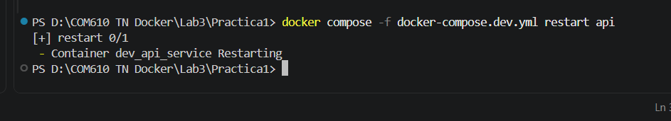

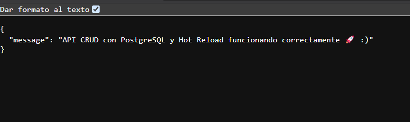

Al realizar modificaciones en el código fuente desde Visual Studio Code y guardar, el monitor nodemon detecta el cambio en tiempo real y reinicia el servicio automáticamente.

#### 4. Validación de Endpoints del CRUD con Postman

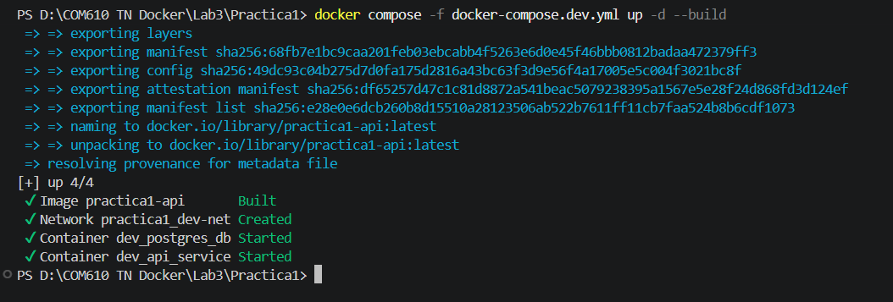


**Verificar estado de la API (GET):**

Método: GET

URL: http://localhost:8080/

Respuesta esperada: El mensaje JSON confirmando que la API está funcionando.


**Crear un usuario (POST):
**
Método: POST

URL: http://localhost:8080/users

Body: Selecciona raw y tipo JSON, luego ingresa:

```bash
  "name": "Benjamín Solano",
  "email": "benjamin@correo.com"
}
 ```

Respuesta esperada: Código 201 Created devolviendo el objeto del usuario creado con su ID autoincremental.


**Listar usuarios (GET):**

Método: GET

URL: http://localhost:8080/users

Respuesta esperada: Un arreglo JSON con los usuarios registrados en PostgreSQL.


**Actualizar usuario (PUT):**
Método: PUT

URL: http://localhost:8080/users/1

Body (JSON):

```bash
{
  "name": "Benjamín Actualizado",
  "email": "benjamin.nuevo@correo.com"
}
```


**Eliminar usuario (DELETE):**

Método: DELETE

URL: http://localhost:8080/users/1


#### 5. Limpieza y Cierre de los Entornos


#### **Práctica 2: Despliegue de un Blog con Doble Volumen**

#### 1. Configuración de la Orquestación de Doble Volumen (`docker-compose.yml`)


Se define un archivo de composición que declara los servicios de infraestructura y aplicación, asignando volúmenes dedicados para cada capa de persistencia.

* **Servicio `db` (MySQL):** Utiliza la imagen oficial más reciente y monta el volumen `db_data` en la ruta interna `/var/lib/mysql` para preservar las tablas relacionales.
  * **Servicio `wordpress`:** Configura las variables de entorno de conexión (`WORDPRESS_DB_HOST`, credenciales) y monta el volumen `wordpress_data` en la ruta `/var/www/html`, garantizando que las modificaciones de contenido y archivos multimedia no se pierdan al destruir los contenedores.
  * **Red aislada (`blog-net`):** Asegura la comunicación privada y segura exclusivamente entre el CMS y la base de datos.

#### 2. Despliegue y Configuración Inicial del CMS


Se inicia el entorno utilizando el orquestador de contenedores.


#### 3. Creación de Contenido y Archivos Multimedia


Se accede al panel de administración de WordPress para generar contenido dinámico y subir archivos multimedia que pondrán a prueba la persistencia del segundo volumen.

#### 4. Validación de la Persistencia ante la Destrucción de Contenedores


Se simula el apagado total del clúster de contenedores para comprobar la integridad de los datos almacenados en los volúmenes con nombre.


