# Laboratorio 4.2: Almacenamiento, Elasticidad y Escalado Automático (S3, ASG y ELB)

## Ejercicio 3.1: Gestión de Almacenamiento con Amazon S3 y AWS IAM y creación de un CDN con CloudFront

### 1. Creación del Bucket de S3

Se creó un bucket de S3 con las siguientes configuraciones:

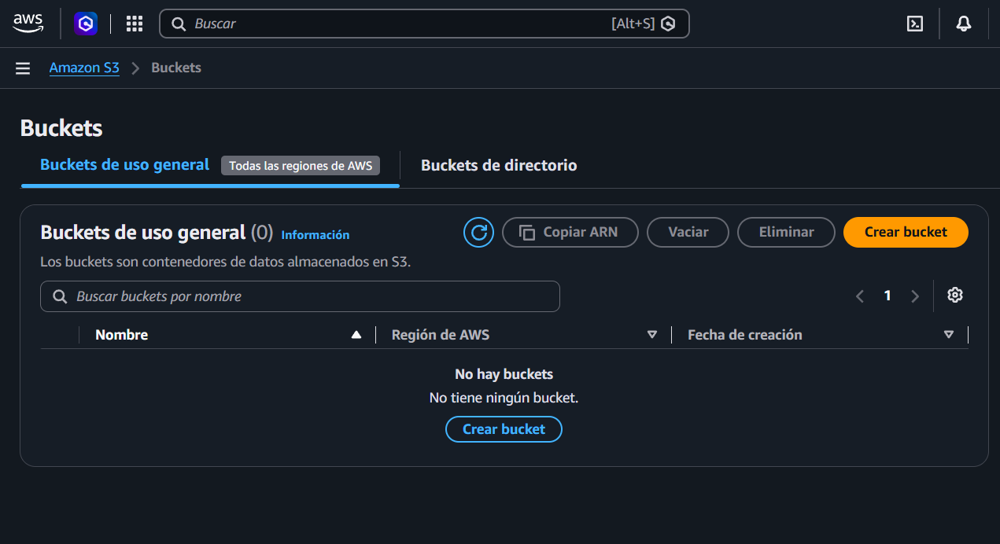

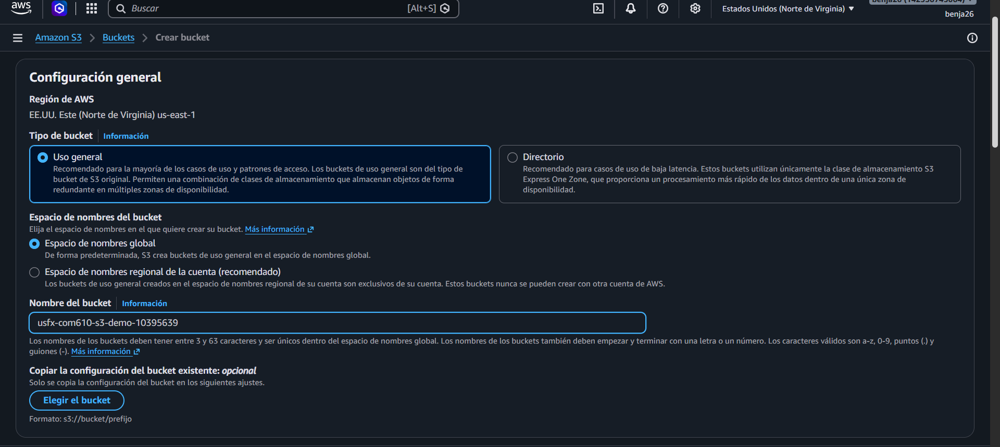

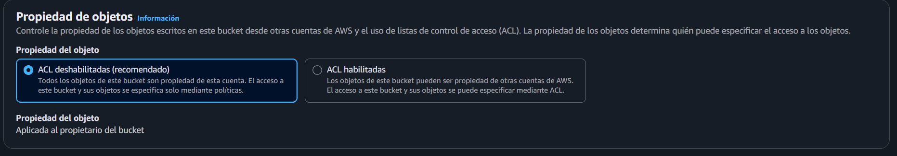

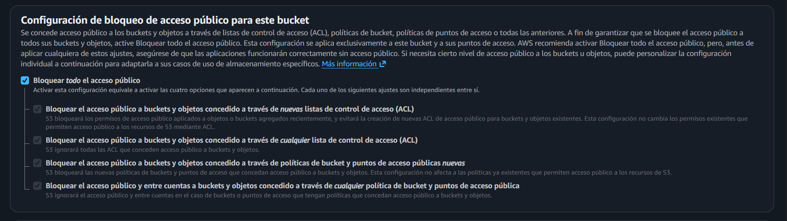

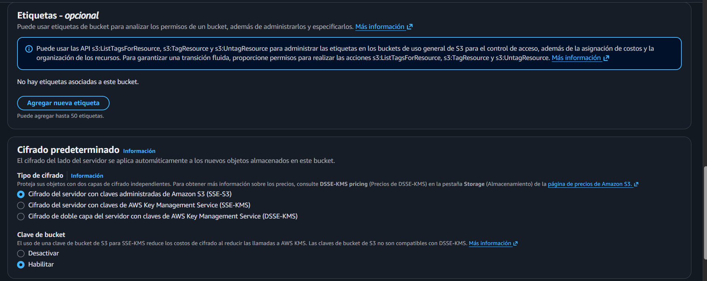

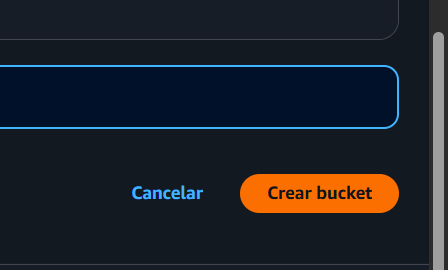
- **Tipo de bucket:** Uso general
- **Nombre del bucket:** `usfx-com610-s3-demo-[tu documento de identidad]`
- **Propiedad de objetos:** ACL deshabilitadas (Recomendado)
- **Bloqueo de acceso público:** Bloqueado (todas las opciones marcadas)
- **Control de versiones:** Desactivado
- **Cifrado predeterminado:** Configuración por defecto (SSE-S3)


### 2. Configuración de acceso con AWS IAM

Se creó un usuario IAM para gestionar el acceso al bucket:

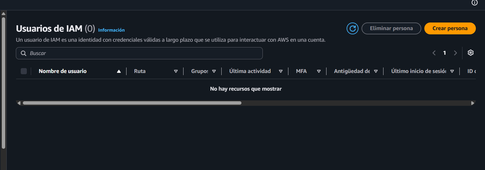

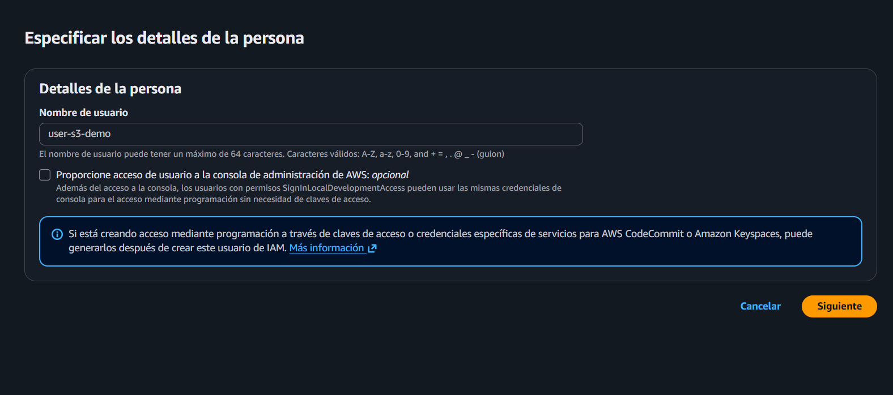

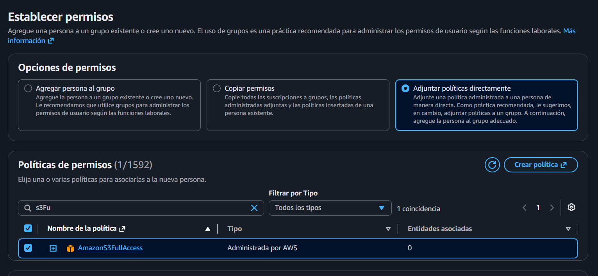

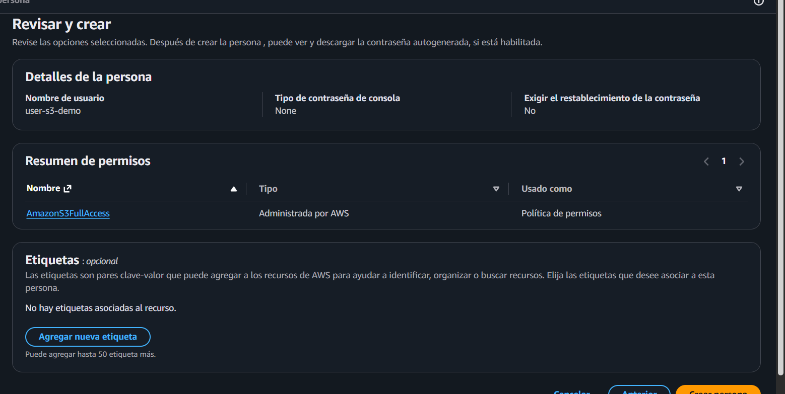


- **Nombre de usuario:** `user-s3-demo`
- **Opciones de permisos:** Adjuntar políticas directamente
- **Política asignada:** `AmazonS3FullAccess` (solo para fines prácticos del laboratorio)

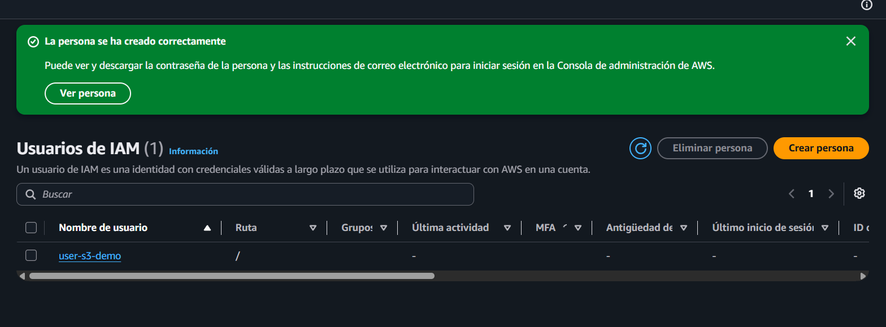

Se revisó y confirmó la creación del usuario.

### 3. Creación de la distribución en CloudFront

Se configuró una distribución de CloudFront tomando como origen el bucket S3 creado:

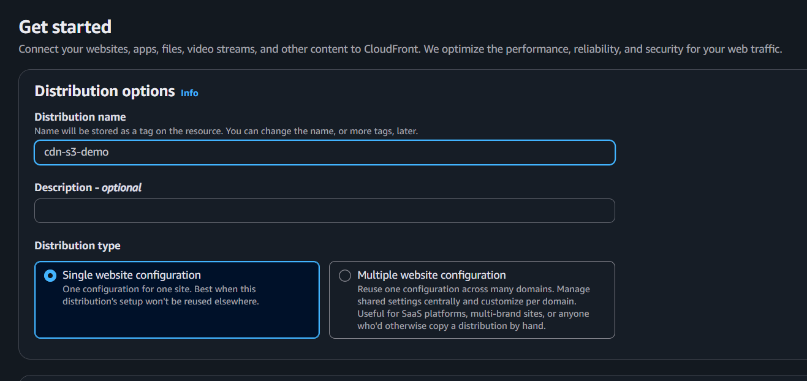

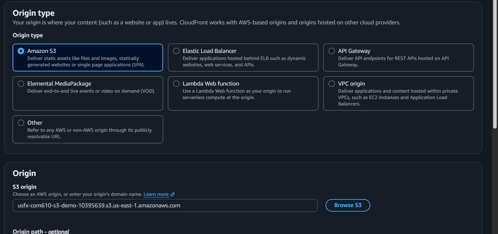

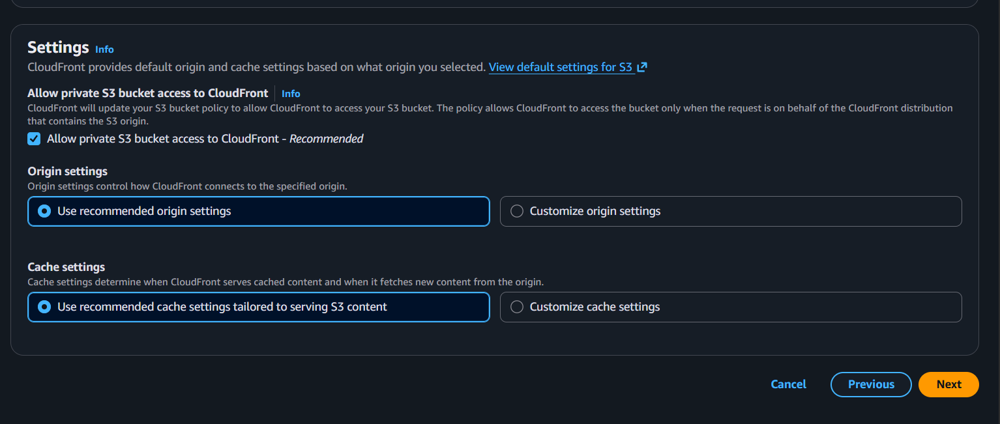

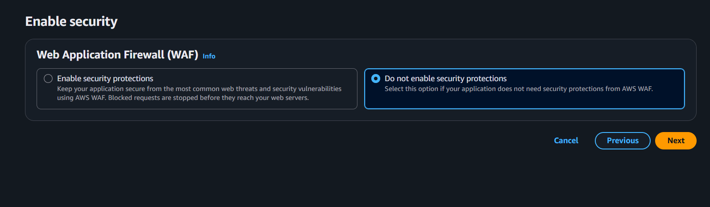

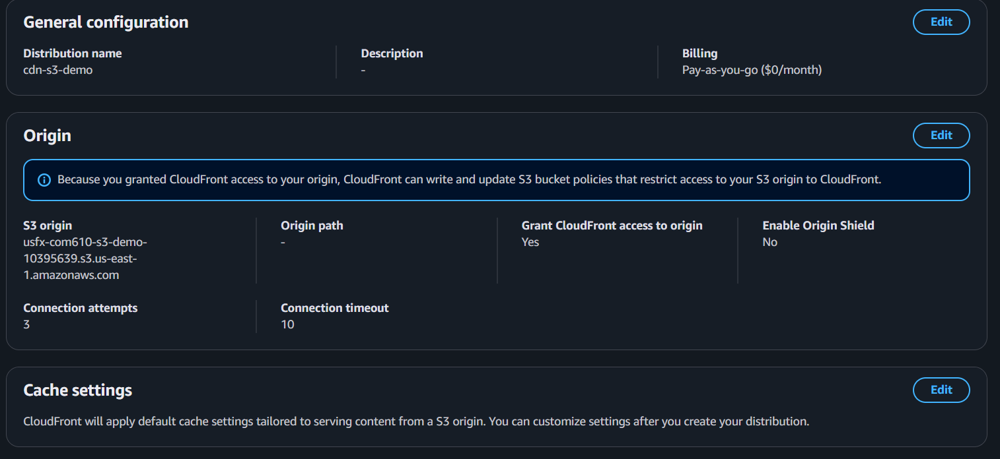

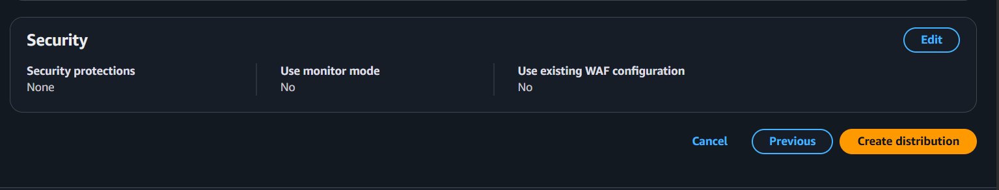

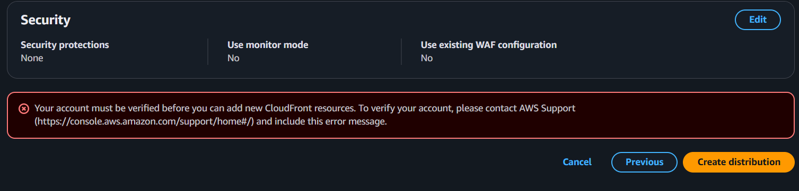

- **Nombre de la distribución:** `cdn-s3-demo`
- **Tipo de distribución:** Single website or app
- **Tipo de origen:** Amazon S3
- **Bucket de origen:** El bucket creado en el paso 1
- **WAF:** No habilitado (Do not enable security protections)


Una vez revisada la configuración, se hizo clic en **Create distribution** y se esperó a que el estado cambiara a **Deployed**.

**Nota:** Durante el desarrollo de la práctica, la distribución de CloudFront no logró completar su despliegue correctamente (el estado no cambiaba a *Deployed* o la URL del CDN no respondía con el contenido esperado). Por este motivo, se optó por una **alternativa equivalente** para demostrar el acceso público a los objetos del bucket: habilitar el **alojamiento de sitio web estático** en S3 y aplicar una **política de bucket** que permita lectura pública de los objetos. Esta solución cumple con el mismo objetivo del ejercicio (servir imágenes públicamente desde S3), aunque sin la capa de caché y distribución global que ofrece CloudFront.

### 4. Alternativa a CloudFront: habilitar acceso público y sitio web estático en S3

#### 4.1 Creación de la clave de acceso (Access Key) para el usuario IAM

Para que la aplicación NodeJS pueda autenticarse con AWS, se generaron credenciales para el usuario `user-s3-demo`:

1. En **IAM → Personas**, se seleccionó el usuario `user-s3-demo`.
2. En la pestaña **Credenciales de seguridad**, sección **Claves de acceso**, se hizo clic en **Crear clave de acceso**.
3. En **Caso de uso** se eligió **Servicio de terceros** y se continuó.
4. Se copiaron y guardaron la **Clave de acceso** y la **Clave de acceso secreta** (solo se muestran una vez).

Estas credenciales se usan en el archivo `.env` del proyecto en `AWS_ACCESS_KEY_ID` y `AWS_SECRET_ACCESS_KEY`.

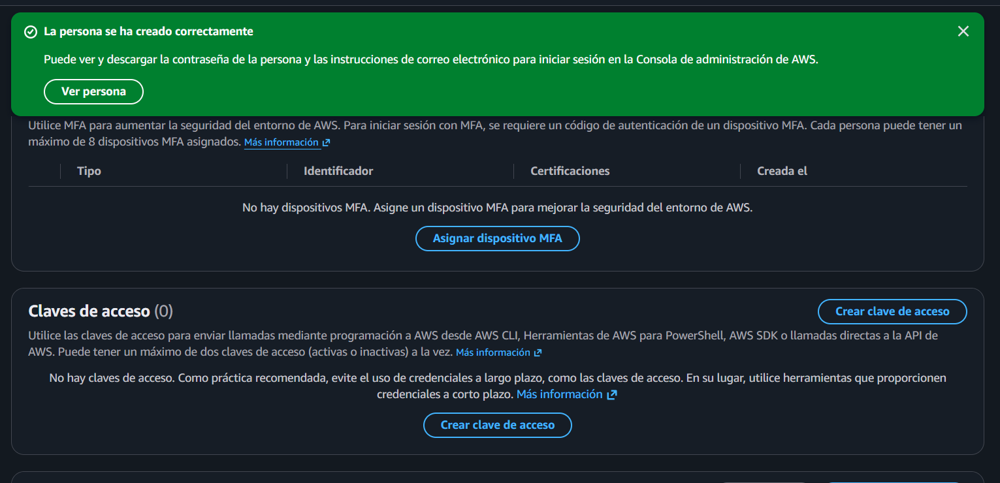

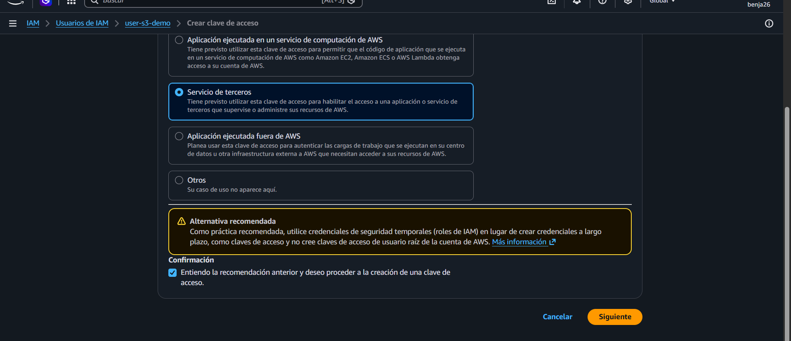

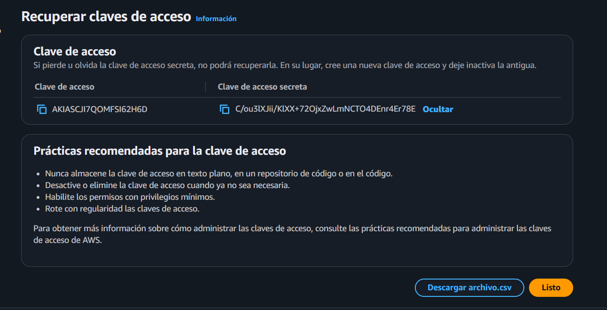

#### 4.2 Habilitación del acceso público en el Bucket S3

Como no se usó CloudFront, se habilitó el acceso público de lectura en el bucket para visualizar las imágenes directamente desde S3:

1. En **S3 → [bucket] → Permisos**, se editó **Bloqueo de acceso público** y se **desmarcó** "Bloquear todo el acceso público" (confirmando la advertencia).
2. En **Política del bucket** se agregó la siguiente política (reemplazando `TU-NOMBRE-DE-BUCKET`):

```json
{
    "Version": "2012-10-17",
    "Statement": [
        {
            "Sid": "PublicReadGetObject",
            "Effect": "Allow",
            "Principal": "*",
            "Action": "s3:GetObject",
            "Resource": "arn:aws:s3:::TU-NOMBRE-DE-BUCKET/*"
        }
    ]
}
```

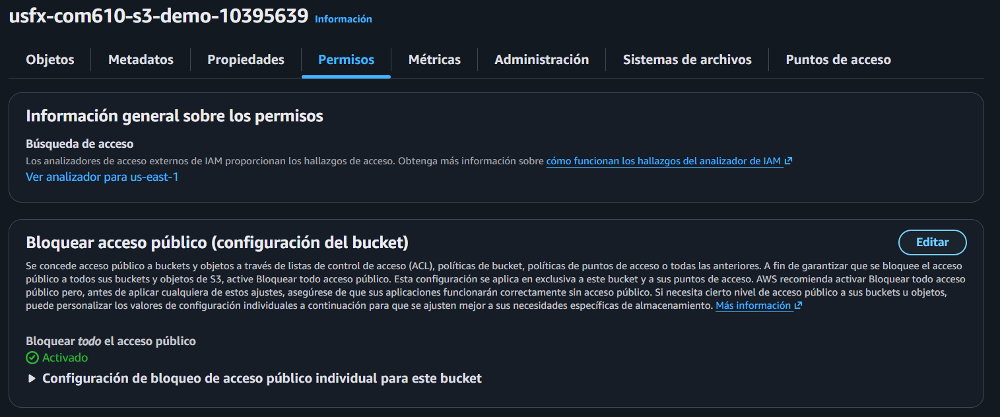

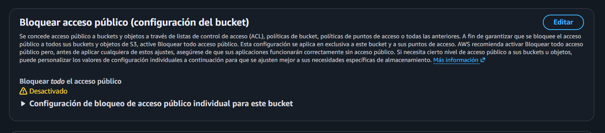

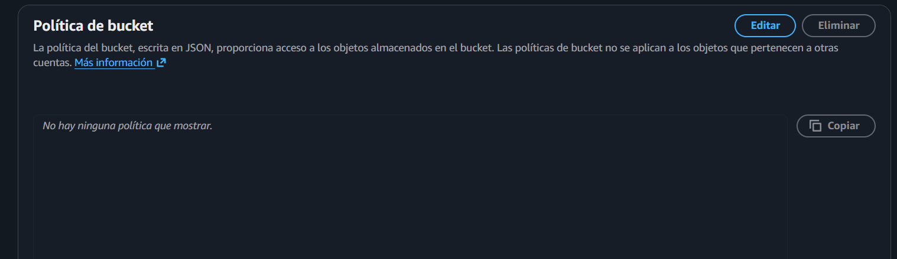

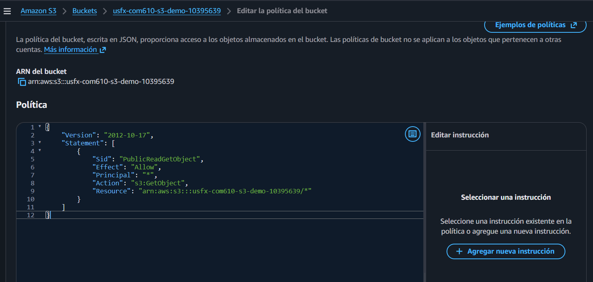


#### 4.3 Configuración de la aplicación NodeJS

Se clonó el proyecto de ejemplo y se instalaron sus dependencias:

```bash
git clone https://github.com/marceloquispeortega/aws-s3-upload-example
cd aws-s3-upload-example
npm install
```

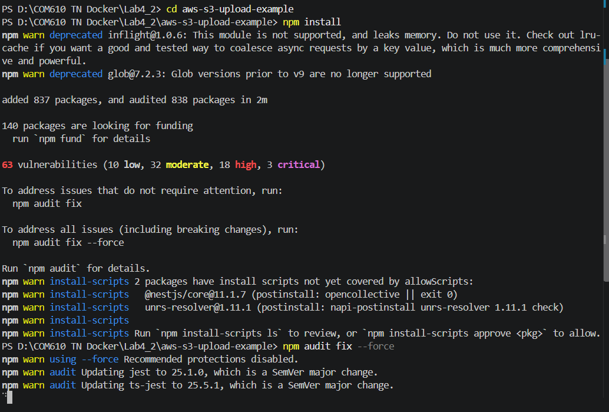

Luego se creó el archivo .env a partir de .env.example y se configuraron las variables de entorno:

AWS_REGION: región del bucket (ej. us-east-1).

AWS_ACCESS_KEY_ID: clave de acceso generada en el paso 4.1.

AWS_SECRET_ACCESS_KEY: clave secreta generada en el paso 4.1.

AWS_S3_BUCKET_NAME: nombre del bucket.

AWS_S3_CDN: URL del sitio web estático del bucket.

Para obtener la URL del sitio web estático, se ingresó a S3 → [bucket] → Propiedades → Alojamiento de sitio web estático → Editar, se seleccionó Habilitar, se colocó index.html como documento de índice y se guardó. Luego se copió la URL del punto de enlace del sitio web del bucket (formato http://[bucket].s3-website-[region].amazonaws.com) y se pegó en AWS_S3_CDN sin la barra / final.

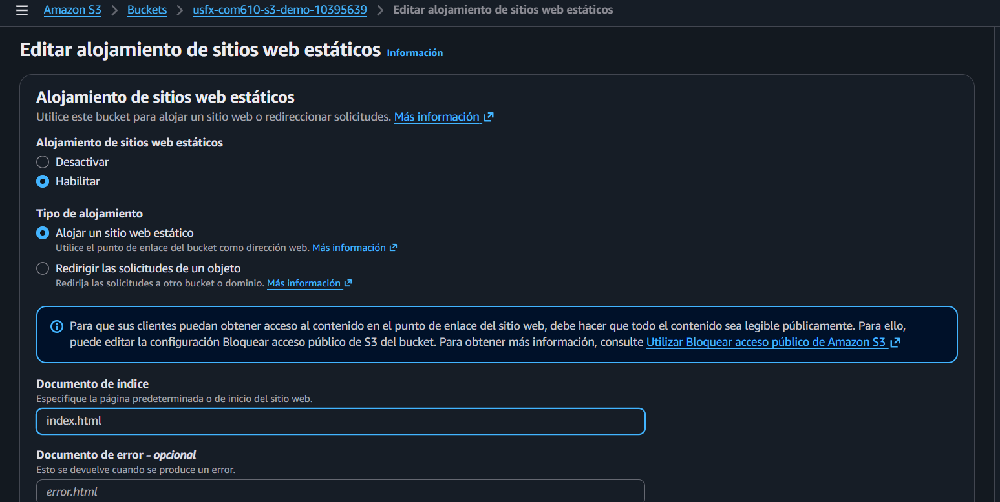

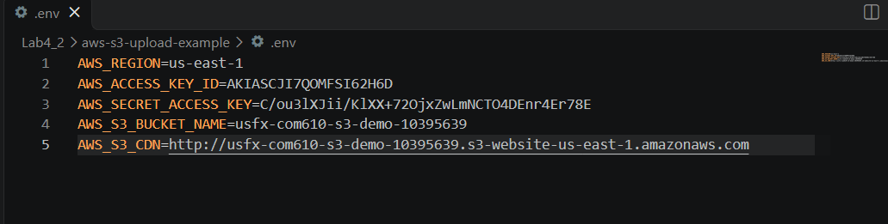

Finalmente, se inició el servidor:

```bash
npm run start:dev
```

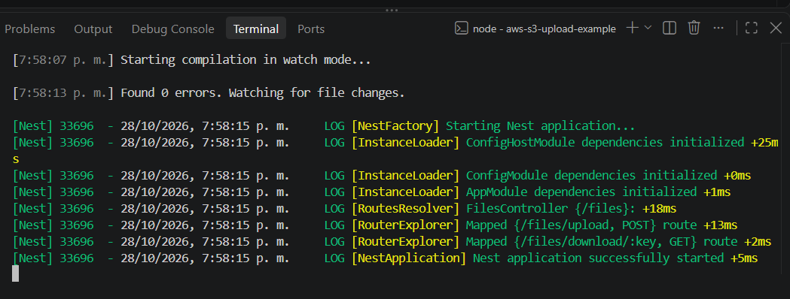

#### 4.4 Pruebas con Postman

**Subida de archivo (POST):**

- Método: `POST`
- URL: `http://localhost:3000/files/upload`
- Body: `form-data` con la key `file` y una imagen seleccionada desde la PC.

Al enviar la petición, la API devolvió un JSON con la URL pública del archivo subido.

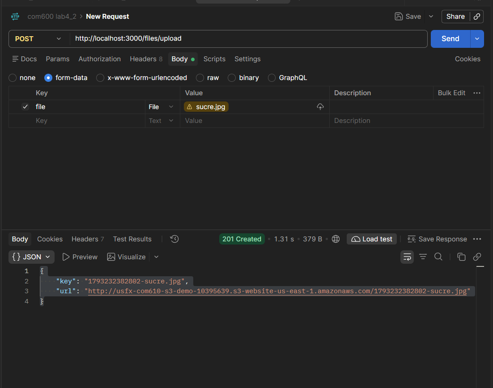

**Visualización del archivo (GET):**

Como el bucket tiene lectura pública habilitada, se copió la URL devuelta por la subida y se pegó en el navegador, verificando que la imagen se muestra correctamente.

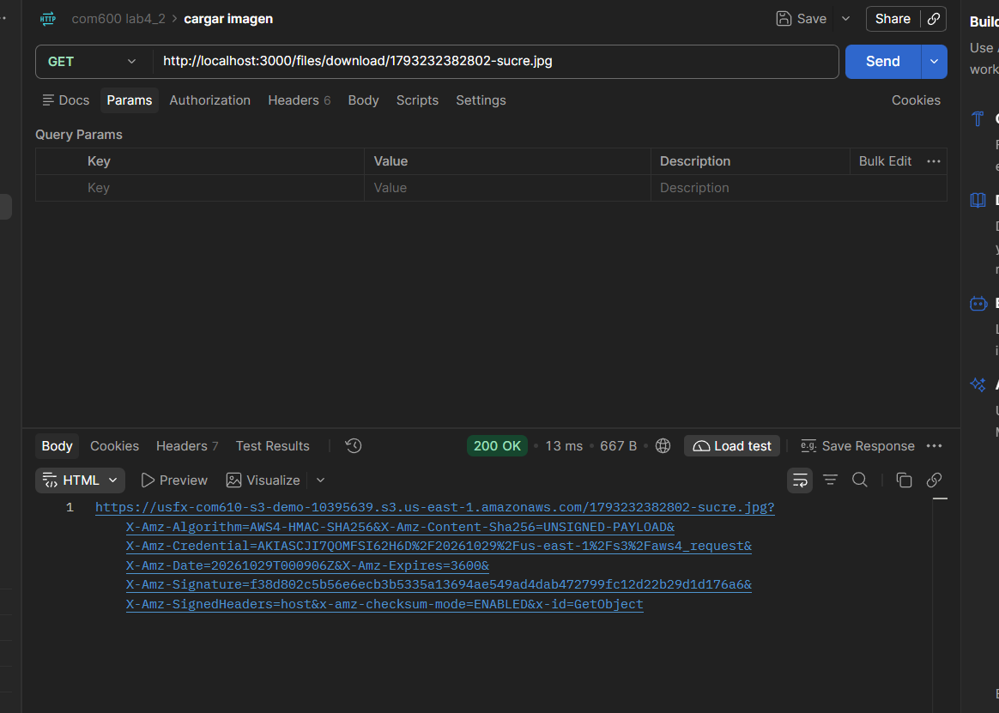

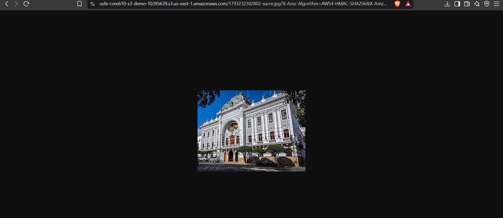

## Ejercicio 3.2: Implementación de un Balanceador de Carga (ALB)

### 1. Creación de los grupos de seguridad

Para aplicar buenas prácticas de seguridad, se crearon dos grupos de seguridad separados: uno para el balanceador y otro para las instancias EC2.

**Grupo de seguridad para el ALB (`alb-securitygroup`):**

- Reglas de entrada: **HTTP (80)** y **HTTPS (443)** desde **0.0.0.0/0** (Anywhere IPv4).

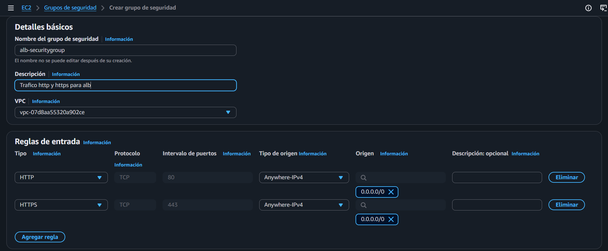

**Grupo de seguridad para las instancias (`ec2-web-securitygroup`):**

- Reglas de entrada: **HTTP (80)**.
- Origen: **Personalizado**, seleccionando el grupo `alb-securitygroup` (por ID).

Esto garantiza que las instancias EC2 solo reciban tráfico proveniente del balanceador y no accesos directos desde Internet.

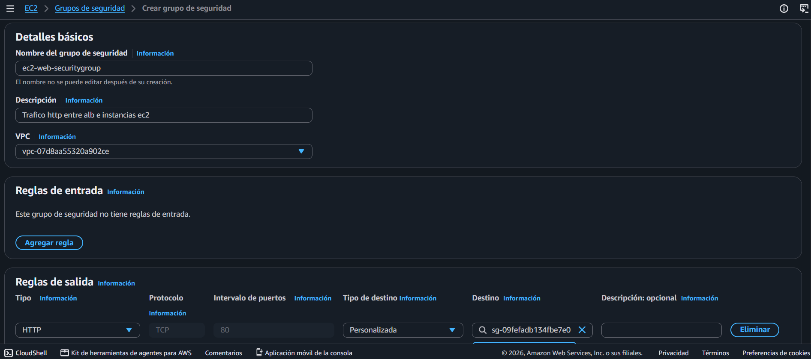


### 2. Creación de las instancias EC2

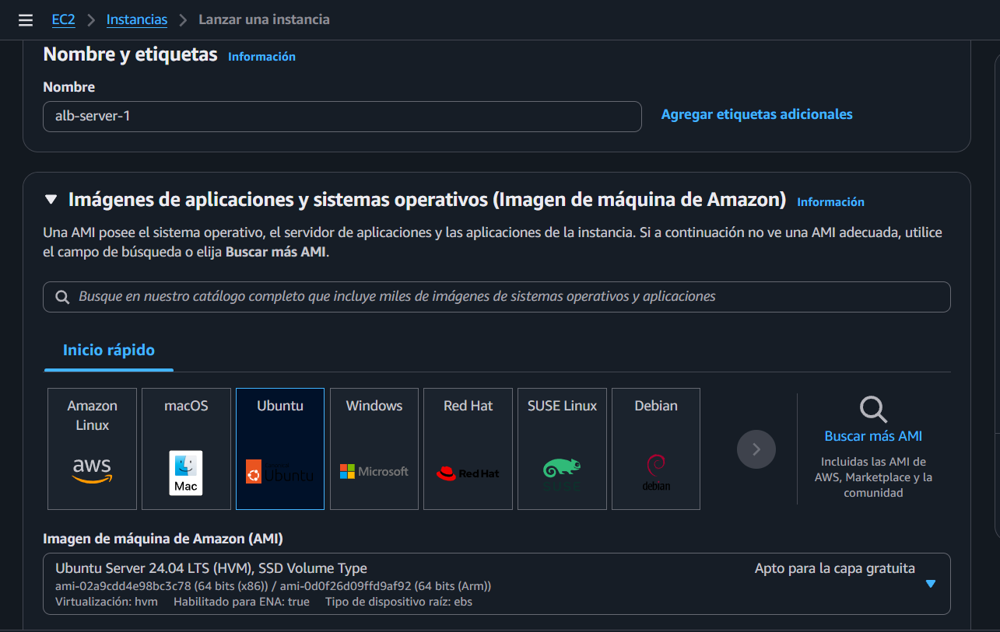

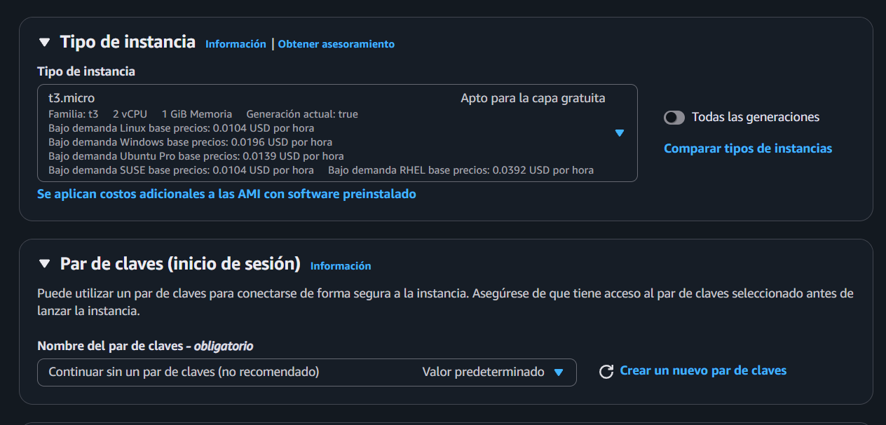

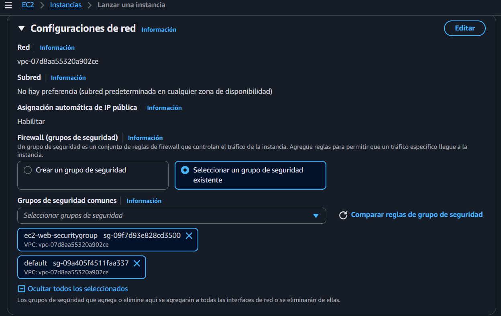

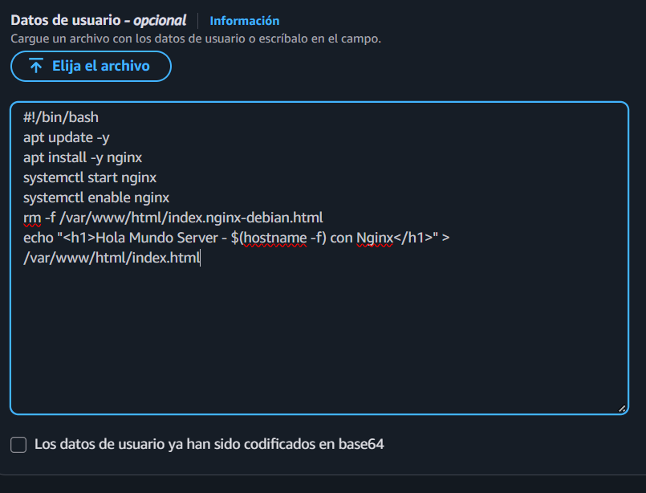

Se lanzaron dos instancias EC2 con las siguientes características:

- **Nombres:** `alb-server-1` y `alb-server-2`
- **Sistema operativo:** Ubuntu 24.04 (Inicio rápido)
- **Tipo de instancia:** `t3.micro` (apta para la capa gratuita)
- **Par de claves:** *Continuar sin un par de claves*
- **Red:**
    - **Asignar IP pública automáticamente:** habilitado (necesario para instalar Nginx).
    - **Grupos de seguridad:** `ec2-web-securitygroup` y `default`.
- **Almacenamiento:** valores por defecto.

En **Detalles avanzados → Datos de usuario** se agregó el siguiente script para instalar Nginx y publicar una página de prueba:

```bash
#!/bin/bash
apt update -y
apt install -y nginx
systemctl start nginx
systemctl enable nginx
rm -f /var/www/html/index.nginx-debian.html
echo "<h1>Hola Mundo Server - $(hostname -f) con Nginx</h1>" > /var/www/html/index.html
```
### 3. Configuración del Application Load Balancer (ALB)

Se creó un balanceador de carga de tipo **Application Load Balancer** con la siguiente configuración:

- **Nombre:** `alb-servers-demo`
- **Esquema:** Expuesto a Internet (Internet-facing)
- **Tipo de dirección IP:** IPv4
- **VPC:** por defecto
- **Zonas de disponibilidad y subredes:** al menos dos zonas disponibles
- **Grupos de seguridad:** únicamente `alb-securitygroup`

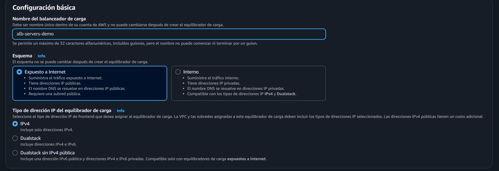

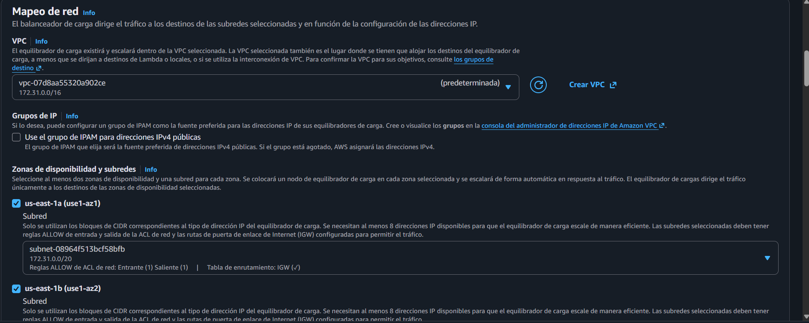

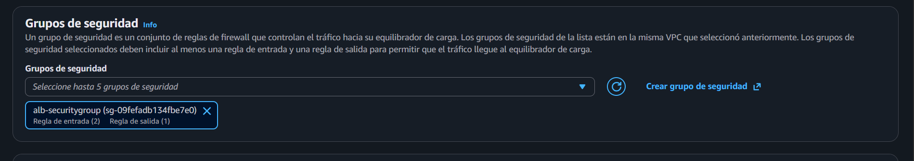

**Grupo de destino:**

Se creó un grupo de destino `alb-target-group` con:

- **Tipo de destino:** Instancias
- **Puerto:** 80 (HTTP)
- **Instancias registradas:** `alb-server-1` y `alb-server-2` (incluidas como pendientes antes de crear el grupo).

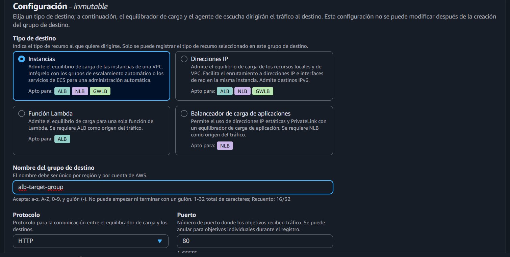

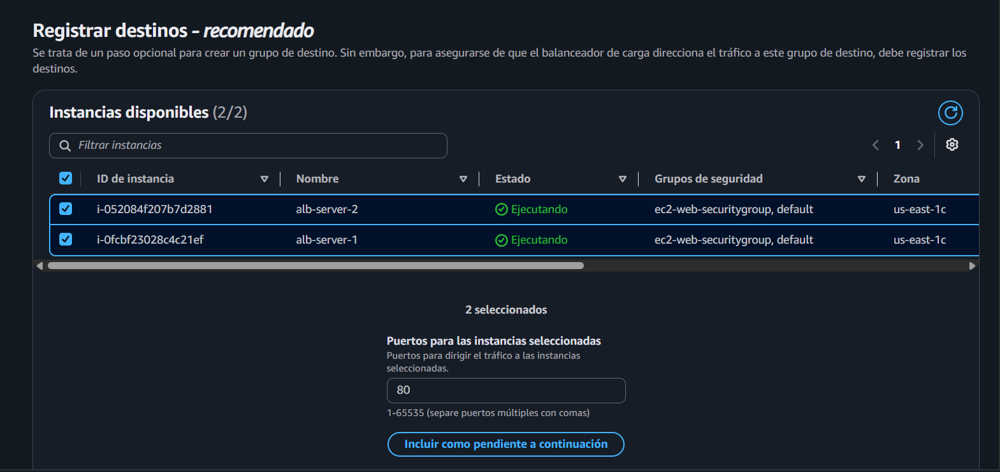

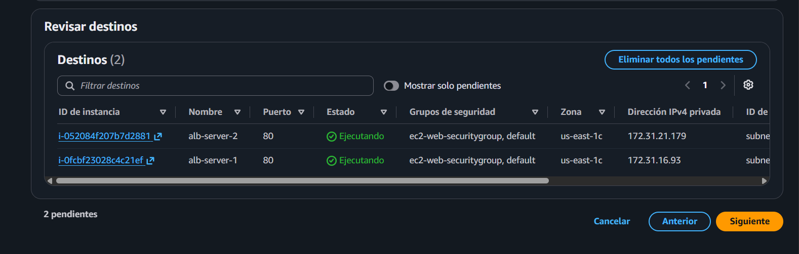

De vuelta en la creación del ALB, se actualizó la lista y se seleccionó el grupo de destino recién creado. Finalmente se hizo clic en **Crear balanceador de carga**.

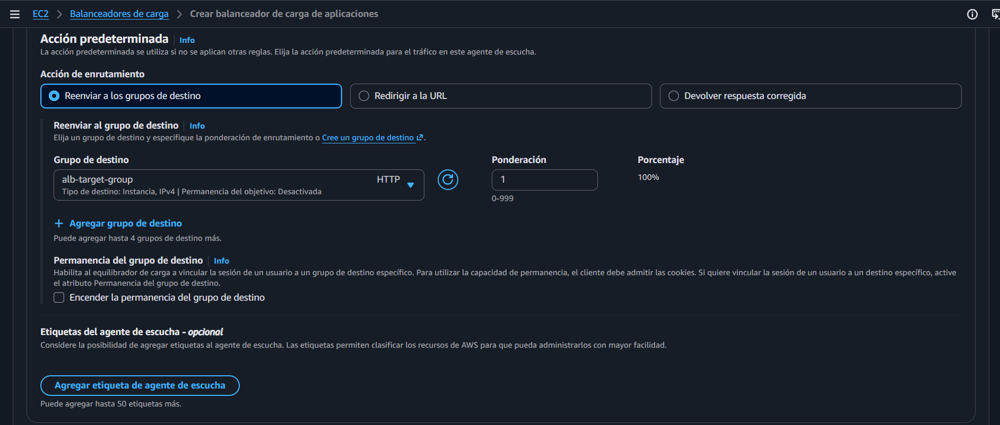

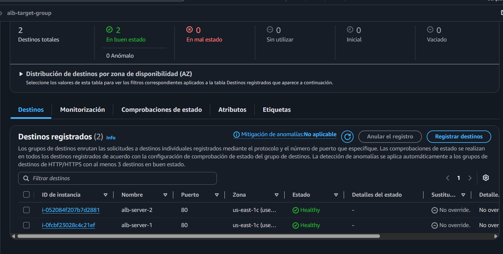

### 4. Verificación del balanceador

Una vez creado el ALB y con las instancias en estado **Healthy** dentro del grupo de destino, se copió el **DNS name** del balanceador y se accedió desde el navegador. Se observó la página de prueba de Nginx, confirmando que el tráfico se distribuye hacia las instancias registradas.

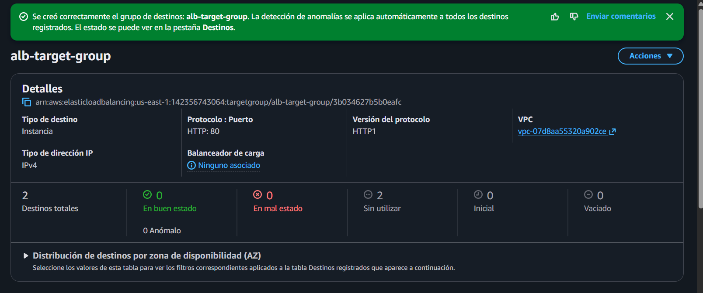

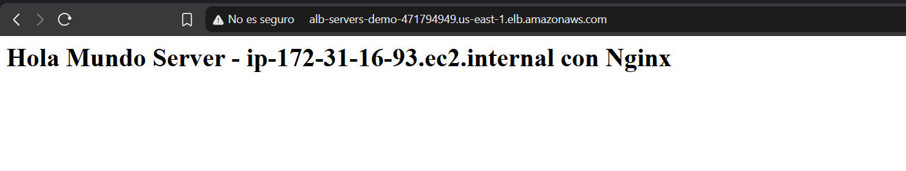

## Ejercicio 3.3: Implementación de un Escalado Horizontal (ASG y ELB)

### 1. Preparación de la instancia EC2 base

Se lanzó una instancia EC2 (capa gratuita) con los grupos de seguridad para Web (HTTP/HTTPS), acceso remoto (SSH) y un grupo adicional para conectarse a la instancia RDS MySQL. Dentro de la instancia se preparó el entorno:

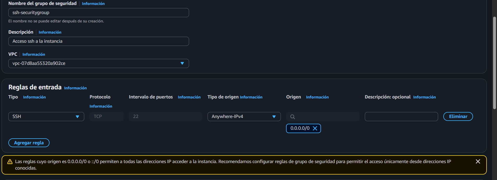

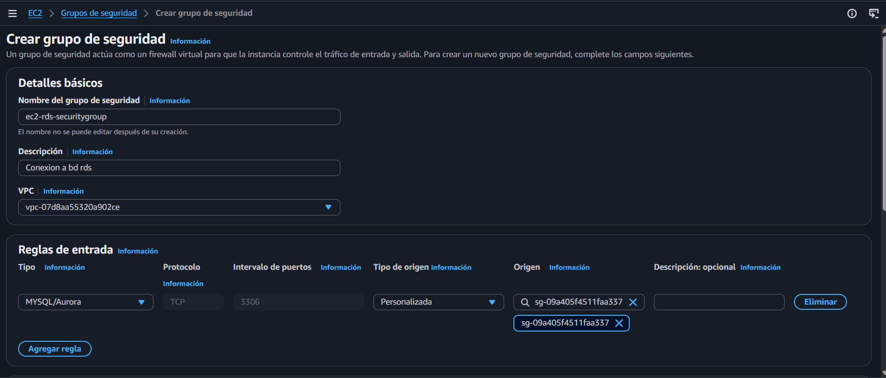


- Actualización de repositorios y paquetes:

```bash
sudo apt update && sudo apt upgrade
```


- Instalación del cliente MySQL para probar la conexión con RDS:

```bash
sudo apt install mysql-client
```


- Instalación de Node.js mediante nvm:

```bash
curl -o- https://raw.githubusercontent.com/nvm-sh/nvm/v0.40.3/install.sh | bash
\. "$HOME/.nvm/nvm.sh"
nvm install 22
```


Se verificaron las versiones con node -v y npm -v.


- Instalación global de PM2:

```bash
npm install pm2@latest -g
pm2 --version
```


### 2. Creación de la instancia RDS MySQL


Se creó una base de datos MySQL en **Amazon RDS** con la siguiente configuración:

- **Método de creación:** Creación estándar
- **Motor:** MySQL
- **Plantilla:** Capa gratuita
- **Disponibilidad:** Instancia de zona de disponibilidad única
- **Identificador:** `db-api-crud-demo`
- **Usuario maestro:** `admin`
- **Administración de credenciales:** Autoadministrado
- **Contraseña:** definida por el usuario
- **Recurso de computación:** conectado a la instancia EC2 creada previamente
- **Acceso público:** No
- **Grupo de seguridad de VPC:** `default`
- **Autenticación:** con contraseña


### 3. Conexión EC2 → RDS y despliegue de la API CRUD

Desde la instancia EC2 se probó la conexión a RDS usando el cliente MySQL:

```bash
mysql -u admin -h [endpoint-del-rds] -p

mysql -h db-api-crud-demo.cqx60sm88ze5.us-east-1.rds.amazonaws.com -P 3306 -u admin -p
```


Dentro del CLI de MySQL se creó la base de datos y el usuario para la API:

```bash
CREATE DATABASE db_apimovies;
CREATE USER 'usr_movies'@'%' IDENTIFIED BY 'secret';
GRANT ALL PRIVILEGES ON db_apimovies.* TO 'usr_movies'@'%';
FLUSH PRIVILEGES;
```


Se clonó el proyecto de la API CRUD y se configuró el archivo .env con los valores de DB_HOST, DB_PORT, DB_USER, DB_PASS y DB_NAME. Luego se generó el build y se levantó la aplicación con PM2:

```bash
npm run build
pm2 start dist/main.js --name api -i 2
pm2 save
pm2 startup
```


Se instaló Nginx y se configuró el virtual host por defecto como proxy inverso hacia la API:


```bash
server {
    listen 80 default_server;
    listen [::]:80 default_server;

    server_name _;

    location / {
        proxy_pass http://127.0.0.1:3000;
        proxy_set_header Host $host;
        proxy_set_header X-Real-IP $remote_addr;
        proxy_set_header X-Forwarded-For $proxy_add_x_forwarded_for;
        proxy_set_header X-Forwarded-Proto $scheme;
    }
}
```

### 4. Creación de la AMI y Plantilla de Lanzamiento

A partir de la instancia configurada se creó una imagen (AMI): **Acciones → Imagen y plantillas → Crear imagen**.


Luego se creó una **Plantilla de lanzamiento** a partir de esa AMI, con:

- **AMI:** la imagen recién creada (Mis AMI → De mi propiedad)
- **Tipo de instancia:** apta para la capa gratuita
- **Par de claves:** No incluir en la plantilla
- **Grupos de seguridad:** Web, SSH y `ec2-rds-*`
- **Almacenamiento y detalles avanzados:** valores por defecto


### 5. Configuración del Auto Scaling Group (ASG)

Se creó el Auto Scaling Group con los siguientes parámetros:

- **Paso 1:** selección de la plantilla de lanzamiento creada.
- **Paso 2:** red con las zonas de disponibilidad disponibles y distribución **Mejor esfuerzo equilibrado**.
- **Paso 3:** integración con un nuevo **Application Load Balancer** con esquema **Internet-facing**, dejando las subredes y el grupo de destino por defecto, y manteniendo las comprobaciones de estado por defecto.
- **Paso 4:** tamaño del grupo:
    - **Capacidad deseada:** 1
    - **Capacidad mínima:** 1
    - **Capacidad máxima:** 4
    - Política de mantenimiento: **Sin política**
- **Pasos 5 y 6:** sin cambios (sin notificaciones ni etiquetas adicionales).
- **Paso 7:** revisión y clic en **Crear grupo de Auto Scaling**.


---

### 6. Política de escalamiento dinámico

En el ASG creado se ingresó a la pestaña **Escalado automático** y se creó una política de **Seguimiento del objetivo (Target tracking scaling)**:

- **Métrica:** Uso de la CPU media (Average CPU utilization)
- **Valor de destino:** 50


### 7. Prueba de escalabilidad manual

- Se escaló manualmente el ASG a **2 réplicas (Capacidad deseada)** y se esperó a que las nuevas instancias se registraran en el ELB. Se verificó la creación de nuevas instancias.
- Se redujo manualmente el ASG a **1 réplica (Capacidad deseada)** y se esperó a que las instancias sobrantes se eliminaran del ELB.


### 8. Verificación de Alta Disponibilidad

Con **Postman** se ejecutaron múltiples peticiones (aprox. 100) en bucle contra los endpoints `CREATE` y `UPDATE` de la API a través del subdominio del ALB, comprobando que las réplicas respondían y que los datos se persistían correctamente en RDS.


